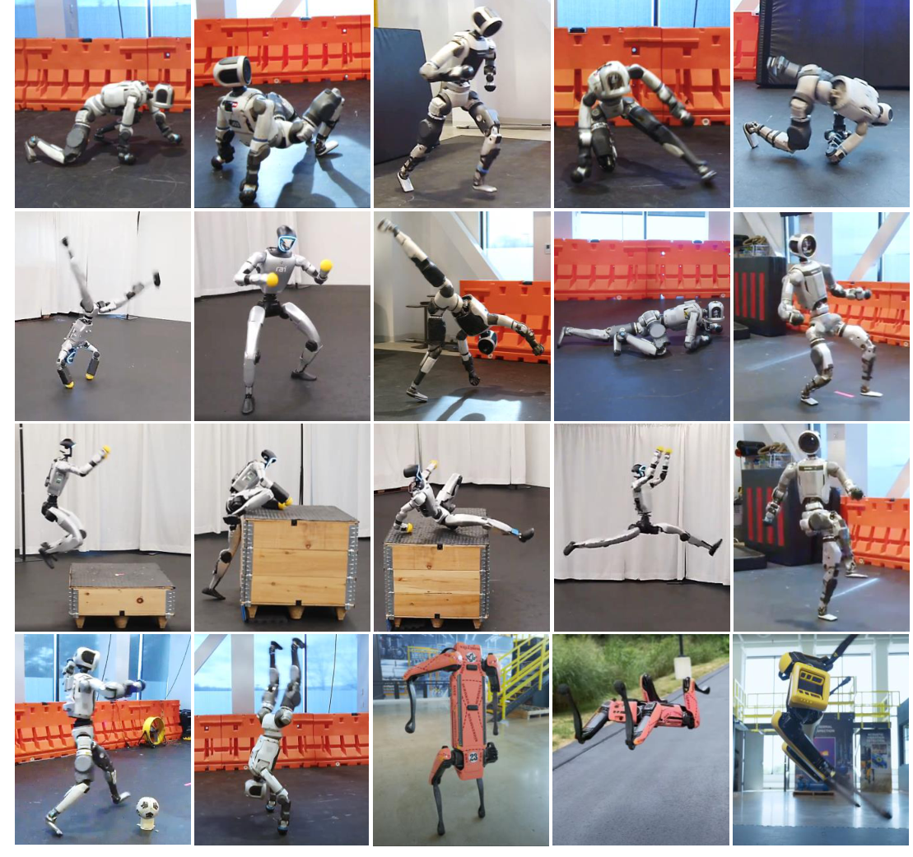
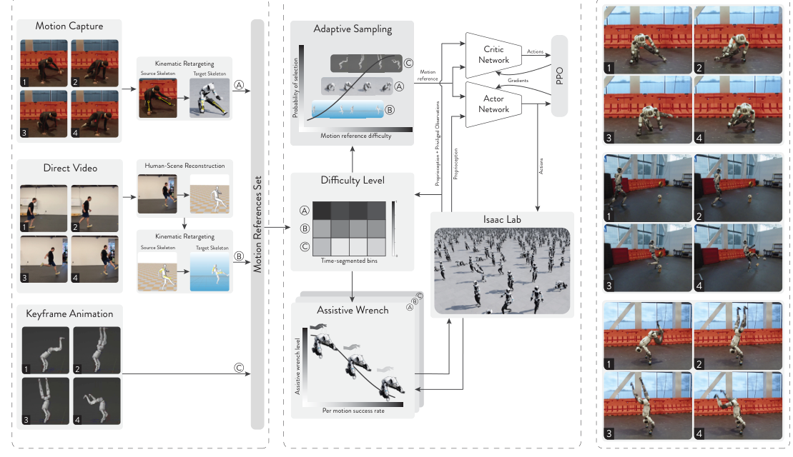
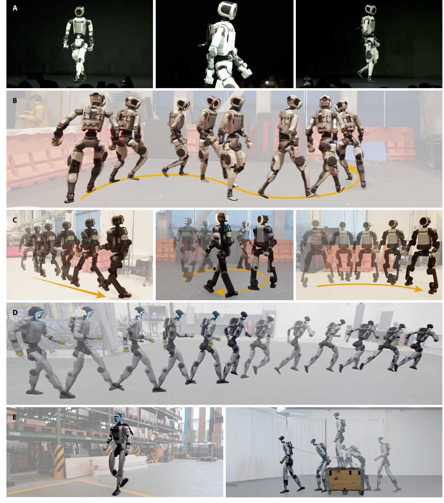
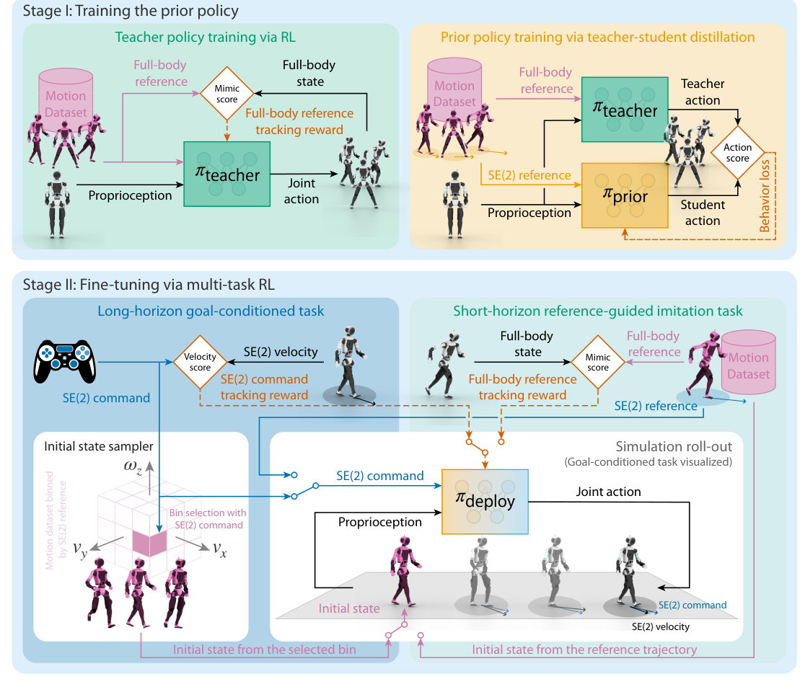
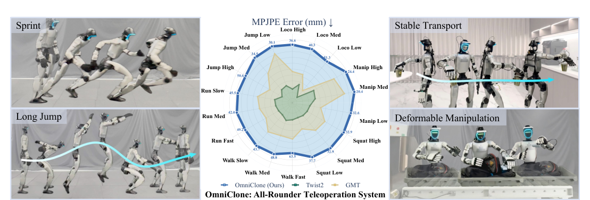
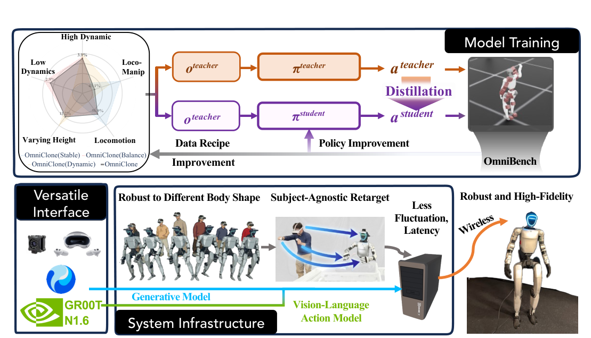
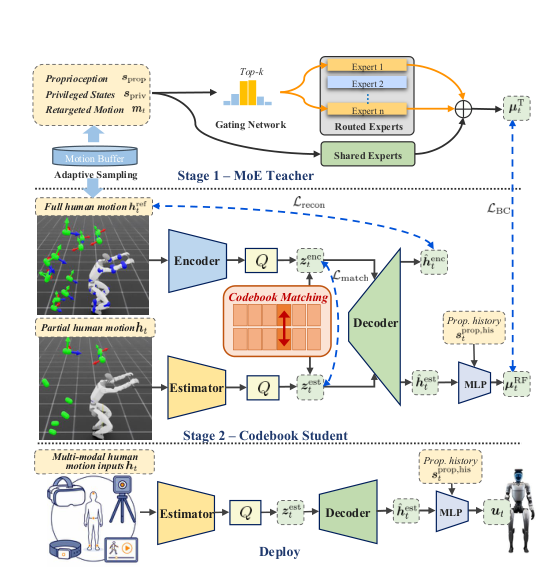
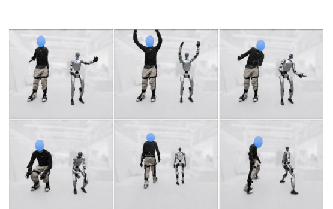

# vicon-g1

Reproducing human-motion-to-humanoid skill transfer in our Vicon lab: capture household tasks (sweeping with a broom, picking up a box, washing dishes) with optical motion capture and train policies that a Unitree G1 executes autonomously.

## Contents

| File | What it is |
|---|---|
| `literature_summary.md` | Team-facing summary of the four papers below: claims, methods, G1 results, metrics, and relevance to our goal. Start here. |
| `fbx_to_g1_policy_pipeline.md` | End-to-end plan from a Vicon export to a deployed G1 policy: capture protocol, cleaning, retargeting, full MDP configuration (gains, rewards, randomization, PPO), compute and schedule, deployment, pitfalls, and how to measure success. |
| `2602.00401v1.pdf` | ZEST: Zero-shot Embodied Skill Transfer for Athletic Robot Control (RAI Institute, Boston Dynamics). The recipe we are reproducing. |
| `2610.10489v1.pdf` | HuMBLE: Human Motion-Driven Behavior Learning for Embodied Locomotion (RAI Institute, Boston Dynamics). Same recipe, publishes the G1 configuration tables and the Vicon dataset. |
| `2603.14327v1.pdf` | OmniClone: Robust, All-Rounder Whole-Body Humanoid Teleoperation (BIGAI and partners). G1 pick-and-place via teleoperation and a GR00T VLA; evaluation methodology. |
| `2610.07891v1.pdf` | Beyond Retargeting: Retargeting-free whole-body teleoperation with a motion codebook (HKUST, Zhejiang, Tencent). Robustness to noisy mocap input; success-rate definition. |
| `notes.txt` | Link to the HOLD dataset (github.com/rai-opensource/hold): Vicon BVH locomotion and box-interaction clips released with HuMBLE, including G1 retargets. |

## Suggested reading order

1. `literature_summary.md`, "The short version" and the side-by-side table.
2. `fbx_to_g1_policy_pipeline.md`, Sections 0, 5, and 8 (architecture choice, compute, measurement).
3. ZEST paper, Results and Materials and Methods.
4. HuMBLE supplementary tables S3 to S9 for the concrete G1 numbers.

## Figures from the papers

All images are cropped from the PDFs in this folder and live in `images/`.

**ZEST, Figure 1.** Hardware deployment across data sources and robots. G1 clips include cartwheel and table tennis from mocap and ballet, jump onto box, and climb up and down box from phone video.

**ZEST, Figure 3.** The three-stage pipeline we are reproducing: reference data and retargeting, PPO training with adaptive sampling and an assistive wrench, zero-shot deployment.

**HuMBLE, Figure 1.** Steerable locomotion on Atlas R1, Atlas D1, and the Unitree G1 (row D shows the G1 walk-to-sprint transition; row E the box-parkour stack).

**HuMBLE, Figure 6.** Teacher-student distillation followed by multi-task RL fine-tuning. The Stage I teacher is the ZEST tracker.

**OmniClone, Figure 1.** Stratified MPJPE on OmniBench and real-world G1 teleoperation from sprinting to deformable-object manipulation.

**OmniClone, Figure 3.** Model training (data recipe, teacher-student distillation) and system infrastructure (subject-agnostic retargeting, wireless transport, GR00T N1.6 as the high-level planner).

**Beyond Retargeting, Figure 2.** Mixture-of-Experts teacher, then a codebook student that maps raw human motion plus proprioception straight to joint commands.

**Beyond Retargeting, Figure 6.** Full-body optical mocap teleoperation of the G1, the input modality closest to our lab.

## Decisions so far

- Architecture: single-skill motion-tracking policies in the ZEST style, one policy per captured clip. First task is the box pick-up; sweeping second; dish washing last and reduced in scope.
- Tooling: General Motion Retargeting (GMR) for BVH to G1 retargeting; BeyondMimic or mjlab as the Isaac Lab or MuJoCo Warp training base; MuJoCo for sim-to-sim checks; ONNX Runtime on the G1's Jetson for deployment.
- Compute: one 24 GB or larger NVIDIA GPU. An AWS g6e.8xlarge (one L40S, 48 GB) is sufficient; see Section 5 of the pipeline document.
- GR00T: not in phase one. Only relevant if we move to the teleoperation-plus-VLA route; see Section 0 of the pipeline document.
- Success metric: report tracking success, tracking fidelity, and task outcome separately; the task-completion target of 0.8 is scored on object outcome over at least 30 pre-registered hardware trials.

## Open items

- Export a test take from Vicon as BVH and verify units, up-axis, and joint names against a GMR config.
- Stand up Isaac Lab or mjlab on the GPU machine and reproduce tracking of a HOLD box-lift clip in simulation.
- Decide the prop set (box dimensions and mass, broom, mock dishes) at 0.8 scale.
