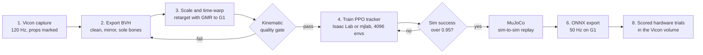
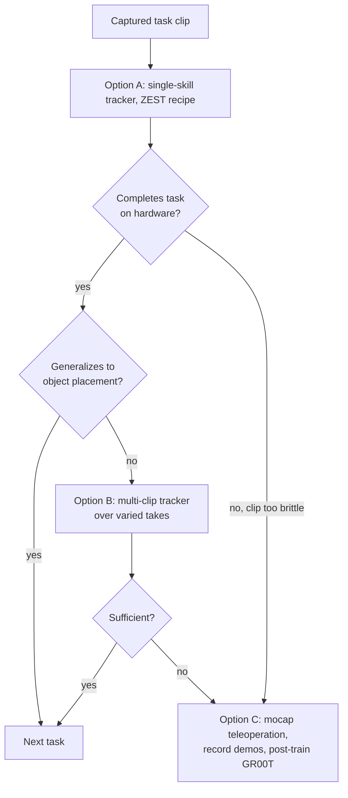
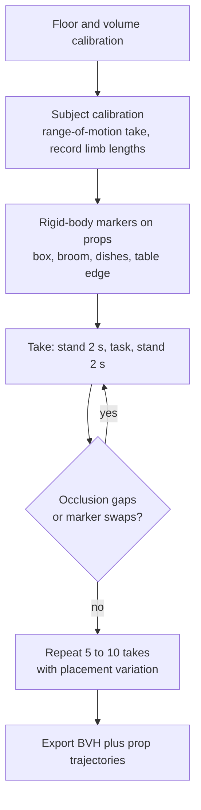
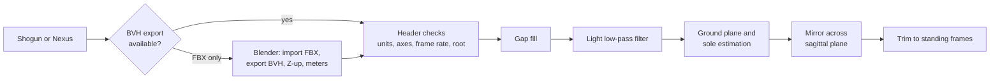
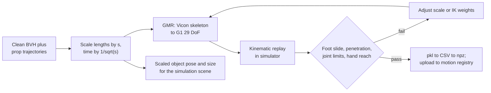
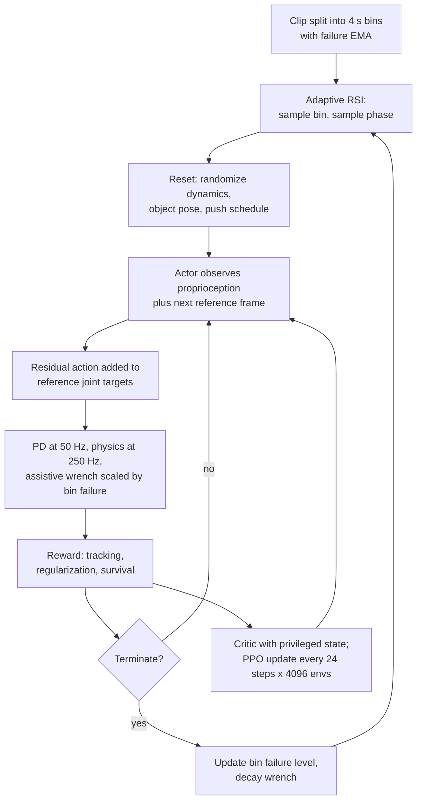
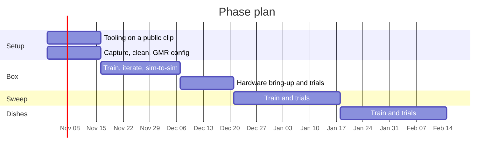
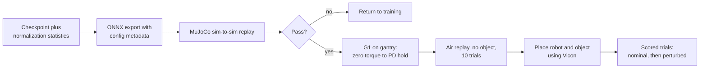
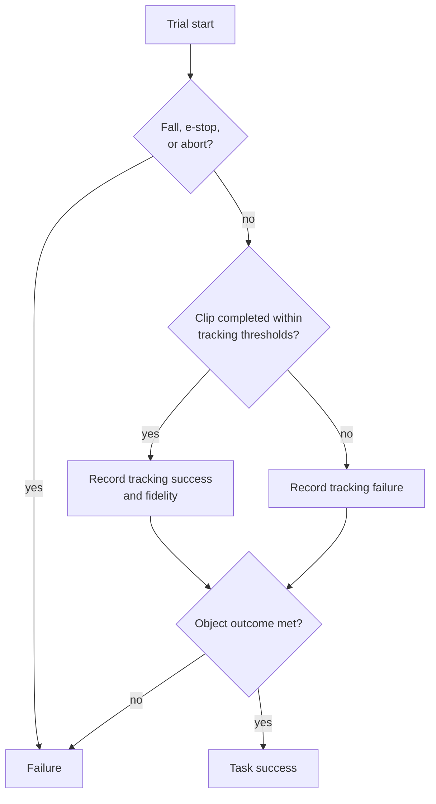
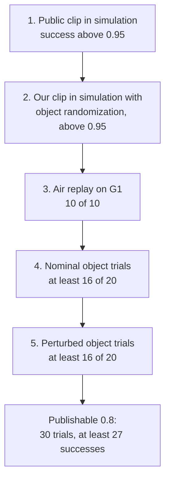

# From Vicon FBX to a Deployed Unitree G1 Policy

An end-to-end plan for turning a motion capture recording of a household task (sweep with a broom, pick up a box, wash dishes) into a reinforcement-learning policy that runs on a Unitree G1. Design choices are taken from [ZEST](https://arxiv.org/abs/2602.00401), [HuMBLE](https://arxiv.org/abs/2610.10489), [OmniClone](https://arxiv.org/abs/2603.14327), and [Beyond Retargeting](https://arxiv.org/abs/2610.07891) unless marked as our inference. Section 7 collects the warnings; Section 8 covers measurement. Tool and manuscript links are collected in Section 9.

## 0. Architecture

| Option | Deployed policy input | Papers | Fit for our tasks (our assessment) |
|---|---|---|---|
| A. Single-skill tracker, one policy per clip | Proprioception plus the next reference frame | [ZEST](https://arxiv.org/abs/2602.00401) | First target. Simplest, fastest to train, demonstrated on a G1 with a physical box. |
| B. Multi-skill tracker, one policy per library | Proprioception plus reference frames | [BeyondMimic](https://arxiv.org/abs/2508.08241), [OmniClone](https://arxiv.org/abs/2603.14327) teacher, [Beyond Retargeting](https://arxiv.org/abs/2610.07891) teacher | After A works per task. ZEST reports single-skill policies track better at a fixed budget (Results). |
| C. Teleoperation plus VLA | Operator stream, then camera plus language | [OmniClone](https://arxiv.org/abs/2603.14327) | Fallback for dish washing if a fixed clip is too brittle. |
| D. Command-conditioned | Velocity or sparse goal command | [HuMBLE](https://arxiv.org/abs/2610.10489) | Not required now. Relevant if the robot must walk to the task. |

*[HuMBLE](https://arxiv.org/abs/2610.10489), Figure 6. Option A is the Stage I teacher alone (the ZEST tracker). Options B and D add the distillation and fine-tuning stages.*

**Recommendation (ours).** Option A for all three tasks, box first, sweeping second, dish washing last with reduced scope (dry mock dishes, no water).

*[OmniClone](https://arxiv.org/abs/2603.14327), Figure 3. Option C. GR00T N1.6 is the high-level planner; the tracking policy remains the low-level controller.*

**GR00T.** Not required for Options A, B, or D. GR00T N1.6 is a vision-language-action model that consumes camera images, language, and robot state from demonstrations; it does not ingest motion capture. OmniClone post-trained it on 50 teleoperated demonstrations (4 x A100, 20k steps, batch 384; Appendix C-B) and ran it above its own tracking policy (Section VI-B). Consequences: a whole-body tracking policy is a prerequisite either way, and GR00T is justified only if (a) the Option A policy completes the box task but fails outside the randomized placement range, or (b) dish washing cannot be tracked from a fixed clip. Fine-tuning hardware: the [Isaac-GR00T README](https://github.com/NVIDIA/Isaac-GR00T) recommends one or more GPUs with 40 GB or more VRAM, names H100 or L40 nodes as the recommended configuration, states that an A6000 works with longer training time, and gives a single-GPU fine-tuning example at global batch size 32. The current release is N1.7; OmniClone used N1.6. A g6e.8xlarge (L40S, 48 GB) meets the stated requirement.

## 1. Capture protocol

**Rig and rate.**
- 120 Hz capture with a subject-calibrated rig ([HuMBLE](https://arxiv.org/abs/2610.10489), Materials and Methods, "Dataset Collection").
- Full-body marker set resolving hands and feet. All four papers track wrist key-bodies; OmniClone (Table A.2) and Beyond Retargeting (Equation 1) treat wrist orientation as an input.
- Fingers: none of the four papers tracks finger motion from mocap. The G1 hand is commanded separately or held in a fixed grasp. Capture finger markers only for a scripted open or close (inference).

**Actor.**
- G1: 29 DoF, about 1.2 m, 35 kg ([ZEST](https://arxiv.org/abs/2602.00401), Materials and Methods). HuMBLE's actor averaged 178 cm and all lengths were scaled by 0.8 for the G1 (Section S2). Record actor height and limb lengths; scale is applied in Section 3.
- [OmniClone](https://arxiv.org/abs/2603.14327) measured skeletal scale discrepancies of up to about 20 cm between capture setups and subjects, corresponding to about 20 mm MPJPE (Section IV-B). Use one actor per task initially (inference).

**Props.** Rigid-body marker clusters on every object the robot touches. [HOLD](https://github.com/rai-opensource/hold) records box and chair props as bones with corner-offset children so object size and pose share the skeleton's BVH ([docs/process.md](https://github.com/rai-opensource/hold/blob/main/docs/process.md)). Object trajectories are needed to place the object in simulation (Section 3) and to score task outcome (Section 8).

**Choreography.**
- Start and end each take in a quiet standing pose; all ZEST policies begin from and return to standing (Results, "MoCap-Derived Human-Like Skills").
- Clip length 5 to 17 s; ZEST hardware skills span 4.30 to 16.66 s (Table 1).
- Repeat each task 5 to 10 times with placement variation; variation across takes defines the simulation randomization range (inference).
- Slow and symmetric. ZEST attributes the G1's higher orientation error to IMU quality (Results, "MoCap-Derived Human-Like Skills"). HuMBLE terminates G1 episodes below 0.5 m torso height (Table S4); avoid deeper crouches.
- Deliberate steps. Sliding feet produce ambiguous contact that HOLD had to repair with estimated sole bones (docs/process.md).
- Keep the actor away from the volume boundary to limit occlusion (inference).

**Scale the scene for the robot.** If the box will rest on a 0.40 m support for the G1, the actor lifts from 0.50 m (0.40 divided by 0.8). Same for sink height and broom length. Object scale mismatch is not recoverable by retargeting (inference).

## 2. Export and clean

**Format.** BVH. ZEST (Section S4), HuMBLE (Materials and Methods), HOLD, and LAFAN1 all use BVH. [GMR](https://github.com/YanjieZe/GMR) reads BVH directly; its FBX path requires the Autodesk FBX SDK Python bindings in a separate environment and a two-step import (repository README). If the Vicon export is FBX only, convert in Blender and verify joint names and the rest pose.

**Header checks.** Meters (Vicon defaults to millimeters), Z-up, right-handed, pelvis root, no unused leaf bones. Read the frame time from the header: HOLD's scaled files change frame time instead of resampling (docs/process.md).

**Cleaning** ([HuMBLE](https://arxiv.org/abs/2610.10489) Materials and Methods; HOLD docs/process.md):
1. Gap-fill missing markers with skeleton-constrained interpolation.
2. Low-pass filter. Keep it light; the reward tolerates noise and heavy filtering removes heel-toe detail (inference from ZEST's reported tolerance of ViCap jitter, Results).
3. Estimate the ground plane and soles: detect double-support frames by foot velocity and height thresholds, fit one constant heel and toe pose so stationary feet sit at z = 0 with gravity-aligned Z (HOLD). Do this before scaling.
4. Mirror across the sagittal plane (HuMBLE Section S2). Mirror object trajectories too.
5. Trim to the standing frames.

## 3. Retarget to the G1 (29 DoF)

**Scale and time-warp.** Scale all lengths by s (robot over actor height; ZEST matches thigh length, Section S4), then scale time by 1 over the square root of s so gravity stays 9.81 m/s squared ([HuMBLE](https://arxiv.org/abs/2610.10489) Section S2; ZEST Section S4). HuMBLE reports that spatial scaling without the time warp degraded tracking, most for motions with flight phases (Section S2). Scale object trajectories and dimensions by the same s.

**Retargeter.** ZEST and HuMBLE use a two-stage spacetime optimization (human to robot-proportioned proxy skeleton, proxy to robot) with alignment frames on head, torso, upper arms, lower arms, hands, pelvis, knees, and feet, joint-velocity regularization, and non-penetration constraints (ZEST Section S4; HuMBLE Materials and Methods). It is not released. The open substitute is [General Motion Retargeting](https://github.com/YanjieZe/GMR) ([paper](https://arxiv.org/abs/2510.02252), MIT license), which provides a BVH configuration for `unitree_g1` (29 DoF) and a 43 DoF variant with hands, was tuned for RL tracking policies, and outputs per-frame base translation, base rotation, and joint positions as a pickle with a converter to the CSV layout BeyondMimic consumes (README). Our Vicon joint names will not match its LAFAN1 or Nokov presets; one custom IK config is required (inference).

**Quality gate.** Replay kinematically (BeyondMimic `replay_npz.py` or the GMR viewer) and reject clips with foot sliding in stance, ground penetration, self-collision, joint angles or velocities outside G1 limits, or hands missing the scaled object pose. Fix scale or IK weights, not reward weights (inference).

**Objects.** The policy does not observe the object; ZEST's box skills are proprioception-only with the initial robot-to-box pose randomized (Results, "ViCap-Derived Human-Like Skills"). In simulation the object is a rigid body at the captured relative pose with randomized initial pose (ZEST: ±10 cm in x, ±0.3 rad in yaw, height 0.70 to 0.80 m). Version one models the broom as a rigid link fixed to the hand (inference).

## 4. Simulation and MDP

*[ZEST](https://arxiv.org/abs/2602.00401), Figure 3. This section configures the middle block.*

**Simulator.** Isaac Lab (ZEST, HuMBLE, OmniClone, BeyondMimic). [mjlab](https://github.com/mujocolab/mjlab) (Apache 2.0) reuses the Isaac Lab manager API on MuJoCo Warp and ships `Mjlab-Tracking-Flat-Unitree-G1`; the BeyondMimic maintainers moved to it (whole_body_tracking README). Set up plain MuJoCo for sim-to-sim validation as OmniClone (Section V), HuMBLE (Results), and Beyond Retargeting (Section IV-A, MjLab) did.

**Starting codebase.** [BeyondMimic whole_body_tracking](https://github.com/HybridRobotics/whole_body_tracking) (MIT, archived) or mjlab. Both accept retargeted CSV motions through a Weights and Biases registry (READMEs). Modify toward the ZEST configuration below.

**Robot model and gains.** Unitree G1 29 DoF description with armature values for the knee and ankle parallel linkages (ZEST, Materials and Methods, "Systems and Modeling"). [HuMBLE](https://arxiv.org/abs/2610.10489) Table S7 G1 gains:

| Joint | Kp | Kd | Nominal angle (rad) | Action scale |
|---|---|---|---|---|
| Waist roll, pitch | 150 | 3.0 | 0 | 0.1 |
| Waist yaw | 100 | 2.0 | 0 | 0.1 |
| Hip roll, yaw | 40 | 3.0 | 0 | 0.2, 0.1 |
| Hip pitch | 40 | 3.0 | -0.1 | 0.2 |
| Knee | 80 | 2.5 | 0.2 | 0.2 |
| Ankle roll | 40 | 2.0 | 0 | 0.05 |
| Ankle pitch | 40 | 2.0 | -0.1 | 0.2 |
| Shoulder roll | 20 | 1.0 | 0.25 left, -0.25 right | 0.1 |
| Shoulder pitch, yaw | 20 | 1.0 | 0.1, 0 | 0.1 |
| Elbow | 30 | 1.0 | 1.0 | 0.1 |
| Wrist roll, pitch, yaw | 20 | 0.5 | 0 | 0.01 |

Identical gains in simulation and on hardware (ZEST, "Actions and Joint-Level Control"). The 0.01 wrist action scale is a locomotion value; manipulation will need a larger one (inference).

**Timing.** Physics dt 0.004 s, decimation 5, policy at 50 Hz, episode cap 10 s (ZEST Table S6).

**Actor observations** (ZEST Table S3): torso angular velocity, gravity in torso frame, joint positions, joint velocities, previous action; next reference frame: base height, base linear velocity, base angular velocity, gravity in base frame, reference joint positions. No history, no future window (ZEST Figure S3: both degrade success), no estimated base linear velocity (drifts on the G1; HuMBLE "Hardware Deployment"). Observation noise standard deviations: 0.10 angular velocity, 0.015 gravity, 0.005 rad joints, 0.25 rad/s joint velocities (ZEST Table S3).

**Critic** (ZEST Table S3): actor observations plus base linear velocity, base height, contact forces, key-body positions and velocities, assistive wrench, tracking rewards, phase. For object tasks add object pose relative to the robot to the critic only (inference).

**Actions.** Residual joint targets added to the reference (ZEST Equation for q_cmd). Absolute targets were the worst ablation (ZEST Figure 2).

**Rewards** (ZEST Table S4; tracking kernel exp(-0.25 e squared over sigma squared)):

| Term | Sigma or weight |
|---|---|
| Base position | 0.4 |
| Base orientation | 0.5 |
| Base angular velocity | 1.5 |
| Base linear velocity | 0.6 |
| Joint positions | 0.3 times square root of joint count |
| Key-body positions (base frame) | 0.2 times square root of key-body count |
| Key-body orientations | 0.4 times square root of key-body count |
| Action rate penalty | 0.15 |
| Joint acceleration penalty | 1e-5 |
| Joint limit penalty | 1.0 |
| Torque limit penalty | 0.1 |
| Survival bonus per step | 1.0 |
| Foot slide, foot jerk, foot clearance (HuMBLE Section S3) | tune |

No object-specific terms initially; ZEST's box skills use the generic reward (inference from Table S4 and Results).

**Terminations** (HuMBLE Table S4, G1 column): contact force above 6000 N, torso height deviation above 0.3 m, torso tilt deviation above 0.6 rad, body-ground penetration above 0.03 m, foot self-collision.

**Adaptive reference-state initialization** (ZEST Section S5, Table S6): 4 s bins, failure EMA alpha 0.005, softmax sampling with a 0.15 uniform floor.

**Assistive wrench** (ZEST Section S6, Table S6; HuMBLE Table S8): force gains (0, 10), torque gains (200, 10), maximum scale 0.6 (ZEST) or 0.75 (HuMBLE), annealed by bin failure. Likely removable for slow household motions (inference).

**Domain randomization** (ZEST Table S5; HuMBLE Table S5, G1 column):

| Term | Range |
|---|---|
| Static friction | U(0.6, 1.3) |
| Dynamic friction | U(0.5, 0.9) |
| Restitution | U(0.0, 0.2) |
| Link mass scale | U(0.9, 1.15) |
| Torso CoM offset | ±0.025 m x; ±0.05 m y, z |
| Joint friction | ankle U(0, 0.05); waist U(0, 0.1) |
| Joint zero offset | ±0.03 rad ankle; ±0.015 rad others |
| Impulsive push | interval U(0, 10) s; ±0.3 m/s |
| External torso force and torque | ±5 N, ±5 N m; interval U(2, 4) s |
| Initial state perturbation | ±0.1 m, ±0.1 rad, ±0.1 m/s; joints ±0.2 rad, ±0.5 rad/s |
| Terrain roughness | ±0.025 m, enabled after mid-training (HuMBLE Section S5) |
| Object initial pose (ours, after ZEST) | ±0.10 m, ±0.3 rad yaw; mass ±20 percent |

ZEST notes that excessive randomization makes policies conservative or aggressive (Materials and Methods, "Domain Randomization").

**PPO** (ZEST Table S7): actor MLP 512-256-128 ELU, critic 512-512-256 ELU, empirical normalization, learning rate 1e-3 adaptive on KL target 0.01, gamma 0.99, GAE 0.95, clip 0.2, entropy 0.001, 5 epochs, 4096 environments, 24-step rollouts, 4 mini-batches. HuMBLE uses a 1024-512-256 actor for a three-hour dataset (Table S9).

## 5. Compute, time, and budget

**Reported.**

| Paper | Hardware | Time | Trained |
|---|---|---|---|
| [ZEST](https://arxiv.org/abs/2602.00401) (Results) | 1 x NVIDIA L4 | about 10 h, 7k iterations | one single-skill policy |
| ZEST ablation (Figure 2) | same | 20 h, 14k iterations | 15-motion multi-skill Atlas policy |
| [OmniClone](https://arxiv.org/abs/2603.14327) (Section IV-C) | 1 x RTX 4090 | 60 h teacher, 22 h student | transformer tracker on 30 h of data |
| OmniClone VLA (Appendix C-B) | 4 x A100 | 20k steps | GR00T N1.6 post-training, 50 demos |
| [HuMBLE](https://arxiv.org/abs/2610.10489) | not stated | not stated | three stages |

**Estimate (inference).**
- GPU: one 24 GB card runs 4096 G1 environments (ZEST on an L4; OmniClone on a 4090). Multi-node training is unnecessary.
- CPU and RAM: Isaac Sim lists 32 GB RAM minimum and 64 GB recommended, 4 to 16 CPU cores, and notes that Isaac Lab training needs more RAM and VRAM than the listed minimum ([Isaac Sim requirements](https://docs.isaacsim.omniverse.nvidia.com/latest/installation/requirements.html)).
- GPU family: Isaac Sim requires a GPU with RT cores and does not support A100 or H100 (same page). This excludes AWS P-series instances for Isaac Lab; mjlab has no such restriction.
- Per task: 3 to 6 runs of 8 to 12 h before a hardware-ready policy; 30 to 70 GPU-hours per task; 100 to 200 GPU-hours for three tasks.
- Simulation evaluation: ZEST's 10,000 rollouts per clip take minutes at 4096 environments.
- Onboard inference: HuMBLE measured 1.1 ms for its MLP on the G1's Jetson AGX Orin CPU with ONNX Runtime (Results).

**AWS g6e.8xlarge.** One NVIDIA L40S (48 GB), 32 vCPUs, 256 GiB RAM ([instance page](https://aws.amazon.com/ec2/instance-types/g6e/)); about 4.53 USD per hour on demand in us-east-1, about 3.42 USD per hour on a one-year savings plan, spot about 1.8 USD per hour at the time of writing ([AWS pricing](https://aws.amazon.com/ec2/pricing/on-demand/); third-party trackers for savings plan and spot, verify before provisioning). Sufficient:
- The L40S has 48 GB versus 24 GB on the L4 and about 3x the FP32 throughput ([L4](https://www.nvidia.com/en-us/data-center/l4/): 30.3 TFLOPS; [L40S](https://www.nvidia.com/en-us/data-center/l40s/): 91.6 TFLOPS). A ZEST run should finish in under 10 h or run 8192 environments (inference).
- Isaac Sim lists a GeForce RTX 4080 with 16 GB VRAM as the minimum GPU and an RTX PRO 6000 with 48 GB as ideal, and requires RT cores ([requirements](https://docs.isaacsim.omniverse.nvidia.com/latest/installation/requirements.html)). The L40S is Ada generation with RT cores and 48 GB. The Isaac Sim container is supported on Linux only (same page). mjlab requires an NVIDIA GPU for training ([README](https://github.com/mujocolab/mjlab)).
- Cost at 100 to 200 GPU-hours: 450 to 900 USD on demand; about 45 USD per 10 h run.
- Single GPU: policies train sequentially. A second instance doubles throughput.

**Schedule (inference; dates illustrative).**

| Phase | Exit criterion |
|---|---|
| Tooling: Isaac Lab or mjlab plus BeyondMimic G1 task on a HOLD or LAFAN1 clip | Sim success above 0.95 under randomization |
| Capture, export, cleaning, GMR config | Retargeted clip passes the Section 3 gate |
| Box: train, iterate, MuJoCo sim-to-sim | Sim success above 0.90 with object randomization; MuJoCo replay passes |
| Hardware bring-up: ONNX, SDK, air replay, object trials | 5 of 5 nominal trials (ZEST Movie S6) |
| Sweeping, then dishes | Same gates |

## 6. Deployment

*[ZEST](https://arxiv.org/abs/2602.00401), Figure 1. The G1 box skills (third row) are the closest published precedent: proprioception only, box pose randomized in training, 5 of 5 nominal hardware trials.*

- Export the actor to ONNX with its observation normalization statistics. ZEST logs checkpoints with configuration metadata to a registry and configures the hardware controller from that metadata (Materials and Methods, "Hardware Deployment Pipeline").
- Run at 50 Hz on the Jetson via ONNX Runtime (HuMBLE, Results) with the Section 4 gains.
- Observations from IMU and encoders only; no state estimator (ZEST, "Actor and Critic Observations"). Yaw is not tracked because IMU yaw drifts (ZEST, Results).
- Reference playback indexed by time from the start command. Initial pose: the clip's standing pose at the captured robot-to-object offset, placed with floor marks or the Vicon system (inference).
- Safety: harness or gantry, operator on the emergency stop, zero-torque to PD hold before starting the clip (inference). HuMBLE describes its MuJoCo pipeline as a hardware-validated proxy (Results).
- Run trials inside the Vicon volume with markers on pelvis, torso, hands, feet, and object to obtain a global ground-truth trajectory (inference).

## 7. Considerations and pitfalls

**Data and retargeting**
- Scale space and time together; spatial scaling alone changes effective gravity and degrades tracking ([HuMBLE](https://arxiv.org/abs/2610.10489) Section S2; [ZEST](https://arxiv.org/abs/2602.00401) Section S4).
- Do not label contacts; ZEST's reward uses none and tolerates noisy contact timing (Results, "ViCap-Derived Human-Like Skills").
- Fix foot-ground contact before training (HOLD docs/process.md).
- Compute subject scale from a calibration frame rather than trusting the capture system's skeleton ([OmniClone](https://arxiv.org/abs/2603.14327) Section IV-B).
- Start and end clips in standing (ZEST Results).
- Dataset composition dominates once there is more than one clip; OmniClone changed policy behavior by adjusting the minority fraction and filtering biased sequences (Section V-B).

**MDP design**
- Residual actions, not absolute (ZEST Figure 2).
- No observation history and no future reference window for an MLP tracker (ZEST Figure S3). OmniClone's transformer student uses future frames in a teleoperation setting (Equation 3).
- Keep privileged information in the critic (ZEST Figure 2).
- One generic reward; add task shaping only on failure (ZEST Table S4; HuMBLE Section S3).
- Moderate randomization (ZEST, "Domain Randomization"); terrain roughness after mid-training for ankle compliance (HuMBLE Section S5).
- Adaptive sampling for long clips and libraries (ZEST Results, table tennis; [Beyond Retargeting](https://arxiv.org/abs/2610.07891) Table IV).
- Single-skill before multi-skill (ZEST Results).

**G1 hardware**

*[Beyond Retargeting](https://arxiv.org/abs/2610.07891), Figure 6. Its robustness sweeps (Table III) show that real optical mocap streams are noisier than clean training clips.*

- G1 IMU quality raises base-orientation error relative to Atlas (ZEST Results).
- G1 estimated linear velocity drifts; exclude it from the policy (HuMBLE "Hardware Deployment"; ZEST Table S3).
- Model knee and ankle parallel linkages with armature values and derive PD gains from them (ZEST "Systems and Modeling"; HuMBLE "Deployment Policy").
- Real objects differ in compliance and friction from simulated ones (ZEST Results, box experiments). Use stiff, high-friction props first (inference).
- Policies fail outside the randomized initial-offset range (ZEST Figure S5).

**Task-specific (inference)**
- Sweeping: fix the broom to the hand in version one; bristle-floor contact is compliant and sliding, which none of the papers simulate.
- Dishes: no paper handles water, deformables, wet contact, or mocap-driven fingers. Start with dry rigid mock dishes between two racks; fall back to Option C if tracking is brittle.
- Box: ZEST's box policy generalized from a 0.70 to 0.80 m training range to 0.55 m (Results). Expect height generalization but not width generalization, which changes the grasp.

## 8. Measuring success

### How the papers measure it

None of the four scores whether a task was accomplished on physical objects. They score whether the robot tracked the reference without failing.

| Paper | Primary metric | Secondary | Where |
|---|---|---|---|
| [ZEST](https://arxiv.org/abs/2602.00401) | Success rate: fraction of 10,000 randomized rollouts per clip not early-terminated (contact force threshold or large reference deviation); mean, 10th percentile, minimum (Figure 2) | MAE(q), MAD(R), ML2 angular velocity, and maxima over successful trials (Table 1) | Simulation; hardware for tracking errors and N of N counts (Movie S6: 5 of 5) |
| [Beyond Retargeting](https://arxiv.org/abs/2610.07891) | Rollout completes the clip without pelvis height error exceeding 0.25 m (Section IV-A) | Seven tracking errors with fixed penalties for failed frames (Section IV-B) | Cross-simulator, 6,495 out-of-distribution clips (Table I) |
| [OmniClone](https://arxiv.org/abs/2603.14327) | Success rate per category and difficulty, 18 cells of 60 episodes, unseen generated motions; MPJPE (Table I) | Operators complete a pick-and-place within 5 to 7 practice trials (Figure 5); VLA 18 of 21 and 4 of 5 (Table II) | MuJoCo; hardware for operator and VLA trials |
| [HuMBLE](https://arxiv.org/abs/2610.10489) | DTW-aligned MAE of torso velocities and joint positions, normalized by reference standard deviation (Figure 3) | Steady-state command error, rise time, push envelope (Figure 4); sim-versus-real tables (Table 1, S2) | Simulation and hardware |

In this literature a 0.8 "task completion score" means 80 percent of rollouts finished the clip without a fall or deviation termination. OmniClone's 80.00 percent is the only task-outcome rate, from 5 trials (Table II).

### What we measure

Three layers, all reported.

1. **Tracking success.** Clip completed with no fall or stop, pelvis height error under 0.25 m (Beyond Retargeting Section IV-A) or torso height deviation under 0.3 m and tilt under 0.6 rad (HuMBLE Table S4). Simulation over 10,000 randomized rollouts; hardware per trial.
2. **Tracking fidelity.** MAE(q) and MAD(R) from encoders and IMU (ZEST Table 1), plus global root and hand position error from Vicon, DTW-aligned (HuMBLE Figure 3). Reported over successful trials only, stated as such.
3. **Task outcome (ours).** Binary per trial, scored from object markers and a human judge:
   - Box: lifted at least 0.15 m above its support, released with its center within 0.10 m of the target footprint, upright, not dropped.
   - Sweep: bristles in floor contact along at least 80 percent of the reference path; debris (dry rice or foam pellets) displaced at least X m toward the target line, X set from a human baseline.
   - Dishes: each mock dish moved from source rack to destination rack without reaching the floor.

**Task completion score = task successes divided by attempted trials, with falls and aborts counted as failures.** Not conditioned on tracking success.

**Trial protocol.**
- Pre-register placement tolerance, trial count, success definitions, and abort criteria.
- Two conditions after ZEST (Movies S6, S7): nominal (object at the training-nominal pose) and perturbed (object offset sampled within the training randomization range; 2 kg torso payload on a subset).
- Consecutive trials, every trial reported (ZEST reports five consecutive runs, Movie S6).
- Sample size (our computation, Wilson 95 percent interval): 16 of 20 gives a point estimate of 0.80 with interval 0.58 to 0.92; 27 of 30 gives a lower bound of about 0.74; 44 of 50 gives a lower bound of about 0.76. A claim of at least 0.8 needs 30 or more trials.
- Hardware gate: at least 0.95 simulation success over 10,000 randomized rollouts and a passing MuJoCo replay (inference, consistent with ZEST Figure 2 success rates above 0.9 for hardware-deployed clips).
- Report per-condition tables and video; aggregate scores hide failing conditions (OmniClone Section III-B).

## 9. References

**Manuscripts**
- ZEST: Zero-shot Embodied Skill Transfer for Athletic Robot Control. [arXiv 2602.00401](https://arxiv.org/abs/2602.00401), [PDF](https://arxiv.org/pdf/2602.00401).
- HuMBLE: Human Motion-Driven Behavior Learning for Embodied Locomotion. [arXiv 2610.10489](https://arxiv.org/abs/2610.10489), [PDF](https://arxiv.org/pdf/2610.10489).
- OmniClone: Engineering a Robust, All-Rounder Whole-Body Humanoid Teleoperation System. [arXiv 2603.14327](https://arxiv.org/abs/2603.14327), [PDF](https://arxiv.org/pdf/2603.14327).
- Beyond Retargeting: Low-Latency and Robust Humanoid Whole-Body Teleoperation with Learned Atomic Motion Primitives. [arXiv 2610.07891](https://arxiv.org/abs/2610.07891), [PDF](https://arxiv.org/pdf/2610.07891).
- BeyondMimic: From Motion Tracking to Versatile Humanoid Control via Guided Diffusion. [arXiv 2508.08241](https://arxiv.org/abs/2508.08241).
- Retargeting Matters: General Motion Retargeting for Humanoid Motion Tracking. [arXiv 2510.02252](https://arxiv.org/abs/2510.02252).

**Code and data**
- [HOLD dataset](https://github.com/rai-opensource/hold) (Vicon BVH, G1 retargets, CC-BY-4.0); [processing notes](https://github.com/rai-opensource/hold/blob/main/docs/process.md).
- [General Motion Retargeting (GMR)](https://github.com/YanjieZe/GMR), MIT.
- [BeyondMimic whole_body_tracking](https://github.com/HybridRobotics/whole_body_tracking), MIT, archived.
- [mjlab](https://github.com/mujocolab/mjlab), Apache 2.0.
- [Isaac Lab](https://github.com/isaac-sim/IsaacLab); [Isaac Sim requirements](https://docs.isaacsim.omniverse.nvidia.com/latest/installation/requirements.html).
- [Isaac-GR00T](https://github.com/NVIDIA/Isaac-GR00T).

**Hardware and pricing**
- [AWS G6e instances](https://aws.amazon.com/ec2/instance-types/g6e/); [EC2 on-demand pricing](https://aws.amazon.com/ec2/pricing/on-demand/).
- [NVIDIA L4](https://www.nvidia.com/en-us/data-center/l4/); [NVIDIA L40S](https://www.nvidia.com/en-us/data-center/l40s/).
