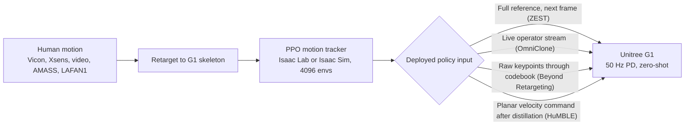

# Literature Summary: Human Motion Capture to Unitree G1 Policies

**Goal.** Record household manipulation motions (sweeping with a broom, picking up a box, washing dishes) with a Vicon optical motion capture system and train control policies that a Unitree G1 humanoid executes autonomously.

**Papers reviewed** (PDFs in [manuscripts/](manuscripts/)):

| arXiv | Title | Group | Date |
|---|---|---|---|
| [2602.00401](https://arxiv.org/abs/2602.00401) | [ZEST: Zero-shot Embodied Skill Transfer for Athletic Robot Control](https://arxiv.org/pdf/2602.00401) | RAI Institute, Boston Dynamics | Jan 2026 |
| [2603.14327](https://arxiv.org/abs/2603.14327) | [OmniClone: Engineering a Robust, All-Rounder Whole-Body Humanoid Teleoperation System](https://arxiv.org/pdf/2603.14327) | BIGAI, Peking University, and others | Mar 2026 |
| [2610.07891](https://arxiv.org/abs/2610.07891) | [Beyond Retargeting: Low-Latency and Robust Humanoid Whole-Body Teleoperation with Learned Atomic Motion Primitives](https://arxiv.org/pdf/2610.07891) | HKUST, Zhejiang University, Tencent Robotics X | Oct 2026 |
| [2610.10489](https://arxiv.org/abs/2610.10489) | [HuMBLE: Human Motion-Driven Behavior Learning for Embodied Locomotion](https://arxiv.org/pdf/2610.10489) | RAI Institute, Boston Dynamics | Oct 2026 |

Also referenced: the [HOLD dataset](https://github.com/rai-opensource/hold) ([manuscripts/notes.txt](manuscripts/notes.txt)), the Vicon dataset released with HuMBLE.

## Summary

All four papers share one recipe: retarget human motion to the robot skeleton, train a motion-tracking policy with PPO in a GPU-parallel simulator (Isaac Lab or Isaac Sim), and deploy to the G1 zero-shot through a joint-position PD controller at 50 Hz. All four deploy on a physical Unitree G1. They differ in what the deployed policy consumes.

None of the four records a manipulation task with optical mocap and then executes that task autonomously on objects. The closest is [ZEST](https://arxiv.org/abs/2602.00401), which trains single-clip policies from Vicon mocap and video and deploys them on the G1, including box climbing with a physical box. [OmniClone](https://arxiv.org/abs/2603.14327) and [Beyond Retargeting](https://arxiv.org/abs/2610.07891) are teleoperation systems. [HuMBLE](https://arxiv.org/abs/2610.10489) is steerable locomotion. Reported "task completion" numbers are tracking success rates (the robot did not fall and stayed near the reference), not task outcome rates. Section 8 of [fbx_to_g1_policy_pipeline.md](fbx_to_g1_policy_pipeline.md) addresses that gap.

**Relevance ranking (our assessment):** ZEST, then HuMBLE (same group and recipe; G1 configuration tables and Vicon dataset released), then OmniClone (pick-and-place on a G1; stratified evaluation), then Beyond Retargeting (teleoperation robustness; least relevant to offline training).

---

## 1. [ZEST: Zero-shot Embodied Skill Transfer](https://arxiv.org/abs/2602.00401) (RAI Institute and Boston Dynamics)

**Claim.** One RL recipe trains single-skill motion-imitation policies from motion capture (Xsens and Vicon), monocular video, or keyframe animation, and deploys them zero-shot on Atlas, Unitree G1, and Spot without contact labels, observation history, future-reference windows, or a state estimator, using one hyperparameter set per robot (Abstract; Materials and Methods).

**G1 results.** Cartwheel and table tennis from mocap; ballet, jump onto box, climb up box, climb down box from phone video (Table 1). The box skills use proprioception only, with the robot's initial pose relative to the box randomized during training. Box climb up and climb down succeeded 5 of 5 consecutive hardware trials at the nominal setup (Movie S6), and all trials initialized within ±10 cm in x and ±0.3 rad in yaw succeeded (Figure S5). The policy also completed the task with a 2 kg torso payload and at box heights outside the 0.70 to 0.80 m training range (Results, "ViCap-Derived Human-Like Skills on Hardware").

**Method.**
- Observations: IMU angular velocity, gravity direction, joint positions, joint velocities, previous action, plus only the next reference frame (base height, base linear and angular velocity, gravity direction, reference joint positions) (Table S3).
- Actions: residual offsets added to the reference joint positions, tracked by a PD controller. Absolute actions were the worst ablation (Figure 2).
- Rewards: exponential-kernel tracking of base pose, base velocities, joint positions, and key-body poses; penalties on action rate, joint acceleration, joint and torque limits; constant survival bonus (Table S4). No task-specific terms.
- Asymmetric actor-critic: the critic receives base velocity, contact forces, and key-body positions (Table S3).
- Adaptive reference-state initialization: clips are split into 4 s bins; each bin keeps an EMA of failure; resets are biased toward high-failure bins (Section S5, Table S6).
- Assistive wrench curriculum: a model-based virtual force and torque on the torso, scaled by bin failure and annealed to zero (Section S6).
- Domain randomization: friction U(0.6, 1.0), link mass ±10 percent, 0.5 m/s impulsive pushes, observation noise (Table S5).
- PD gains derived from analytical armature values of the parallel-linkage ankles and knees; identical in simulation and on hardware (Materials and Methods, "Actions and Joint-Level Control").

**Compute.** About 10 hours (7k PPO iterations) per policy on one NVIDIA L4 with 4096 environments in Isaac Lab (Results; Table S7). All hardware results use single-skill policies because they track better than a multi-skill policy at a fixed budget (Results, first paragraph).

**Data pipeline.** Vicon and Xsens exported to BVH, retargeted in two stages (human skeleton to a robot-proportioned proxy skeleton, then to the robot) by a spacetime optimization that jointly solves a uniform spatial scale and a time resampling so ballistic phases remain consistent with 9.81 m/s squared gravity (Section S4). Video is reconstructed with MegaSaM and TRAM to SMPL, then retargeted the same way. A clip converts in minutes (Results, "ViCap-Derived Human-Like Skills").

**Metrics.** Hardware: MAE of joint angles, mean angular distance of base roll and pitch, mean L2 base angular velocity error, and the maxima of each, over successful trials (Table 1). Simulation: success rate over 10,000 randomized rollouts per clip, reported as mean, 10th percentile, and minimum (Figure 2).

**Assessment (ours).** The recipe to reproduce: it consumes Vicon mocap, deploys on the G1, and handles a fixed object through pose randomization. Gaps: no code release, proprietary retargeter, and no held tools or small objects.

---

## 2. [OmniClone: All-Rounder Whole-Body Humanoid Teleoperation](https://arxiv.org/abs/2603.14327) (BIGAI and partners)

**Claim.** A single transformer tracking policy trained on 30 hours of motion data on one RTX 4090 supports real-time teleoperation of a G1 across dynamic motions and quasi-static loco-manipulation, executes generated motions, and serves as the low-level controller under a Vision-Language-Action (VLA) model (Abstract; Section IV-C).

**G1 results.** Teleoperation of a G1-Comp (29 DoF, 12 DoF Inspire hands, RealSense D455 head camera; Appendix C-A) through pick-and-place, opening a cabinet and retrieving a tissue, serving tea, transporting coffee beans, and running (Figures 1, 7). Six operators from 1.47 m to 1.94 m completed a walk-stabilize-pick-and-place task within 5 to 7 practice trials (Figure 5). GR00T N1.6 post-trained on 50 teleoperated demonstrations reached 85.71 percent success on pick-and-place (21 trials) and 80.00 percent on squat-to-pick-and-place (5 trials) (Table II).

**Method.**
- Teacher-student: PPO teacher, about 60 hours and 33k steps with 4096 environments; DAgger student, about 22 hours; about 80 GPU-hours total on one RTX 4090 (Section IV-C). The student receives deployable observations plus future reference frames (Equation 3).
- Transformer backbone outperformed an MLP in every OmniBench category under identical training (Table I).
- OmniBench: unseen generated motions in six categories, each stratified by height or speed, 60 episodes per category (Section III-A).
- Data recipe: about 60 percent standing manipulation, the remainder split between dynamic and stable locomotion; changing the minority fraction or filtering biased sequences changes policy behavior substantially (Section V-B, Figure 4).
- Subject-agnostic retargeting: a scale factor from a calibration frame replaces per-operator calibration. Measured skeletal scale discrepancies of up to about 20 cm corresponded to about 20 mm of MPJPE (Section IV-B).
- Infrastructure: FIFO frame buffer with zero-order hold, UDP transport, about 80 ms end-to-end latency (Section IV-B).

**Metrics.** Success rate and MPJPE in millimeters, stratified by category and difficulty, evaluated in MuJoCo on motions outside the training set (Section V, Table I). Hardware: operator task completion; VLA task success rate (Table II).

**Assessment (ours).** Not an offline training paper, but it shows pick-and-place on a G1 with hands and the most granular evaluation of the four. Reusable: stratified evaluation; dataset composition as a design variable; a fallback route of optical-mocap teleoperation, demonstration recording, and VLA post-training.

---

## 3. [Beyond Retargeting: Retargeting-Free Teleoperation with a Motion Codebook](https://arxiv.org/abs/2610.07891) (HKUST, Zhejiang University, Tencent Robotics X)

**Claim.** A student policy maps raw human keypoints plus robot proprioception directly to G1 joint commands in one forward pass. A factorized discrete codebook projects noisy, partial, or out-of-distribution observations onto learned full-body prototypes, which improves robustness over a continuous MLP student (Abstract; Section III-B).

**G1 results.** One checkpoint drives a physical G1 from a VR headset, full-body optical mocap, monocular video (GVHMR), and text-to-motion (HY-Motion) without fine-tuning (Section IV-C, Figures 5 to 8).

**Method.**
- Stage 1: privileged Mixture-of-Experts teacher trained with PPO and adaptive sampling on 14,147 retargeted AMASS, LAFAN1, and OMOMO clips (Section IV-A).
- Stage 2: codebook student with C = 128 channels and D = 12 entries, trained by matching codes from corrupted inputs to codes from clean inputs, with action distillation and auxiliary heads (Section III-B, Table V).
- Training-time keypoint masking and noise (Equation 2).

**Metrics.** Success: the rollout reaches the end of the reference clip without the pelvis height error exceeding 0.25 m (Section IV-A). Seven tracking errors with fixed penalty values substituted for failed frames (Section IV-B). Robustness sweeps over observation dropout, keypoint noise, root-height drift, initialization bias, and unseen motions (Table III). Hardware latency of 147.5 ms median, measured by aligning operator and robot optical flow (Section IV-B). On the held-out set the codebook student reached 0.9590 success versus 0.8451 for TWIST (Table I).

**Assessment (ours).** Teleoperation-specific; the retargeting-free design does not apply to an offline pipeline. Reusable: a precise success definition; training-time noise and masking because real mocap streams are noisier than clean references; evidence that Mixture-of-Experts teachers and adaptive sampling matter for large libraries (Table IV).

---

## 4. [HuMBLE: Human Motion-Driven Behavior Learning for Embodied Locomotion](https://arxiv.org/abs/2610.10489) (RAI Institute and Boston Dynamics)

**Claim.** From about three hours of Vicon locomotion capture, train a compact MLP that produces human-like, steerable walking from proprioception and a planar velocity command, deployed on Atlas R1, Atlas D1, and Unitree G1 (Abstract).

**G1 results.** Joystick-steered walking through sprinting with emergent gait transitions (Figure 1D), outdoor deployment, and use as the locomotion layer under a box-parkour planner whose climbing experts are ZEST-style policies (Section S7). G1 inference time 1.1 ms on the Jetson AGX Orin CPU with ONNX Runtime (Results, "Application of Learned Locomotion Behaviors").

**Method.**
- Stage I: a ZEST-style tracking teacher, distilled with DAgger into a command-conditioned prior (Materials and Methods, "Stage I").
- Stage II: multi-task PPO fine-tuning with environments split 50:50 between reference tracking (style regularizer) and random velocity commands (coverage); goal-conditioned reference-state initialization; critic warm-started from the teacher critic for 5000 iterations before the actor is updated (Materials and Methods, "Stage II").
- Vicon pipeline: 120 Hz, subject-calibrated rig, gap filling and filtering, BVH export, two-stage retargeting as in ZEST, mirroring across the sagittal plane, estimated sole and toe bones for foot contact (Materials and Methods, "Dataset Collection"; Section S2).
- Scaling for the G1: actor height about 178 cm; lengths scaled by 0.8 and time by 1 over the square root of 0.8 to preserve 9.81 m/s squared gravity (Section S2).
- G1 hardware findings: stiff ankles stumbled on real floors until terrain roughness randomization of ±2.5 cm was added after the midpoint of teacher training (Section S5, Table S5). The G1 state estimator drifts outdoors, so a variant without the linear velocity observation was trained (Materials and Methods, "Hardware Deployment").

**Metrics.** DTW-aligned MAE of torso velocities and joint positions against the reference, normalized by the reference standard deviation (Figure 3, Table S1). Steady-state command-tracking error and 90 percent rise time over a velocity grid; push-recovery envelope (Figure 4). Sim-versus-real error tables on identical command sequences (Table 1, Table S2).

**Released artifacts.** [HOLD](https://github.com/rai-opensource/hold) (CC-BY-4.0): 552 BVH trajectories, about 576 minutes at 120 Hz, a 0.8-scaled variant, and example G1 retargets; includes box lifting, carrying, pushing, stepping onto boxes, and sitting (Section S2; repository README). The paper states that the G1 reference motion dataset and figure data will be released (Data and materials availability).

**Assessment (ours).** Not our target behavior, but the same group and recipe as ZEST, with the full G1 training configuration published (Tables S3 to S9) and Vicon box clips already retargeted to the G1. Those clips serve as a validation set for our retargeting and training pipeline.

---

## Side-by-side

| | [ZEST](https://arxiv.org/abs/2602.00401) | [OmniClone](https://arxiv.org/abs/2603.14327) | [Beyond Retargeting](https://arxiv.org/abs/2610.07891) | [HuMBLE](https://arxiv.org/abs/2610.10489) |
|---|---|---|---|---|
| Input to deployed policy | Full-body reference, next frame only | Reference plus future frames (teleop stream) | Raw human keypoints, no retargeting | Planar velocity command |
| Human data source | Vicon, Xsens, phone video, animation | AMASS, LAFAN, TWIST2 corpus, own teleop (30 h) | AMASS, LAFAN1, OMOMO (14,147 clips) | Own Vicon capture (3 h) |
| Policy | MLP, one skill per policy | Transformer, one policy | MLP student with discrete codebook; MoE teacher | MLP, distilled then fine-tuned |
| Training stages | 1 (PPO) | 2 (PPO teacher, DAgger student) | 2 (PPO teacher, distillation) | 3 (PPO teacher, DAgger prior, PPO fine-tune) |
| Simulator | Isaac Lab | Isaac Lab (train), MuJoCo (eval) | Isaac Sim (train), MjLab (eval) | Isaac Lab (train), MuJoCo (cross-check) |
| Compute reported | 10 h per skill, 1 x L4 | 80 h, 1 x RTX 4090 | Not stated | Not stated |
| G1 object interaction | Box climb, jump onto box (proprioception only) | Pick-and-place, cabinet, tea (teleop and VLA) | Bimanual grasp via VR | Box climb as a separate expert |
| Success metric | Sim success over 10k rollouts; hardware N of N | Stratified success rate and MPJPE on unseen motions | Clip completed with pelvis height error under 0.25 m | DTW-aligned MAE, command error, push envelope |
| Code released | No | Pipeline "will be released" | Not stated | Dataset only (HOLD) |

## Implications for our plan (our assessment)

1. **Reproduce ZEST with HuMBLE's G1 tables.** Single-skill tracking policies, one per clip, about 10 GPU-hours each. ZEST code is not public; [BeyondMimic](https://github.com/HybridRobotics/whole_body_tracking) and [mjlab](https://github.com/mujocolab/mjlab) implement the same family of recipe for the G1 and are the starting codebases.
2. **Start with the box.** It is the only task with published precedent (ZEST box interaction; HOLD box-lifting clips). Sweeping adds a held tool. Dish washing adds water, deformables, wet contact, and finger control, none of which these papers attempt with a tracking policy.
3. **Define task completion ourselves.** The papers measure tracking survival. With markers on the G1 and the objects, Vicon measures global tracking error and object outcome in one frame, which none of the four papers had on hardware.
4. **Fallback.** If mocap tracking fails for dishes, OmniClone's route applies: teleoperate the G1 from optical mocap, record demonstrations, post-train a VLA on about 50 demonstrations (Table II).
