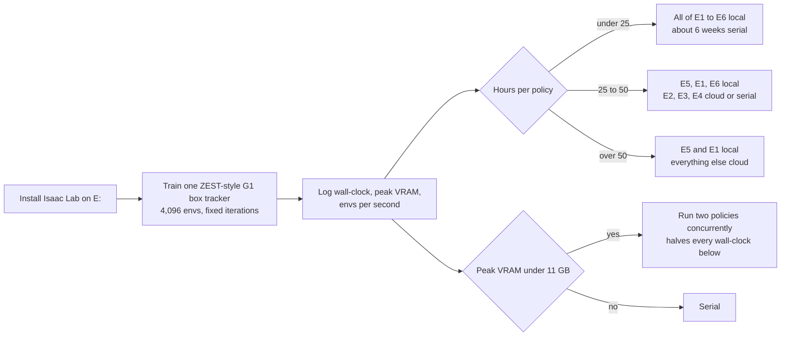
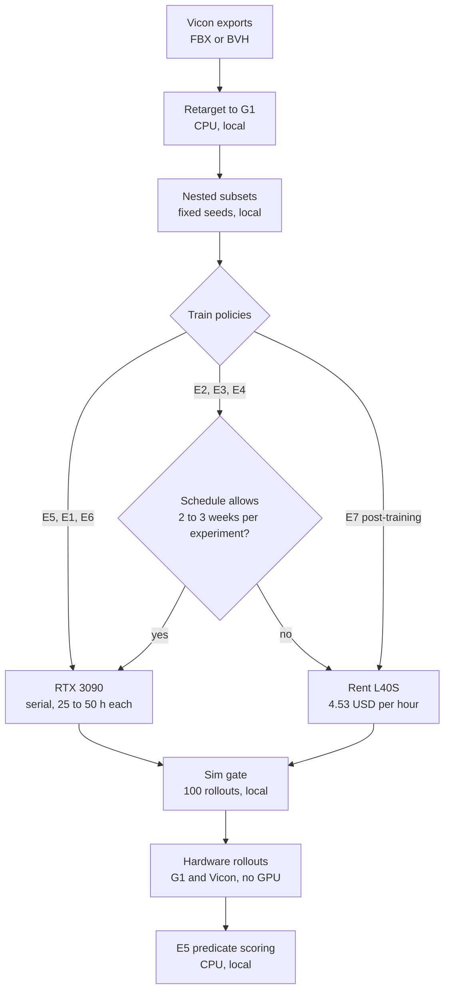
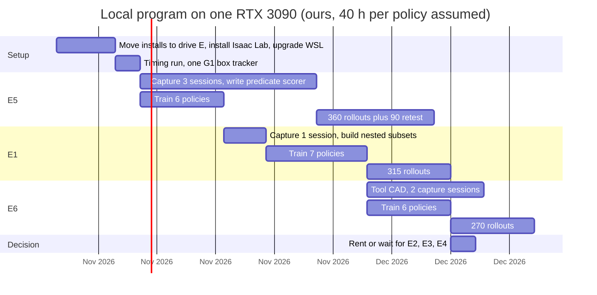
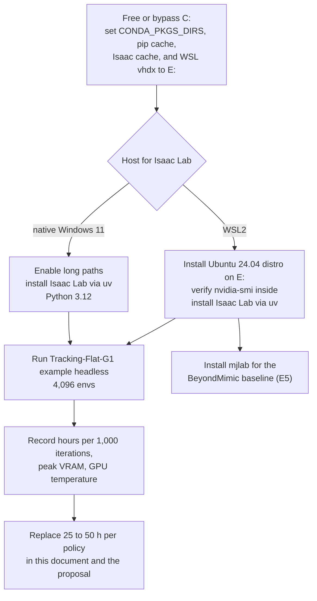

# Which proposed experiments the local workstation can run

This document maps the seven experiments in [potential-manuscript-ideas.md](potential-manuscript-ideas.md) onto the lab workstation inventoried on 2026-10-25. The verdict per experiment is one of: local, local but serial-slow, or cloud. Every hour figure below is an inference from published anchors scaled by GPU throughput; the first task in the schedule replaces those inferences with a measured number.

## Machine inventory (measured 2026-10-25)

| Component | Value | How measured |
|---|---|---|
| GPU | NVIDIA GeForce RTX 3090, 24,576 MiB, compute capability 8.6 | `nvidia-smi --query-gpu` |
| Driver, CUDA | 591.86, CUDA 13.1 | `nvidia-smi` |
| CPU | Intel Core i9-11900K, 8 cores, 16 threads | `Win32_Processor` |
| RAM | 64 GB | `Win32_ComputerSystem` |
| OS | Windows 11 Pro 10.0.26200 | `Win32_OperatingSystem` |
| Disk C: | 9.2 GB free of 930 GB | `Get-PSDrive` |
| Disk E: | 2,866 GB free of 3,726 GB | `Get-PSDrive` |
| WSL2 | Ubuntu 20.04 LTS, GPU visible inside, 900 GB free on its virtual disk | `wsl -d Ubuntu` |
| Docker | 25.0.3 with docker-desktop WSL backends | `docker --version` |
| Simulators | none installed in any of the 18 conda environments or in WSL; system torch 2.3.0 has no CUDA build | `pip list` per environment |

## Requirements against the machine

| Requirement | Source | Value | This machine | Status |
|---|---|---|---|---|
| Isaac Sim OS | [Isaac Sim requirements](https://docs.isaacsim.omniverse.nvidia.com/latest/installation/requirements.html) | Ubuntu 22.04/24.04 or Windows 11 | Windows 11; WSL is 20.04 | native Windows passes; WSL fails until upgraded |
| Isaac Sim VRAM | same page, minimum row | 16 GB | 24 GB | pass |
| Isaac Sim RAM | same page, good row | 64 GB | 64 GB | pass |
| Isaac Sim CPU | same page, good row | i7 9th gen, 8 cores | i9 11th gen, 8 cores | pass |
| Isaac Sim storage | same page, minimum row | 50 GB SSD | C: 9 GB free, E: 2.87 TB free | pass only on E: |
| Isaac Sim GPU tier | same page, minimum row | GeForce RTX 4080 | RTX 3090 | below the named card in compute; the tier gates rendering, not headless RL (inference) |
| Isaac Lab solver | [Isaac Lab installation](https://isaac-sim.github.io/IsaacLab/main/source/isaaclab/installation.html) | compute capability 7.5 or newer, Python 3.12, Windows 11 supported | 8.6 | pass |
| Isaac Lab Isaac Sim version | same page | Isaac Sim 6.2; 5.1 and older unsupported | not installed | install current |
| mjlab (BeyondMimic G1 tracker) | [mjlab README](https://github.com/mujocolab/mjlab) | NVIDIA GPU for training; macOS evaluation only; Windows not mentioned | 3090 | run inside an upgraded WSL distro |
| MuJoCo Playground | [repository](https://github.com/google-deepmind/mujoco_playground) | Python 3.10+, JAX with CUDA 12; Ampere needs `JAX_DEFAULT_MATMUL_PRECISION=highest` for reproducibility | Ampere | pass with the flag |
| Isaac-GR00T fine-tuning | [Isaac-GR00T README](https://github.com/NVIDIA/Isaac-GR00T) | 40 GB+ VRAM recommended, H100 or L40 nodes; A6000 works but slower | 24 GB | below recommendation |
| Isaac-GR00T inference | same README | 16 GB+ VRAM, RTX 4090 named | 24 GB | pass |

Three items block installation today and none is a hardware limit: C: has no room, WSL is two LTS releases behind, and no simulator exists yet.

## Per-policy training time on the RTX 3090

The proposal's working figure is 15 to 25 GPU-hours per policy on an L40S. The RTX 3090 is a smaller card, so the figure must be rescaled. FP32 throughput is the proxy; RL training is partly memory- and latency-bound, so the proxy is coarse (inference).

| GPU | FP32 TFLOPS | Memory | Source |
|---|---|---|---|
| RTX 3090 | 35.7 (computed: 10,496 cores x 2 x 1.70 GHz) | 24 GB GDDR6X | [NVIDIA RTX 3090 page](https://www.nvidia.com/en-us/geforce/graphics-cards/30-series/rtx-3090-3090ti/) |
| L4 | 30.3 | 24 GB | [NVIDIA L4 page](https://www.nvidia.com/en-us/data-center/l4/) |
| RTX 4090 | 83 | 24 GB GDDR6X | [NVIDIA RTX 4090 page](https://www.nvidia.com/en-us/geforce/graphics-cards/40-series/rtx-4090/) |
| L40S | 91.6 | 48 GB | [NVIDIA L40S page](https://www.nvidia.com/en-us/data-center/l40s/) |

| Anchor | Reported | Rescaled to the 3090 (inference) |
|---|---|---|
| [ZEST](https://arxiv.org/abs/2602.00401), one behavior on one L4 | about 10 h (Table S7) | about 8.5 h |
| Proposal working figure on L40S | 15 to 25 h | 38 to 64 h |
| [KungfuBot](https://arxiv.org/abs/2506.12851), one motion on one RTX 4090 | 27 h (Appendix D.1) | about 63 h |

The anchors span 8.5 to 64 h because the recipes differ in environment count, iteration count, and network size. This document plans with 25 to 50 h per policy and treats the first local timing run as the number that replaces it. The 3090 has the same 24 GB as the L4 that ZEST trained on, so memory is not the constraint at the proposal's 4,096 environments; whether two runs fit concurrently on one card is unmeasured.

## Verdict per experiment

Hours use 25 to 50 h per policy. Days assume the card runs 24 h per day with no concurrency. Robot time and capture time are unchanged from the proposal and do not need the GPU.

| Experiment | Policies | 3090 hours | Serial wall clock | Verdict | What the GPU does not cover |
|---|---|---|---|---|---|
| E5 benchmark and dataset | 6 (ZEST-style tracker plus one public baseline per task, 3 tasks) | 150 to 300 | 6 to 13 days | local | 3 capture sessions, 360 rollouts, scoring code |
| E1 minutes curve | 7 | 175 to 350 | 7 to 15 days | local | 1 capture session, 315 rollouts |
| E6 sweeping and dish rack | 6 | 150 to 300 | 6 to 13 days | local | 2 capture sessions, 270 rollouts, tool CAD and assistive wrench |
| E2 variants factorial | 8 | 200 to 400 | 8 to 17 days | local but serial-slow | 2 capture sessions, 360 rollouts |
| E3 performer count | 6 | 150 to 300 | 6 to 13 days | local but serial-slow | 10 performer sessions, 270 rollouts |
| E4 reference quality | 10, plus the video reconstruction pipeline | 250 to 500 plus reconstruction | 10 to 21 days plus reconstruction | local but serial-slow | 450 rollouts; monocular reconstruction VRAM unverified |
| E7 capture versus teleop for VLA | 2 to 4 GR00T post-training runs | fine-tuning exceeds the 40 GB recommendation | not measured | cloud for post-training; local for inference and rollouts | 2 capture sessions, 450 rollouts |

Totals for E1 to E6: 43 policies, 1,075 to 2,150 GPU-hours, 45 to 90 days of continuous serial training. The proposal's cloud figure for the same experiments is 645 to 1,075 L40S-hours at 4.53 USD per hour, 2,900 to 4,900 USD.

Why E2, E3, and E4 are "serial-slow" rather than "cloud": nothing about them needs more than 24 GB, but each is a sweep of 6 to 10 policies that must finish before its hardware rollouts start, so one card makes the training phase longer than the capture and rollout phases combined. The decision between waiting and renting is a schedule decision, not a capability decision.

Why E7 is "cloud": the Isaac-GR00T README recommends 40 GB or more for fine-tuning and names H100 or L40 nodes. The 3090's 24 GB may fit a reduced-batch or frozen-backbone configuration, but the README states no such configuration, so this document does not assume one. Inference at 16 GB or more is within budget, so policy rollouts and scoring remain local.

## What runs locally regardless of the training verdict

Every experiment has a simulation-only front half that this machine handles without question (inference from the requirements above: these are single-environment or small-batch workloads).

- Retargeting Vicon exports to the G1 skeleton, logging discards, and building the nested data subsets with fixed seeds (E1 to E4).
- Reward shaping, domain randomization, and the simulation gate (survival and tracking error over 100 simulated rollouts) for each trained checkpoint.
- The E5 predicate scorer: Vicon rigid-body streams in, milestone vector out. This is CPU code and is the foundation for every other experiment.
- The synthetic-results pipeline in [scripts/synthetic_results.py](scripts/synthetic_results.py), which already runs here and should be rerun with measured means as each experiment reports.
- Policy inference during hardware rollouts: a tracking policy is a small MLP and runs on the robot's onboard computer; the workstation only logs.
- GR00T inference for E7 at 16 GB or more.

## Recommended local program

Order follows the proposal's prioritization (E5 first, then E1 and E6) and keeps the card busy while capture and rollouts happen. The Gantt assumes 40 h per policy, serial training, and no concurrency; measured timing moves every bar.

Three experiments, 19 policies, roughly 760 GPU-hours at the assumed rate, finish on the workstation inside about four months with the robot and the capture volume never waiting on the GPU for more than two weeks. E5 training overlaps its own capture because the public baseline policies can start from the [HOLD dataset](https://github.com/rai-opensource/hold) clips before the lab's sessions are complete.

## Operating cost of running locally

The GPU's board power is 350 W ([NVIDIA RTX 3090 page](https://www.nvidia.com/en-us/geforce/graphics-cards/30-series/rtx-3090-3090ti/)). With the rest of the system at about 150 W under load (assumption), a continuous run draws about 0.5 kW, or 12 kWh per day. At an assumed 0.17 USD per kWh, that is about 2 USD per day and about 180 USD for the full 90-day E1 to E6 serial program, against 2,900 to 4,900 USD of cloud time for the same policies. The lab's actual tariff replaces the assumption. The card has no ECC memory and consumer cooling, so training logs should include GPU temperature and any NaN or divergence events to catch thermal faults.

## Setup steps

1. Redirect every cache and install target to E:. The Isaac Sim minimum is 50 GB and C: has 9 GB.
2. Pick the host. Native Windows 11 is listed as supported by Isaac Lab and avoids the WSL upgrade; WSL2 Ubuntu 24.04 is needed for mjlab and for any Linux-only reconstruction tool in E4. Installing both is cheap because the WSL disk lives on E:.
3. Train the stock G1 flat tracking task once at the proposal's environment count and iteration budget. Log wall-clock, peak VRAM, and iterations per second.
4. Convert the log into hours per policy and update the budget tables in [potential-manuscript-ideas.md](potential-manuscript-ideas.md), Section "Shared protocol", and the verdict table above.
5. If peak VRAM is under 11 GB, test two concurrent runs and record the combined throughput; if it exceeds 1.3 times a single run, every wall-clock figure above shrinks accordingly.

## Open items

- Measured hours per policy on this card. Everything above is scaled from three published anchors.
- Peak VRAM at 4,096 environments for a G1 tracker, which decides concurrency.
- VRAM and runtime of the monocular reconstruction pipeline for E4; no requirement was verified here.
- Whether a GR00T post-training configuration fits in 24 GB. The README recommends 40 GB or more and names no reduced configuration.
- The lab's electricity tariff and whether the workstation can run unattended for two-week stretches.
