# Potential manuscript ideas

Experiments that the published record on the Unitree G1 has not run, that our Vicon volume, one G1, and one GPU can run, and that each yield a self-contained manuscript. The gaps below are taken from the literature review in [reports/g1_policy_data_scaling.md](reports/g1_policy_data_scaling.md) and its source notes in [research_notes/g1_policy_data_scaling/](research_notes/g1_policy_data_scaling/). Every claim about a paper cites the table, figure, or section; every design choice and budget is labeled as ours.

## What the literature leaves open

| Gap | Evidence | Experiment that closes it |
|---|---|---|
| No hardware data-scaling curve for a mocap-trained humanoid policy | Only [LIMMT](https://arxiv.org/abs/2606.06953) varies motion-data quantity on a G1, two levels, 40 trials each (Table 6). All other sweeps are simulation. | E1 |
| No study separates clip count, clip length, and variant diversity at fixed minutes | [Lin et al.](https://arxiv.org/abs/2410.18647) show that conditions, not repetitions, drive generalization for a tabletop gripper (Sec. 4.3, Fig. 7); no humanoid study tests this. | E2 |
| No study varies the number of human performers | [HuMBLE](https://arxiv.org/abs/2610.10489) captured one actor and defers scalability (Sec. S2); [HOLD](https://github.com/rai-opensource/hold) has one performer. | E3 |
| Data quality versus quantity untested on hardware | Simulation results disagree in sign: [SONIC](https://arxiv.org/abs/2511.07820) Fig. 2A and [Humanoid-GPT](https://arxiv.org/abs/2606.03985) Table 2 rise with data; [OmniTrack](https://arxiv.org/abs/2602.23832) Fig. 4 and [ExBody2](https://arxiv.org/abs/2412.13196) Table X fall with raw data. | E4 |
| No graded task-completion score for an RL tracking policy | Tracking papers report fall-free survival plus kinematic error ([Beyond Retargeting](https://arxiv.org/abs/2610.07891) Table I; [HuB](https://arxiv.org/abs/2505.07294) Sec. 4.1). Graded scores exist only for arms ([TRI LBM](https://arxiv.org/abs/2507.05331) Sec. 4.1.2; [BEHAVIOR](https://arxiv.org/abs/2108.03332)). | E5 |
| No autonomous broom sweeping or dish handling on any humanoid | Nearest results: [ContactMimic](https://arxiv.org/abs/2607.08742) whiteboard wiping 5/5 (Table 2); [Humanoid Everyday](https://arxiv.org/abs/2510.08807) eraser wipe 0 to 70 percent (Table II). Unitree released wipe and dishwasher teleop datasets without success rates. | E6 |
| Human-side capture as a substitute for robot teleoperation is tested once, with an arm exoskeleton | [HumanoidExo](https://arxiv.org/abs/2510.03022): 5 teleop plus 195 exoskeleton demos match 200 teleop demos at about 80 percent, 60 trials (Fig. 6). The 5 to 50 demonstration regime is unmeasured on the G1. | E7 |
| No public Vicon household-task dataset with G1 retargets and robot observations | HOLD contains human motion only; every released G1 manipulation dataset was collected by XR teleoperation (Unitree, Humanoid Everyday, NVIDIA cards). | E5, E6 |

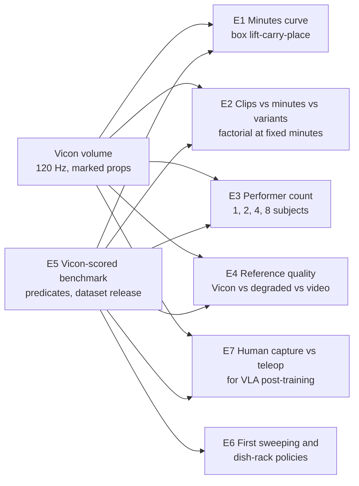

E5 is the measurement layer that every other experiment reports through, so it is built first.

## Shared protocol

All experiments use the same pipeline, policy class, and scoring so that results are comparable across manuscripts. The pipeline is the one in [fbx_to_g1_policy_pipeline.md](fbx_to_g1_policy_pipeline.md): Vicon BVH, retarget with [GMR](https://github.com/YanjieZe/GMR), train a [ZEST](https://arxiv.org/abs/2602.00401)-style PPO tracker in Isaac Lab or mjlab, sim-to-sim in MuJoCo, deploy through ONNX at 50 Hz.

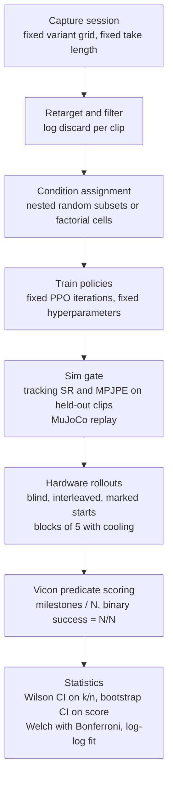

Fixed elements (ours):

- Training compute is held constant across conditions, mirroring the epoch scaling of [Lin et al.](https://arxiv.org/abs/2410.18647) (Appendix C), so that data is the only variable.
- Hardware evaluation is at least 45 rollouts per policy (9 marked start configurations times 5 trials), matching the 40 blind rollouts of Lin et al. (Sec. 4.1) and the 50 per condition of [TRI LBM](https://arxiv.org/abs/2507.05331) (Sec. 3), and exceeding every G1 paper except HumanoidExo's 60.
- Policies are interleaved and the operator is blind to condition, following [Kress-Gazit et al.](https://arxiv.org/abs/2409.09491), whose Example 2 records a drop from 13/20 to 0/8 after a lab reorganization (Sec. 2.2 to 2.3).
- Motors overheat after 5 to 10 min of box holding on a G1 ([TWIST](https://arxiv.org/abs/2505.02833) Sec. 4.1), so trials run in blocks of five with logged cooling intervals.
- Every result is reported as k/n with the Wilson 95 percent interval ([Brown, Cai and DasGupta](https://projecteuclid.org/euclid.ss/1009213286)); the graded score is the primary panel because 45 trials resolve binary gaps of only about 0.3 (computed in the report).

Per-policy training cost is bracketed by ZEST's about 10 h on one L4 per behavior (Table S7) and [KungfuBot](https://arxiv.org/abs/2506.12851)'s 27 h on one RTX 4090 per motion (Appendix D.1); 15 to 25 GPU-hours per policy is the working figure until the lab times one run (inference). At the AWS g6e.8xlarge on-demand rate of about 4.53 USD per hour, one policy costs 68 to 113 USD.

## How the synthetic results were produced

Every figure titled "SYNTHETIC DATA" below is generated by [scripts/synthetic_results.py](scripts/synthetic_results.py) with seed 0 from the stated assumptions. Nothing in them is measured. They exist so that the scoring code, the statistics, and the decision rule are fixed before the first capture session, in the spirit of pre-registration. Each figure shows two worlds: the left panel is generated under the hypothesis, the right panel under its negation. The sampling model is the same in every experiment (ours):

- A rollout passes milestones in order and stops at the first failure; the per-milestone pass probability is solved so that the expected normalized score equals the generating mean.
- Each condition has 45 rollouts; the mean score carries a percentile bootstrap 95 percent interval (10,000 resamples); binary success is 5/5 with a Wilson 95 percent interval.
- Seeds, drift, and rater disagreement are drawn where stated in the figure caption.

The synthetic panels also show what 45 rollouts can and cannot resolve: adjacent bootstrap intervals overlap whenever the generating means differ by less than about 0.15, and adjacent Wilson intervals overlap whenever the success rates differ by less than about 0.3, which is the result derived in [reports/g1_policy_data_scaling.md](reports/g1_policy_data_scaling.md).

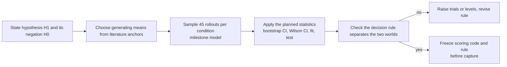

## E1. The first hardware curve of mocap minutes against task completion

**Question.** Normalized completion of a box lift-carry-place skill on a physical G1 rises with post-retargeting Vicon minutes and saturates within a single capture session.

**Why unprecedented.** LIMMT is the only G1 hardware study that varies motion-data quantity, and its two points slope the wrong way for a naive minutes axis (0.850 at a curated 10 percent subset versus 0.775 at 100 percent; Table 6). [OmniH2O](https://arxiv.org/abs/2406.08858) has three minutes-axis points but on an H1 with a behavior-cloning policy (Table 3). No study holds task, policy class, compute, variant distribution, and clip length fixed while varying minutes.

**Design (ours).** This is the protocol in the report, Section "A 315-rollout, 175-GPU-hour protocol", reproduced here as the baseline experiment.

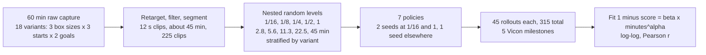

| Item | Value | Basis |
|---|---|---|
| Data levels | 5, factor-of-two spacing | Lin et al. used 6 and judged a three-parameter fit unjustified (footnote 1) |
| Policies | 7 | seeds at the endpoints decide the slope (ours) |
| GPU-hours | 105 to 175 | 7 x 15 to 25 |
| Rollouts | 315, about 10.5 robot-hours | 45 per policy at 2 min each |
| Primary outcome | mean milestone score with bootstrap 95 percent CI | TRI LBM Sec. 4.1.5 |
| Secondary outcome | binary success k/n with Wilson CI | Brown et al. |

**Expected result and its two readings (inference).** If the curve flattens by the second or third level, one short session per task is past the knee and the next variable to study is coverage (E2, E3). If it rises to the full pool, box lifting on the G1 is data-limited at a scale no tracker has probed.

**Hypothesis.** H1: normalized completion of the box skill rises with post-retargeting minutes, the two-parameter fit 1 - score = beta x minutes^alpha has alpha below 0 with Pearson r below -0.9, and the gain from 22.5 to 45 min is under 0.05, so the curve saturates inside one session. H0: completion is flat across all five levels because the knee lies below 2.8 min, which is what the 1-to-16-clip specialist results imply ([ZEST](https://arxiv.org/abs/2602.00401) 5/5 from one clip, Fig. S5; [PhysHSI](https://arxiv.org/abs/2510.11072) 6/10 from 16 clips, Table III). Predicted (inference): the knee falls between 5 and 11 min, because [LIMMT](https://arxiv.org/abs/2606.06953) Table 6 shows that count beyond a curated core adds nothing and the specialist papers show that one clip is not enough for varied starts. Decision rule: H1 is supported if at least one adjacent pair of levels differs by Welch's t-test at alpha 0.0125 (Bonferroni over four pairs) in the direction of more data, and the log-log fit meets the alpha and r thresholds; H0 is retained if no adjacent pair differs.

**Procedure.**

1. Mark the box (three sizes), the floor start and goal zones, and the performer; capture 18 variants with at least three repetitions each in one session of about 60 min at 120 Hz.
2. Export BVH, retarget with GMR at 0.8 scale and the matching time warp, filter on root-state and joint-energy plausibility, segment into one-cycle clips of 12 s; log discarded clips and minutes per variant.
3. Draw the five nested random subsets with a fixed seed, stratified so every level contains every variant where the count allows; record clip count, minutes, and variant count per level.
4. Train seven policies with identical PPO settings and iteration count (two seeds at the smallest and largest levels); record wall-clock and GPU-hours.
5. Gate each policy in simulation on held-out clips (tracking success and MPJPE) and replay in MuJoCo; a policy that fails the gate is still evaluated on hardware and flagged.
6. On hardware, run 45 rollouts per policy from nine Vicon-marked start configurations times five trials, policies interleaved, operator blind, blocks of five with cooling.
7. Score every rollout automatically from Vicon rigid bodies with the five-milestone predicate list; a second rater re-scores 25 percent from video.
8. Compute per-level mean score with bootstrap intervals, k/n with Wilson intervals, Welch tests on adjacent levels, and the log-log fit; tabulate failure modes.

**Synthetic results.**

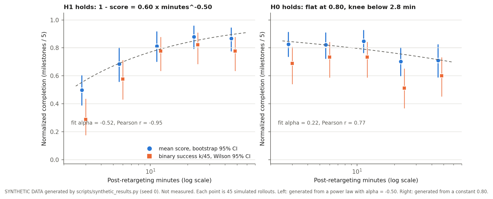

| Scenario | Minutes | Mean score [95% CI] | Success k/n | Wilson 95% CI |
|---|---|---|---|---|
| H1 holds | 2.8 | 0.50 [0.39, 0.60] | 13/45 | [0.18, 0.43] |
| H1 holds | 5.6 | 0.68 [0.56, 0.80] | 26/45 | [0.43, 0.71] |
| H1 holds | 11.3 | 0.81 [0.70, 0.92] | 35/45 | [0.64, 0.87] |
| H1 holds | 22.5 | 0.88 [0.80, 0.96] | 37/45 | [0.69, 0.91] |
| H1 holds | 45.0 | 0.87 [0.78, 0.94] | 35/45 | [0.64, 0.87] |
| H0 holds | 2.8 | 0.83 [0.74, 0.91] | 31/45 | [0.54, 0.80] |
| H0 holds | 5.6 | 0.82 [0.72, 0.91] | 33/45 | [0.59, 0.84] |
| H0 holds | 11.3 | 0.85 [0.76, 0.92] | 33/45 | [0.59, 0.84] |
| H0 holds | 22.5 | 0.70 [0.60, 0.80] | 23/45 | [0.37, 0.65] |
| H0 holds | 45.0 | 0.71 [0.59, 0.82] | 27/45 | [0.45, 0.73] |

Reading (ours): in the H1 world the first two adjacent pairs separate at 45 rollouts and the upper three do not, which is the saturation signature; in the H0 world the fit slope is noise and no adjacent pair separates. The binary success panel cannot separate any adjacent pair in either world, which is why the graded score is the primary outcome.

**Manuscript.** "How many minutes of motion capture does a humanoid skill need? A hardware data-scaling curve for a Unitree G1 tracking policy."

## E2. Clips, minutes, and variants: a factorial at fixed capture budget

**Question.** At a fixed number of post-retargeting minutes, the number of distinct task variants predicts hardware completion better than clip count or clip length.

**Why unprecedented.** Lin et al. established for a handheld gripper that distinct environments and objects follow a power law with exponent magnitude 0.47 to 0.84 while demonstrations per condition plateau near 50 (Sec. 4.2, Fig. 5, Fig. 7). No humanoid study tests any of this, and no study isolates clip count from clip length for motion tracking. ZEST lists references in seconds (Table 1) and SONIC counts clips (Table 2), so the two units coexist without a conversion.

**Design (ours).** Capture a large pool once: 36 variants (3 box sizes x 3 masses x 2 start heights x 2 goal placements) with 6 repetitions each, about 2 h raw. Then build training sets that hold total minutes at 20 and vary two factors.

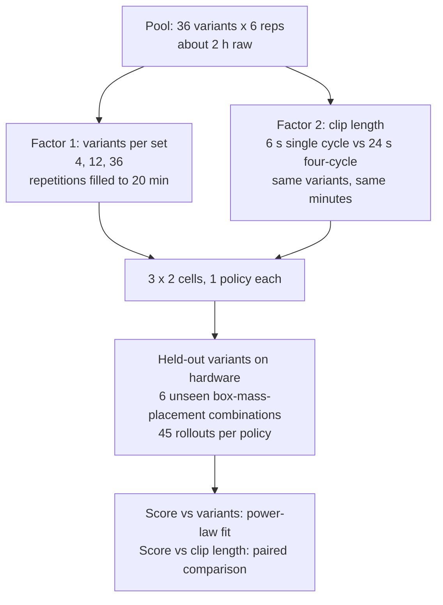

| Item | Value |
|---|---|
| Policies | 6 (3 variant counts x 2 clip lengths), plus 2 seed replicates at the extremes: 8 |
| GPU-hours | 120 to 200 |
| Rollouts | 360 on held-out variants |
| Outcome | milestone score on unseen variants, with the in-distribution score as a secondary panel |

**Expected contribution.** The first measurement of whether the diversity law of Lin et al. transfers from arms to whole-body humanoid tracking, and the first statement of what one "minute" of mocap buys as a function of how it was spent. The practical output is a capture-planning rule: minutes per variant versus number of variants (inference).

**Hypothesis.** H1: at a fixed 20 min, the score on six unseen variants rises with the number of distinct training variants as 1 - score = beta x variants^alpha with alpha between -0.3 and -0.8, the range [Lin et al.](https://arxiv.org/abs/2410.18647) report for environments and objects (Fig. 5), and clip length (6 s versus 24 s) has no effect. H0: variant count has no effect and clip length does, meaning the tracker learns from within-clip context rather than coverage. Predicted (inference): H1, because the retargeted clips of one variant are near-duplicates and the adaptive sampling in [ZEST](https://arxiv.org/abs/2602.00401) (Materials and Methods) allocates training to the failing bins regardless of repetition. Decision rule: H1 if the variant main effect across 4, 12, and 36 is significant by Welch tests with Bonferroni over the two adjacent pairs at alpha 0.025 and the clip-length paired difference is inside its bootstrap interval at every variant count; H0 if the reverse pattern holds.

**Procedure.**

1. Capture the pool once: 36 variants (3 box sizes x 3 masses x 2 start heights x 2 goal placements) with 6 repetitions each, about 2 h across two sessions, same performer.
2. Retarget and filter as in E1; segment each take two ways, 6 s single-cycle clips and 24 s four-cycle clips, from the same frames.
3. Build six training sets at 20 min each: 4, 12, or 36 variants, with repetitions filled in to reach 20 min, in both clip lengths; stratify so clip count differs only through clip length.
4. Train eight policies (six cells plus a second seed at 4 and 36 variants, 6 s).
5. Hold out six variants (box-mass-placement combinations) that appear in no training set; gate in simulation on those variants.
6. Run 45 hardware rollouts per policy on the held-out variants from marked starts, blind and interleaved; score with the E5 predicates.
7. Fit the power law on the variant axis for each clip length; test the clip-length paired differences; report in-distribution scores as a secondary panel.

**Synthetic results.**

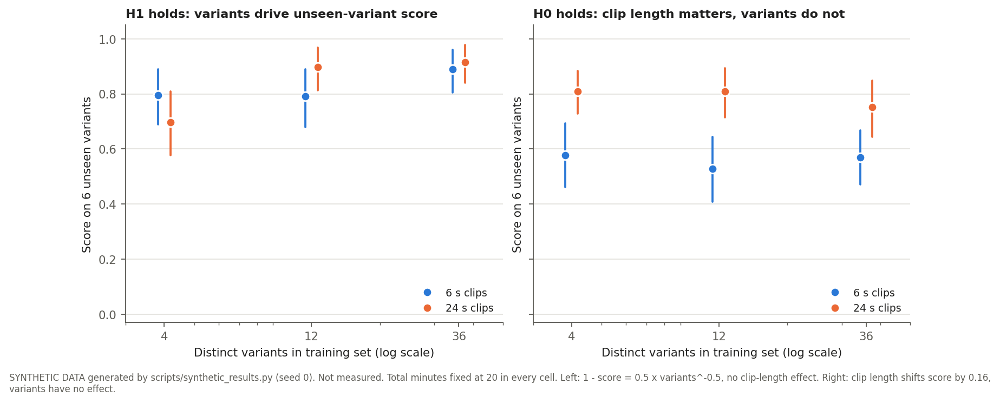

| Scenario | Variants | Clip length (s) | Mean score [95% CI] | Success k/n |
|---|---|---|---|---|
| H1 | 4 | 6 | 0.80 [0.69, 0.89] | 31/45 |
| H1 | 12 | 6 | 0.79 [0.68, 0.89] | 32/45 |
| H1 | 36 | 6 | 0.89 [0.80, 0.96] | 37/45 |
| H1 | 4 | 24 | 0.70 [0.58, 0.81] | 24/45 |
| H1 | 12 | 24 | 0.90 [0.81, 0.97] | 37/45 |
| H1 | 36 | 24 | 0.92 [0.84, 0.98] | 39/45 |
| H0 | 4 | 6 | 0.58 [0.46, 0.69] | 16/45 |
| H0 | 12 | 6 | 0.53 [0.41, 0.64] | 16/45 |
| H0 | 36 | 6 | 0.57 [0.47, 0.67] | 12/45 |
| H0 | 4 | 24 | 0.81 [0.73, 0.88] | 27/45 |
| H0 | 12 | 24 | 0.81 [0.72, 0.89] | 31/45 |
| H0 | 36 | 24 | 0.75 [0.64, 0.85] | 27/45 |

Reading (ours): the generated H1 effect from 4 to 36 variants is 0.17, which 45 rollouts resolve at the extremes but not between adjacent levels; a second seed at the extremes is therefore the cheapest way to confirm the slope.

**Manuscript.** "Spend minutes on variants: what a motion-capture session should contain for humanoid skill transfer."

## E3. Performer count: does a second human make the robot better?

**Question.** Policies trained on capture from more performers generalize better to unseen performers' motion and to unseen object placements, at fixed total minutes.

**Why unprecedented.** HuMBLE's dataset is one actor ("the actor", Sec. S2), HOLD is one performer, and OmniClone's subject-agnostic retargeting handles subject scale at inference, reporting about 20 mm MPJPE from a 20 cm scale discrepancy (Sec. VI-A), but no study varies the number of performers in training. AMASS has over 300 subjects but no humanoid study subsets it by subject count.

**Design (ours).** Eight performers each capture the same 12-variant box protocol for 10 min. Training sets use 1, 2, 4, and 8 performers at a fixed 40 min (40, 20, 10, 5 min per performer). Hardware evaluation uses references from a ninth and tenth performer who are not in any training set, retargeted the same way.

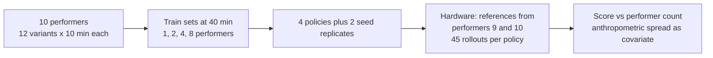

Anthropometrics (height, limb lengths) are recorded for every performer so that the covariate is the spread of body scale, not just the count. HuMBLE's 0.8 spatial scale with time warp by one over the square root of 0.8 (Sec. S3) is applied uniformly.

| Item | Value |
|---|---|
| Policies | 6 |
| GPU-hours | 90 to 150 |
| Rollouts | 270 |
| Capture | about 100 min across 10 performers, one session each |

**Hypothesis.** H1: at a fixed 40 min, the score on references from two unseen performers rises with the number of training performers (1, 2, 4, 8) while the in-distribution score stays constant. H0: one performer suffices because retargeting normalizes body scale; [OmniClone](https://arxiv.org/abs/2603.14327) reports about 20 mm MPJPE from a 20 cm subject-scale discrepancy with subject-agnostic retargeting (Sec. VI-A), which suggests scale is absorbed before training. Predicted (inference): a moderate H1 effect of 0.1 to 0.2 between 1 and 8 performers, driven by style and timing differences rather than scale, with the anthropometric spread of the training set as the covariate. Decision rule: H1 if the unseen-performer score at 8 performers exceeds that at 1 performer by Welch's test at alpha 0.025 and the in-distribution difference is inside its interval; H0 otherwise.

**Procedure.**

1. Recruit ten performers; record height and limb lengths; obtain consent for dataset release.
2. Each performer captures the same 12-variant box protocol for 10 min in one session; retarget with the same scale rule.
3. Build four training sets at 40 min from performers 1 to 8: one performer (40 min), two (20 each), four (10 each), eight (5 each); choose performers for the smaller sets by a fixed random draw.
4. Train six policies (four sets plus a second seed at 1 and 8 performers).
5. Build the evaluation reference set from performers 9 and 10 only; gate in simulation.
6. Run 45 hardware rollouts per policy on the unseen-performer references and 45 on in-distribution references, blind and interleaved; score with the E5 predicates.
7. Regress the unseen-performer score on performer count and on anthropometric spread; report both.

**Synthetic results.**

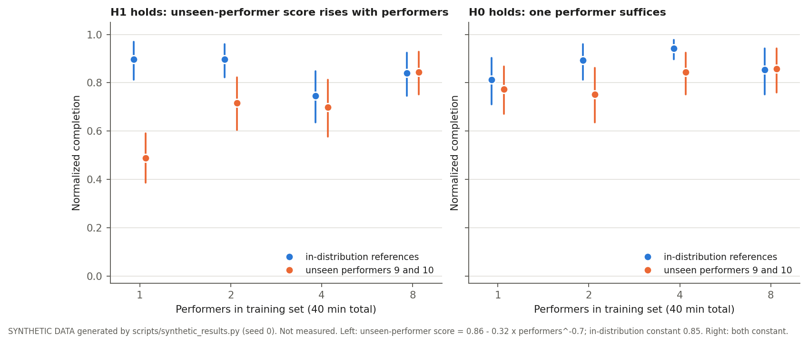

| Scenario | Performers | Evaluation references | Mean score [95% CI] | Success k/n |
|---|---|---|---|---|
| H1 | 1 | in-distribution references | 0.90 [0.81, 0.97] | 39/45 |
| H1 | 2 | in-distribution references | 0.90 [0.82, 0.96] | 36/45 |
| H1 | 4 | in-distribution references | 0.75 [0.64, 0.85] | 28/45 |
| H1 | 8 | in-distribution references | 0.84 [0.75, 0.92] | 34/45 |
| H1 | 1 | unseen performers 9 and 10 | 0.49 [0.39, 0.59] | 10/45 |
| H1 | 2 | unseen performers 9 and 10 | 0.72 [0.60, 0.82] | 24/45 |
| H1 | 4 | unseen performers 9 and 10 | 0.70 [0.58, 0.81] | 26/45 |
| H1 | 8 | unseen performers 9 and 10 | 0.84 [0.75, 0.93] | 33/45 |
| H0 | 1 | in-distribution references | 0.81 [0.71, 0.90] | 32/45 |
| H0 | 2 | in-distribution references | 0.89 [0.81, 0.96] | 37/45 |
| H0 | 4 | in-distribution references | 0.94 [0.90, 0.98] | 38/45 |
| H0 | 8 | in-distribution references | 0.85 [0.75, 0.94] | 37/45 |
| H0 | 1 | unseen performers 9 and 10 | 0.77 [0.67, 0.87] | 28/45 |
| H0 | 2 | unseen performers 9 and 10 | 0.75 [0.64, 0.86] | 31/45 |
| H0 | 4 | unseen performers 9 and 10 | 0.84 [0.75, 0.92] | 33/45 |
| H0 | 8 | unseen performers 9 and 10 | 0.86 [0.76, 0.94] | 36/45 |

Reading (ours): the generated H1 effect is 0.35 between 1 and 8 performers on unseen references, which is resolved at the extremes; the 2-versus-4 step is not, so the manuscript should report the endpoint contrast and the regression slope, not pairwise steps.

**Manuscript.** "One actor is not enough: performer diversity in motion capture for humanoid motion tracking."

## E4. Reference quality as the binding variable: Vicon against degraded references on hardware

**Question.** At fixed content, reference quality moves hardware completion more than reference quantity, and a Vicon reference is worth a measurable number of video-derived references.

**Why unprecedented.** The quantity-versus-quality disagreement lives entirely in simulation. OmniTrack reports raw references lowering success from 95.1 to 88.2 percent as data grows while physically plausible references hold near 92.6 percent (Fig. 4); ExBody2 reports a 250-clip filtered set beating a 1,919-clip raw set out of distribution (Table X(c)); [SCHUR](https://arxiv.org/abs/2511.09241) reports filtering raising tracker success from 0.762 to 0.907 (Tables I to III). SONIC and [HiPHI](https://arxiv.org/abs/2608.16222) report monotone gains with volume (Fig. 2A; Fig. 7). No one has tested either direction on hardware, and no one has the ground truth to do it: a Vicon lab can capture the same motion with optical markers and with a phone camera simultaneously, which gives paired references of different quality for identical content.

**Design (ours).** Capture the E1 pool with Vicon and two synchronized phone cameras. Produce four reference sets of identical content: Vicon at 120 Hz; Vicon degraded (downsampled to 30 Hz, simulated marker dropout, Gaussian jitter); monocular video reconstruction using the method of [VideoMimic](https://arxiv.org/abs/2505.03729) or the pipeline of [AdaMimic](https://arxiv.org/abs/2510.14454) (Sec. 3); and video reconstruction with a physics-plausibility filter of the OmniClone type (Appendix A). Train one policy per set at two data levels.

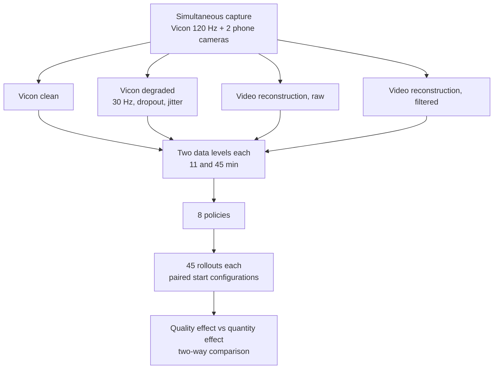

| Item | Value |
|---|---|
| Policies | 8, plus 2 seed replicates: 10 |
| GPU-hours | 150 to 250 |
| Rollouts | 450 |
| Extra capture | none beyond E1 if cameras run during the E1 session |

**Expected contribution.** The first hardware estimate of the exchange rate between reference quality and reference quantity, which is the number that decides whether a lab should buy mocap time or process video (inference).

**Hypothesis.** H1: at identical motion content, the ordering is Vicon clean above filtered video above degraded Vicon above raw video, and raw video does not improve from 11 to 45 min or worsens, reproducing on hardware the direction [OmniTrack](https://arxiv.org/abs/2602.23832) reports in simulation (Fig. 4, 95.1 to 88.2 percent). H0: all four reference sets score the same and only volume matters, the direction of [SONIC](https://arxiv.org/abs/2511.07820) Fig. 2A and [HiPHI](https://arxiv.org/abs/2608.16222) Fig. 7. Predicted (inference): H1 at this scale, because the disagreement in the literature splits by curation and the volume effects were reported above 100 h. Decision rule: H1 if the quality main effect (clean minus raw, averaged over levels) exceeds the quantity main effect (45 minus 11 min, averaged over sets) and the raw-video 45 min score is not above its 11 min score; H0 if the quantity effect dominates and the four sets are within their intervals of each other.

**Procedure.**

1. Run two phone cameras, synchronized to the Vicon clock by a clap or a flashed marker, during the E1 capture session; no extra capture is needed.
2. Produce four reference sets of the same takes: Vicon at 120 Hz; Vicon downsampled to 30 Hz with marker dropout and Gaussian jitter at magnitudes measured from the phone reconstruction's residuals; monocular reconstruction with the [VideoMimic](https://arxiv.org/abs/2505.03729) or [AdaMimic](https://arxiv.org/abs/2510.14454) pipeline, raw; the same reconstruction passed through a root-state and joint-energy filter of the [OmniClone](https://arxiv.org/abs/2603.14327) type (Appendix A).
3. Retarget all four sets with the same GMR configuration; log discard rate per set.
4. Build two data levels per set from the same nested draw as E1 (11.3 and 45 min).
5. Train ten policies (eight cells plus a second seed for Vicon clean and raw video at 45 min).
6. Run 45 hardware rollouts per policy from the E1 start configurations, blind and interleaved; score with the E5 predicates.
7. Compute the two main effects and their bootstrap intervals; report the exchange rate as the number of filtered-video minutes that match the Vicon clean score at 11.3 min, by interpolation.

**Synthetic results.**

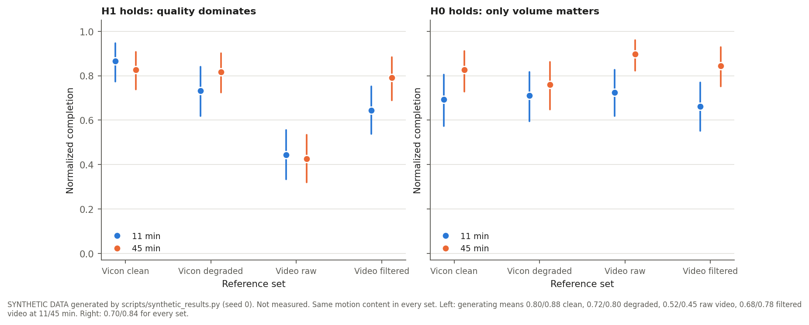

| Scenario | Reference set | Minutes | Mean score [95% CI] | Success k/n |
|---|---|---|---|---|
| H1 | Vicon clean | 11 | 0.87 [0.77, 0.95] | 36/45 |
| H1 | Vicon degraded | 11 | 0.73 [0.62, 0.84] | 28/45 |
| H1 | Video raw | 11 | 0.44 [0.33, 0.56] | 9/45 |
| H1 | Video filtered | 11 | 0.64 [0.54, 0.75] | 20/45 |
| H1 | Vicon clean | 45 | 0.83 [0.74, 0.91] | 32/45 |
| H1 | Vicon degraded | 45 | 0.82 [0.72, 0.90] | 31/45 |
| H1 | Video raw | 45 | 0.43 [0.32, 0.53] | 8/45 |
| H1 | Video filtered | 45 | 0.79 [0.69, 0.88] | 29/45 |
| H0 | Vicon clean | 11 | 0.69 [0.57, 0.80] | 26/45 |
| H0 | Vicon degraded | 11 | 0.71 [0.60, 0.82] | 26/45 |
| H0 | Video raw | 11 | 0.72 [0.62, 0.83] | 24/45 |
| H0 | Video filtered | 11 | 0.66 [0.55, 0.77] | 21/45 |
| H0 | Vicon clean | 45 | 0.83 [0.73, 0.91] | 33/45 |
| H0 | Vicon degraded | 45 | 0.76 [0.65, 0.86] | 29/45 |
| H0 | Video raw | 45 | 0.90 [0.82, 0.96] | 37/45 |
| H0 | Video filtered | 45 | 0.84 [0.75, 0.93] | 35/45 |

Reading (ours): in the H1 world the raw-video set is separated from every other set at both levels, and the filtered-video set closes the gap to Vicon at 45 min; in the H0 world the only visible structure is the 11-versus-45 shift. The two worlds are distinguishable at 45 rollouts because the generated quality effect is 0.35 and the quantity effect is 0.14.

**Manuscript.** "Is optical motion capture worth it? Reference quality against quantity for humanoid skill transfer on hardware."

## E5. A Vicon-scored household benchmark for humanoid tracking policies, with dataset release

**Question.** Task completion of a tracking policy can be scored automatically from Vicon rigid bodies on the object and robot, the score is reproducible across raters and sessions, and it ranks policies differently from fall-free tracking success.

**Why unprecedented.** Every tracking paper scores survival and kinematic error. Graded completion exists only for arm manipulation: the Lin et al. per-step 0 to 3 rubric (Sec. 3), the TRI LBM milestone fraction (Sec. 4.1.2), the BEHAVIOR predicate fraction, and GR00T N1's partial credit on the GR-1 ([GR00T N1](https://arxiv.org/abs/2503.14734), Sec. 5). Humanoid Everyday, the closest G1 manipulation benchmark, uses binary success on 10 trials (Table II). No public dataset pairs Vicon human capture, G1 retargets, and robot-side observations.

**Design (ours).** Define three tasks with predicate lists computed from rigid bodies: box lift-carry-place (reach, lift, carry, place, upright), broom sweep (grasp, contact with floor, debris displaced past a line, debris in zone, upright), and dish rack (grasp, lift, place in rack slot, release, upright). Record every rollout with Vicon, onboard joint states, and video. Release the human capture, the G1 retargets, the robot logs, and the scoring code.

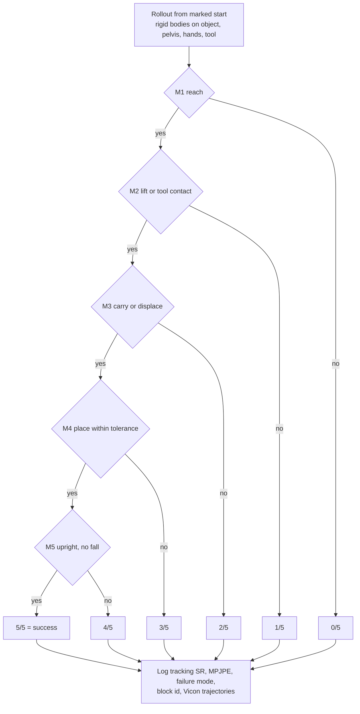

Validation of the score itself: a second rater scores 25 percent of rollouts from video, matching the LBM re-check of about 27 percent with a 2.31 percent discrepancy (Sec. 4.1.3); the same policy is re-evaluated after one week to measure session drift of the kind documented by Kress-Gazit et al.

| Item | Value |
|---|---|
| Tasks | 3 |
| Policies | one ZEST-style tracker per task plus one public baseline per task (BeyondMimic or mjlab checkpoint retrained on the same clips) |
| Rollouts | 6 x 45 = 270, plus 90 for the one-week retest |
| GPU-hours | 90 to 150 |
| Release | BVH, G1 retargets, robot logs, scoring code, CC-BY-4.0 as HOLD |

**Hypothesis.** H1: across at least six policies on the same task, the Spearman rank correlation between fall-free tracking success and Vicon-predicate completion is below 0.5, the test-retest mean absolute difference in completion after one week is below 0.05, and second-rater disagreement on a 25 percent re-check is below 5 percent, the level [TRI LBM](https://arxiv.org/abs/2507.05331) reports for its milestone re-check (2.31 percent, Sec. 4.1.3). H0: survival and completion rank policies the same (rho above 0.8), so the predicate layer adds nothing to the existing tracking metric. Predicted (inference): H1, because survival saturates near 1.0 for specialist policies ([HuB](https://arxiv.org/abs/2505.07294) 24/25, Table 2; [AdaMimic](https://arxiv.org/abs/2510.14454) 57/60, Table IV) while object outcomes do not ([PhysHSI](https://arxiv.org/abs/2510.11072) 6/10 full carry versus 8/10 pick-up, Table III). Decision rule: H1 if all three thresholds are met; partial support if only the rank-correlation threshold is met.

**Procedure.**

1. Define predicate lists for the three tasks (box, sweep, dish rack) in terms of rigid-body poses and tolerances; implement the scorer; unit-test it on replayed Vicon logs with known outcomes.
2. Capture the three task pools (about 10 min each after retargeting) and the robot-side observations (joint states, onboard camera) during every rollout.
3. Train one ZEST-style tracker per task and one public baseline per task (BeyondMimic or mjlab tracking configuration retrained on the same clips).
4. Run 45 hardware rollouts per policy (270 total); score automatically; a second rater scores 25 percent from video without seeing the automatic score.
5. Re-run the two box policies one week later from the same marked starts (90 rollouts) to measure session drift.
6. Compute rank correlations between survival, MPJPE, and completion; test-retest differences; rater disagreement.
7. Package the human capture (BVH), G1 retargets, robot logs, rollout videos, and scorer under CC-BY-4.0 with a datasheet.

**Synthetic results.**

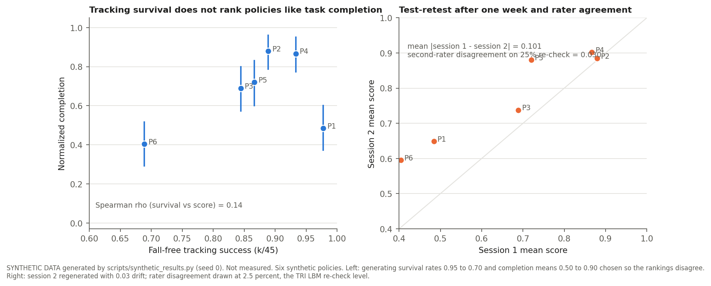

| Policy | Tracking survival k/n | Completion mean [95% CI] |
|---|---|---|
| P1 | 44/45 | 0.48 [0.37, 0.60] |
| P2 | 40/45 | 0.88 [0.79, 0.96] |
| P3 | 38/45 | 0.69 [0.57, 0.80] |
| P4 | 42/45 | 0.87 [0.77, 0.95] |
| P5 | 39/45 | 0.72 [0.60, 0.83] |
| P6 | 31/45 | 0.40 [0.29, 0.52] |

Reading (ours): the generated policies P1 and P2 have nearly equal survival and completion means 0.4 apart; that is the pattern the benchmark exists to expose. The test-retest panel shows the drift magnitude the one-week retest must stay under.

**Manuscript.** "Scoring what the robot did, not whether it fell: a Vicon-predicate benchmark and dataset for humanoid household skills."

## E6. First autonomous sweeping and dish-rack skills on a humanoid from human motion capture

**Question.** A ZEST-style tracker trained on under ten minutes of retargeted Vicon capture executes broom sweeping and dish racking on a G1 at a measurable completion rate, and the failure modes are dominated by tool contact rather than balance.

**Why unprecedented.** No manuscript reports learned-policy broom sweeping on any humanoid. The nearest tool-contact result is ContactMimic's whiteboard wiping at 5/5 from one HUMOTO clip (Table 2). Dish handling exists as Unitree whole-body teleoperation data (200 to 374 episodes per dishwasher variant) with no autonomous evaluation. Both tasks need sustained tool or object contact that proprioception-only trackers have reached only for boxes ([PhysHSI](https://arxiv.org/abs/2510.11072) 6/10 full carry, Table III; [ULTRA](https://arxiv.org/abs/2603.03279) 19/26, Table IV).

**Design (ours).** Sweeping: broom with a rigid-body marker cluster, debris as a marked foam block set, 12 variants (3 start positions x 2 broom lengths x 2 debris layouts), 10 min raw. Dish rack: three mock plates with markers, a marked rack, 12 variants, 10 min raw. One tracker per task, with the broom and plate modeled as attached bodies in simulation with randomized mass and friction; the ZEST assistive wrench curriculum (Sec. Materials and Methods, betamax 0.6) is applied to the tool as well as the pelvis (ours). The G1 wrist payload stated by [ResMimic](https://arxiv.org/abs/2510.05070) is about 2.5 kg (Sec. IV-C), which bounds broom and plate mass.

| Item | Value |
|---|---|
| Policies | 2 tasks x 2 seeds = 4, plus one ablation per task without tool randomization: 6 |
| GPU-hours | 90 to 150 |
| Rollouts | 270 |
| Hardware | Dex3 or Inspire hand with a fixed-grip broom adapter; grip is not learned in phase one (ours) |

**Expected contribution.** First hardware baseline for two household tool tasks, a failure taxonomy that says whether the bottleneck is contact modeling or data, and a direct test of whether the under-five-minute budget seen for box skills holds for tools (inference).

**Hypothesis.** H1: a tracker trained on under 10 min of retargeted capture reaches a mean completion above 0.5 on both sweeping and dish racking, tool randomization raises completion by at least 0.1, and more than 40 percent of failed rollouts fail at tool or object contact while fewer than 20 percent fail at balance. H0: completion stays below 0.3 or balance failures dominate, meaning the task is locomotion-limited and the tool-contact modeling is not the bottleneck. Predicted (inference): H1, because [ContactMimic](https://arxiv.org/abs/2607.08742) reaches 5/5 on whiteboard wiping from one clip (Table 2) with sustained tool contact, and the box results show balance under load is solved at this data scale. Decision rule: H1 if the three thresholds hold with the failure counts from at least 45 rollouts per task.

**Procedure.**

1. Build the props: a broom with a marker cluster and a fixed-grip adapter for the G1 hand; foam debris blocks with markers; three mock plates and a rack with markers; weigh every item against the 2.5 kg wrist limit cited by [ResMimic](https://arxiv.org/abs/2510.05070) (Sec. IV-C).
2. Capture 12 variants per task with three repetitions, about 10 min raw each; the performer uses the same adapter grip.
3. Retarget with the tool as a child body of the hand; filter on tool-floor and plate-rack contact plausibility; log discards.
4. Train six policies: per task, two seeds with tool mass and friction randomized and the assistive wrench applied to the tool, and one ablation without tool randomization.
5. Gate in simulation on tool-contact ratio and MuJoCo replay.
6. Run 45 hardware rollouts per policy from marked starts; score with the task predicates; label every non-success rollout with one of four failure modes from video, by two raters.
7. Report milestone distributions, success k/n, the ablation contrast, and the failure taxonomy.

**Synthetic results.**

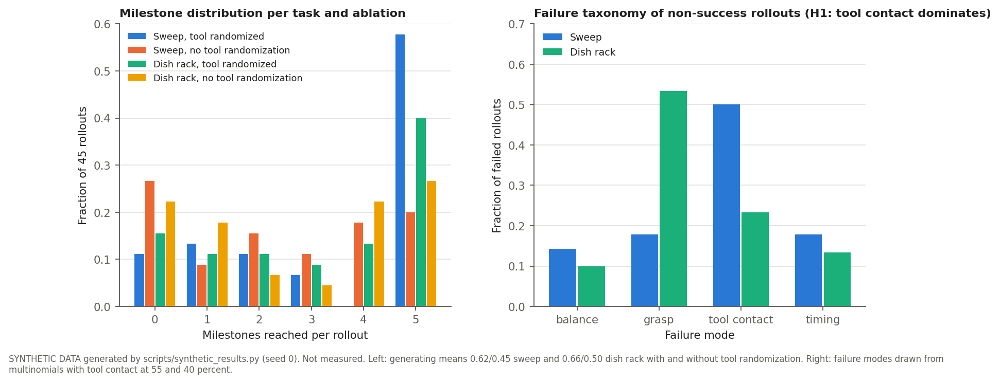

| Condition | Mean score [95% CI] | Success k/n | Rollouts at 0 1 2 3 4 5 milestones |
|---|---|---|---|
| Sweep, tool randomized | 0.69 [0.58, 0.80] | 26/45 | 5 6 5 3 0 25 |
| Sweep, no tool randomization | 0.49 [0.38, 0.60] | 9/45 | 12 4 7 5 8 9 |
| Dish rack, tool randomized | 0.63 [0.51, 0.74] | 18/45 | 7 5 5 4 6 18 |
| Dish rack, no tool randomization | 0.53 [0.42, 0.65] | 12/45 | 10 8 3 2 10 12 |

| Task | Failed rollouts | balance | grasp | tool contact | timing |
|---|---|---|---|---|---|
| Sweep | 28 | 4 | 5 | 14 | 5 |
| Dish rack | 30 | 3 | 16 | 7 | 4 |

Reading (ours): the milestone histogram is bimodal in the generated H1 world (most rollouts either stop at reach or complete), which is what a contact-limited failure looks like; a balance-limited world would pile rollouts at milestones 2 and 3 after the lift or tool pickup.

**Manuscript.** "From the broom closet to the robot: humanoid sweeping and dish racking from minutes of motion capture."

## E7. Human capture as a substitute for robot teleoperation in VLA post-training

**Question.** Full-body Vicon capture of a human, retargeted to the G1 and rendered through the tracker, produces post-training demonstrations for a vision-language-action model that match teleoperated demonstrations at equal count, and the success-versus-count curve between 5 and 50 demonstrations has a knee the literature has not located.

**Why unprecedented.** HumanoidExo is the single G1 result where human-side capture substitutes for teleoperation, using an arm exoskeleton: 5 teleop plus 195 exoskeleton demonstrations match 200 teleop demonstrations at about 80 percent (Fig. 6). OmniClone reports 85.71 percent from 50 teleoperated demonstrations with GR00T N1.6 (Table II) and [TrajBooster](https://arxiv.org/abs/2509.11839) reports 0 percent without pretraining at 28 episodes (Table II). No study measures the curve between 5 and 50 on the G1, and none uses optical full-body capture as the demonstration source.

**Design (ours).** For the box task, generate demonstrations two ways: teleoperation with the OmniClone-style mocap-driven tracker (the human in the Vicon volume drives the G1 live, robot camera and joint logs recorded), and offline replay (the human is captured alone, the retargeted motion is executed by the E1 tracker on the robot with the object present, logs recorded). Post-train GR00T at 5, 10, 25, 50, and 100 demonstrations from each source, following the OmniClone recipe (Sec. VI-B: 20k steps, batch 384).

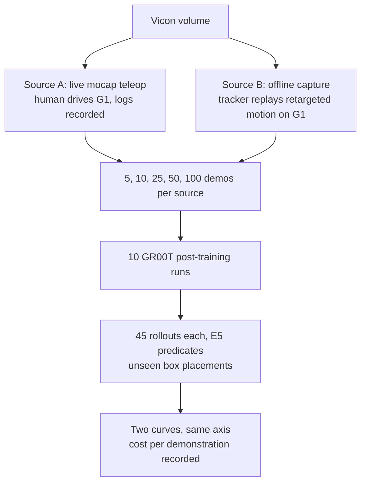

| Item | Value |
|---|---|
| Post-training runs | 10 |
| GPU-hours | the Isaac-GR00T README recommends 40 GB or more VRAM and names H100 or L40 nodes; an L40S qualifies. Per-run time on one GPU must be measured; OmniClone used 4 A100 for 20k steps |
| Rollouts | 450 |
| Capture | 200 demonstrations per source, about 2 h of robot time for Source A, about 1 h of human capture plus 2 h of replay for Source B |

**Expected contribution.** The first demonstration-count curve on a G1 across the unmeasured regime, and a cost-per-demonstration comparison between live teleoperation and offline capture (inference). If Source B matches Source A, the lab can collect VLA training data without an operator in the loop.

**Hypothesis.** H1: demonstrations produced by offline capture replayed through the tracker (Source B) post-train GR00T to within 0.1 of live mocap teleoperation (Source A) at every demonstration count, the success-versus-count curve has its knee between 10 and 25 demonstrations, and 0.8 is reached between 50 and 100, consistent with [OmniClone](https://arxiv.org/abs/2603.14327) 18/21 at 50 (Table II) and [HumanoidExo](https://arxiv.org/abs/2510.03022) about 5 percent at 5 (Fig. 6). H0: Source B lags Source A by more than 0.2 because the replayed robot motion lacks the closed-loop corrections a human operator makes. Predicted (inference): H1, because HumanoidExo's exoskeleton demonstrations, which are also human-side kinematic capture without closed-loop robot feedback, matched teleoperation at 200 demonstrations. Decision rule: H1 if the Source A minus Source B difference is inside a bootstrap interval of width 0.2 at 25, 50, and 100 demonstrations; H0 if the difference exceeds 0.2 at two or more counts.

**Procedure.**

1. Measure GR00T post-training throughput on the lab GPU with the OmniClone recipe (Sec. VI-B) before scheduling; abort if one run exceeds 24 h.
2. Source A: a performer in the Vicon volume drives the G1 live through the tracker; record 200 box demonstrations with robot camera, joint states, and Vicon object poses.
3. Source B: the same performer is captured alone for 200 box takes; retarget; the E1 tracker executes each take on the G1 with the box present; record the same streams.
4. Filter both sources by the E5 predicates so that only successful demonstrations enter training; log the filter rate per source as the first result.
5. Post-train ten GR00T checkpoints at 5, 10, 25, 50, and 100 demonstrations per source with a fixed step count and batch size.
6. Run 45 hardware rollouts per checkpoint on unseen box placements, blind and interleaved; score with the E5 predicates.
7. Fit a logistic in log demonstrations per source; report the knee, the 0.8 crossing, and the cost per demonstration in operator and robot minutes.

**Synthetic results.**

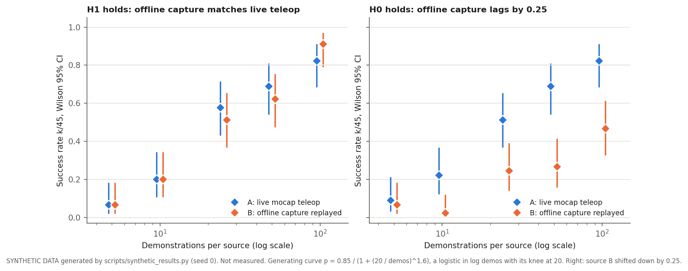

| Scenario | Source | Demos | Success k/n | Wilson 95% CI |
|---|---|---|---|---|
| H1 | A: live mocap teleop | 5 | 3/45 | [0.02, 0.18] |
| H1 | A: live mocap teleop | 10 | 9/45 | [0.11, 0.34] |
| H1 | A: live mocap teleop | 25 | 26/45 | [0.43, 0.71] |
| H1 | A: live mocap teleop | 50 | 31/45 | [0.54, 0.80] |
| H1 | A: live mocap teleop | 100 | 37/45 | [0.69, 0.91] |
| H1 | B: offline capture replayed | 5 | 3/45 | [0.02, 0.18] |
| H1 | B: offline capture replayed | 10 | 9/45 | [0.11, 0.34] |
| H1 | B: offline capture replayed | 25 | 23/45 | [0.37, 0.65] |
| H1 | B: offline capture replayed | 50 | 28/45 | [0.48, 0.75] |
| H1 | B: offline capture replayed | 100 | 41/45 | [0.79, 0.96] |
| H0 | A: live mocap teleop | 5 | 4/45 | [0.04, 0.21] |
| H0 | A: live mocap teleop | 10 | 10/45 | [0.13, 0.36] |
| H0 | A: live mocap teleop | 25 | 23/45 | [0.37, 0.65] |
| H0 | A: live mocap teleop | 50 | 31/45 | [0.54, 0.80] |
| H0 | A: live mocap teleop | 100 | 37/45 | [0.69, 0.91] |
| H0 | B: offline capture replayed | 5 | 3/45 | [0.02, 0.18] |
| H0 | B: offline capture replayed | 10 | 1/45 | [0.00, 0.12] |
| H0 | B: offline capture replayed | 25 | 11/45 | [0.14, 0.39] |
| H0 | B: offline capture replayed | 50 | 12/45 | [0.16, 0.41] |
| H0 | B: offline capture replayed | 100 | 21/45 | [0.33, 0.61] |

Reading (ours): in the H1 world the two sources are inside each other's Wilson intervals at every count and the knee sits at 25; in the H0 world Source B is separated at 25, 50, and 100. The 5 and 10 demonstration points cannot separate the worlds, so the decision rule uses only the three larger counts.

**Manuscript.** "Capture once, demonstrate many: optical motion capture as a demonstration source for humanoid vision-language-action post-training."

## Prioritization

| Experiment | Novelty | Dependence | GPU-hours | Rollouts | Capture sessions | Risk |
|---|---|---|---|---|---|---|
| E5 benchmark and dataset | high | none; enables all others | 90 to 150 | 360 | 3 | low: builds on ZEST and HOLD precedent |
| E1 minutes curve | high | E5 | 105 to 175 | 315 | 1 | low: box skill has the most hardware precedent |
| E6 sweeping and dish rack | high | E5 | 90 to 150 | 270 | 2 | high: no precedent; tool contact may fail |
| E4 reference quality | high | E1 pool | 150 to 250 | 450 | 0 extra | medium: video reconstruction pipeline setup |
| E2 variants factorial | medium | E5 | 120 to 200 | 360 | 2 | low |
| E3 performer count | medium | E5 | 90 to 150 | 270 | 10 short | medium: recruiting 10 performers |
| E7 capture vs teleop for VLA | high | E1 tracker, E5 | unmeasured | 450 | 2 | high: GR00T post-training throughput on one GPU unverified |

Total across all seven: 645 to 1,075 GPU-hours plus E7 post-training, about 2,475 rollouts, and roughly 20 capture sessions (computed from the rows above). At 4.53 USD per GPU-hour that is 2,900 to 4,900 USD of cloud compute excluding E7 (computed).

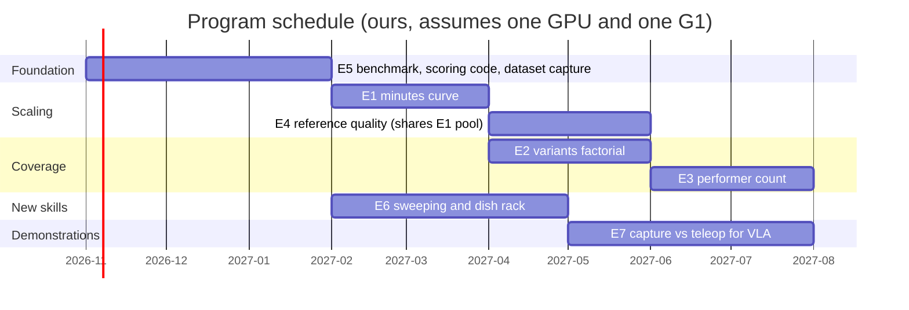

## What every manuscript needs in its methods

- Post-retargeting minutes, clip count, variant count, and discard rate per condition, following the distinction between collected and valid data in Lin et al. (3,840 collected, 3,765 valid; Sec. 4.1) and the OmniClone root-state and joint-energy filter (Appendix A).
- Fixed PPO iterations and hyperparameters across conditions, reported in a table of the HuMBLE S-table form (Tables S4 to S9).
- k/n for every cell, Wilson intervals, the number of policies per cell, and the seed policy.
- Failure modes tabulated by frequency, per the Kress-Gazit et al. checklist (Sec. 4.1, 4.3).
- Session dates, block structure, and cooling intervals.
- Released capture, retargets, logs, and scoring code.

## Open questions before starting

- Per-policy GPU-hours on the lab's GPU: time one full ZEST-style run before fixing any budget above.
- GR00T post-training throughput on one L40S: needed before E7 is scheduled.
- Tool grip hardware for E6: fixed adapter versus learned grasp decides whether E6 is a tracking paper or a manipulation paper.
- Ethics approval and consent for releasing performer capture in E3 and E5.
