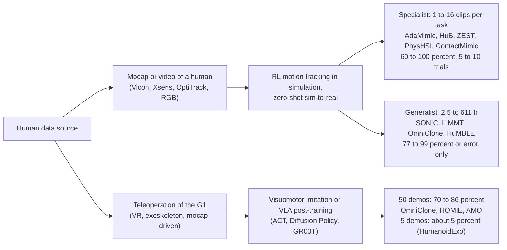
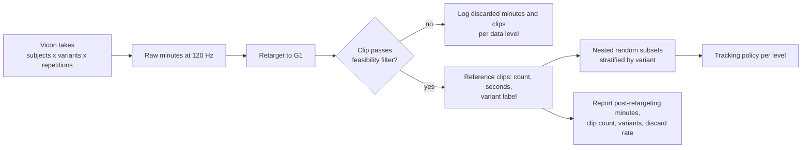
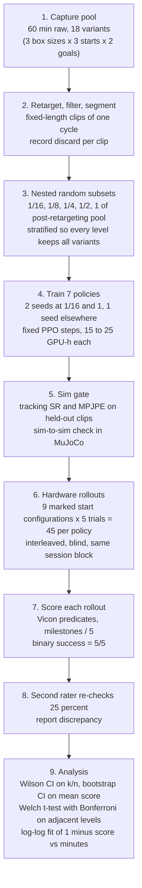
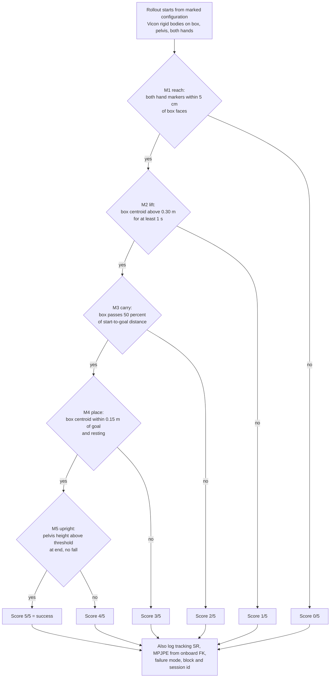

# Reference Clips, Not Minutes, Drive G1 Skills

Across the published record to October 2026, learned policies embodied on a physical Unitree G1 were trained from as little as one human reference clip and as much as 611 hours of retargeted motion capture, and the hardware outcome depends far more on whether the policy is a task specialist or a generalist than on the hours behind it. Specialist reinforcement-learning trackers trained on one to about sixteen clips (seconds to a few minutes of retargeted human motion) reach **60 to 100 percent hardware success** on box carrying, box climbing, balance and contact tasks over 5 to 10 trials; the 611 h generalist [SONIC](https://arxiv.org/abs/2511.07820) tracks **123 of 124 motions** (Fig. 2K); teleoperation-trained manipulation policies on the G1 reach **70 to 86 percent with about 50 demonstrations** and collapse to about 5 percent with 5. For box lifting the literature therefore supports a per-task reference budget of **under five minutes of retargeted Vicon capture** for a specialist tracker and **about three hours of curated capture** for a generalist locomotion-plus-skill prior; sweeping and dish washing have no published autonomous G1 result from any data source. A graph of mocap minutes against normalized task completion cannot be drawn from the literature today: only one hardware study ([LIMMT](https://arxiv.org/abs/2606.06953)) varies motion-data quantity on a G1, with two points and 40 trials each, and every other data-scaling curve is simulation. The lab can produce the first such curve with five nested data levels, seven policies, 315 blind hardware rollouts scored by Vicon-derived milestones, and 105 to 175 GPU-hours on one consumer GPU.

## Hardware-quantified G1 trackers span one clip to 611 hours

The published record contains twenty-two manuscripts that report a numeric hardware metric for a whole-body policy trained from human motion capture or human video and deployed on a physical G1, and eighteen more that show hardware demonstrations without trial counts or on-robot error. The quantified set splits into two clusters whose data budgets differ by five orders of magnitude yet whose hardware success rates overlap.

The specialist cluster trains one policy per motion or per task from a handful of clips. [AdaMimic](https://arxiv.org/abs/2510.14454) uses a single video-reconstructed reference per task and reports **5/6 to 6/6 success** on far jump, high jump, triple jump, tennis hit and badminton hit (Table IV). [HuB](https://arxiv.org/abs/2505.07294) trains on five extreme-balance references and scores **24/25** across its five tasks, with a strict three-condition success definition (no fall, no foot-contact mismatch, tracking error under threshold; Sec. 4.1, Table 2). [KungfuBot](https://arxiv.org/abs/2506.12851) trains thirteen per-motion policies from 158 to 610 reference frames each (Table 4), each costing 27 h on one RTX 4090 (Appendix D.1), and reports ten Tai Chi trials with 36.64 mm body-position error (Table 2). [ZEST](https://arxiv.org/abs/2602.00401) lists its references per motion in seconds (Walk 8.47 s, Jog 7.11 s, Crawl 29.98 s; Table 1), trains each policy for about 10 h on one NVIDIA L4 (Table S7), and achieves **5/5 consecutive box climb-up and climb-down** at a 0.75 m box with every in-distribution start succeeding (Fig. S5). [ContactMimic](https://arxiv.org/abs/2607.08742) trains one policy per HUMOTO clip and reports whiteboard wiping 5/5 and backrest leaning 9/10 to 10/10 (Table 2). [PhysHSI](https://arxiv.org/abs/2510.11072) builds its carry-box policy from eleven AMASS locomotion clips, three AMASS carrying clips and two video-derived clips (Appendix VII-A) and reports **8/10 pick-up and 6/10 full carry** with 0.19 m placement precision over distances to 5.69 m (Table III). [HDMI](https://arxiv.org/abs/2509.16757) learns each task from monocular video (suitcase from one OMOMO reference) and reports 67 consecutive door traversals and 7 consecutive suitcase lifts (Sec. IV). [ULTRA](https://arxiv.org/abs/2603.03279) converts OMOMO human-object mocap into feasible G1 rollouts and scores **19/26** on dense box and suitcase tracking (Table IV).

The generalist cluster trains one policy on tens to hundreds of hours. [SONIC](https://arxiv.org/abs/2511.07820) trains on 611 h, 100 million frames and 317,189 clips after filtering about 700 source hours (Sec. 2.1, Table 2), spends 21k GPU-hours on 128 GPUs (Abstract), and on hardware tracks 123 of 124 motions with 25.7 mm local MPJPE against 22.3 mm in simulation (Fig. 2K to L). [LIMMT](https://arxiv.org/abs/2606.06953) deploys two trackers on the same four motion categories with ten trials each: the full 24,197-clip AMASS set scores **31/40 (0.775)** with 0.1528 rad MPJPE and a curated 10 percent subset scores **34/40 (0.850)** with 0.1287 rad (Table 6, Table 9). [Extreme-RGMT](https://arxiv.org/abs/2607.20110) reports 90.0, 85.0 and 100.0 percent over four motions times five trials for replay, dynamic teleoperation and generalist teleoperation (Table VIII). [Humanoid-GPT](https://arxiv.org/abs/2606.03985) trains on about 2 billion retargeted frames with about 15,000 GPU-hours (Sec. 3, Table 8) and reports only joint error on four unseen dances (0.0856 to 0.1075 rad, Table 3). [OmniClone](https://arxiv.org/abs/2603.14327) trains on 30 h in about 80 GPU-hours on one RTX 4090 (Sec. V) and evaluates the tracker qualitatively through six teleoperators (Sec. VI-A). [BeyondMimic](https://arxiv.org/abs/2508.08241) trains on about 2.5 h, deploys 30 clips totaling 15 min, and repeats one motion three times per MDP variant (Fig. 8A). [HuMBLE](https://arxiv.org/abs/2610.10489) is the only generalist trained on in-house Vicon capture: 528,214 frames, about 3 h, one actor (Sec. S2), with hardware reported as velocity-command error (0.10 m/s, 0.23 rad/s mean absolute; Table S2) rather than success.

Two properties of this record matter for a data-scaling question. First, hardware trial counts are 5 to 30 per motion almost everywhere; SONIC's 124 single-trial motions and HDMI's 67 door runs are the exceptions. A 9/10 result carries a Wilson 95 percent interval of roughly 0.60 to 0.98 (computed), so adjacent points on any curve built from these papers would overlap. Second, success definitions differ across papers: fall-free local tracking (SONIC), contact matching (ContactMimic), task completion judged by mocap (ULTRA, PhysHSI), or the three-condition rule of HuB. The specialist and generalist clusters overlap in success rate while differing by five orders of magnitude in data, which means that hardware success and data scale are confounded by motion difficulty and policy scope (inference).

## Fifty teleoperated demonstrations yield 70 to 86 percent on G1 pick-and-place

The second policy family on the G1 learns autonomous manipulation from teleoperated robot demonstrations rather than from human mocap, and it is the only family with any hardware demonstration-count variation. [OmniClone](https://arxiv.org/abs/2603.14327) post-trains GR00T N1.6 on 50 whole-body demonstrations and reports **18/21 (85.71 percent)** on pick-and-place and 4/5 (80.00 percent) on squat-to-pick-and-place (Table II, Sec. VI-B). [HOMIE](https://arxiv.org/abs/2502.13013) trains a Seer policy on 50 exoskeleton-teleoperated episodes per task and reports 73.3 percent on squat-pick and 80.0 percent on pick-and-place over 15 trials each (Table V). [AMO](https://arxiv.org/abs/2505.03738) trains ACT on 50 episodes per task and scores 8/10, 8/10 and 9/10 on the three stages of paper-bag picking (Table IV). The [hierarchical vision-language planner](https://arxiv.org/abs/2506.22827) reaches 72.5 percent over 40 trials on a two-table bag transfer from 30 demonstration sequences (Sec. IV). [TrajBooster](https://arxiv.org/abs/2509.11839) shows the pretraining lever: 28 episodes (about 10 min) of G1 teleoperation give 100, 70, 70 and 10 percent on four tasks when GR00T N1.5 is first post-pre-trained on 35 h of retargeted Agibot data, and **0 percent on all four** without it at the same 3K training steps (Table II).

[HumanoidExo](https://arxiv.org/abs/2510.03022) is the only G1 study with a demonstration-count comparison on hardware. On PlaceToy with 60 trials per condition, 5 teleoperated demonstrations give about 5 percent, 200 teleoperated demonstrations give about 80 percent, and 5 teleoperated plus 195 wearable-exoskeleton demonstrations also give about 80 percent (Fig. 6); PlaceLaundry repeats the pattern at 80, 80 and 5 percent on seen cloth (Table 1). The exoskeleton reads human arm joints and torso pose, so it is a kinematic capture of the human rather than teleoperation of the robot; this result is the closest existing evidence that human-side capture can substitute for robot demonstrations on a G1 at equal success (inference). At the top of the data range, NVIDIA's GR00T N1.5 reaches 98.8 percent on a four-fruit pick-and-place after 1,000 teleoperated G1 episodes ([GEAR N1.5 page, Table 3](https://research.nvidia.com/labs/gear/gr00t-n1_5/)). At the bottom, [Humanoid Everyday](https://arxiv.org/abs/2510.08807) trains seven policies on about 40 demonstrations per task and reports average success of 29 to 51 percent over ten trials per task, with eraser wiping scoring 0 to 70 percent depending on the policy (Table II).

The only humanoid hardware sweep with three levels is on the Unitree H1, not the G1: [OmniH2O](https://arxiv.org/abs/2406.08858) trains a diffusion policy on 25, 50 and 100 percent of about 40 min of teleoperation data and reports 4/10, 6.5/10 and 8/10 average success, with Squat saturating at 9/10 on 25 percent and Catch-Release still rising at 6/10 on 100 percent (Tables 3 and 17). Outside humanoids, [Lin et al.](https://arxiv.org/abs/2410.18647) collected over 40,000 demonstrations and 15,000 real rollouts on a UMI gripper and found that demonstrations per condition correlate only weakly with performance (r of -0.62 and -0.79) and plateau near **50 demonstrations per environment-object pair**, while the number of distinct environments or objects follows a power law with exponents of -0.47 to -0.84 and Pearson r of 0.94 to 0.99 (Sec. 4.2, Sec. 4.3, Fig. 5, Fig. 7). The G1 results cluster exactly where that recommendation predicts, and the regime between 5 and 50 demonstrations, where success rises from 5 to 80 percent, is unmeasured on the G1 (inference).

## Every quantified data-performance point fits in two tables

The tables below list every (data quantity, performance) pair with a stated trial count or on-robot metric. Hardware rows are separated from simulation rows. Where a paper reports several cells, the rows closest to a scaling comparison are kept. Units are as printed in the source.

**Table 1. Physical Unitree G1 (plus one H1 anchor).**

| Paper | Robot | HW or sim | Data quantity (unit) | Performance metric and value | Trials | Source |
|---|---|---|---|---|---|---|
| [SONIC](https://arxiv.org/abs/2511.07820) | G1, 29 DoF | HW | 611 h, 100M frames, 317,189 clips | 123/124 motions tracked (99.2 percent); MPJPE-L 25.7 mm | 124 (1 each) | Fig. 2K to L, Table 2 |
| [SONIC](https://arxiv.org/abs/2511.07820) | G1 | HW | 611 h tracker plus VLA data | drill-and-box relocation 70 percent | 10 | Table 1 |
| [LIMMT](https://arxiv.org/abs/2606.06953) | G1 | HW | 100 percent AMASS, 24,197 clips | tracked-to-completion 31/40 (0.775); MPJPE 0.1528 rad | 40 (4 x 10) | Table 6, Table 9 |
| [LIMMT](https://arxiv.org/abs/2606.06953) | G1 | HW | GQS-curated 10 percent of AMASS (about 2,420 clips, computed) | 34/40 (0.850); MPJPE 0.1287 rad | 40 (4 x 10) | Table 6 |
| [ExBody2](https://arxiv.org/abs/2412.13196) | G1 | HW | CMU subset, unfiltered vs filtered at threshold 0.15 | MPJPE 0.1361 vs 0.1074 rad | not stated | Table III |
| [HuB](https://arxiv.org/abs/2505.07294) | G1 | HW | 5 reference motions | 4/5, 5/5, 5/5, 5/5, 5/5; Epos-l 27.9 to 38.3 mm | 25 (5 x 5) | Table 2 |
| [AdaMimic](https://arxiv.org/abs/2510.14454) | G1 | HW | 1 clip per task, 5 tasks | easy 29/30; hard 28/30 | 60 (5 x 6 x 2) | Table IV |
| [KungfuBot](https://arxiv.org/abs/2506.12851) | G1 | HW | 1 motion per policy, 158 to 610 frames | Tai Chi Empbpe 36.64 mm real vs 33.18 sim | 10 | Table 2, Table 4 |
| [ZEST](https://arxiv.org/abs/2602.00401) | G1 | HW | per-motion clips of 7 to 30 s | box climb up 5/5, climb down 5/5 | 10 | Table 1, Fig. S5 |
| [ContactMimic](https://arxiv.org/abs/2607.08742) | G1 | HW | 1 HUMOTO clip per motion, 5 motions | wipe whiteboard 5/5; lean 9/10 and 10/10; sit 4/5 | 5 to 10 per motion | Table 2 |
| [PhysHSI](https://arxiv.org/abs/2510.11072) | G1 | HW | carry box: 16 clips (11 + 3 + 2) | pick-up 8/10; full carry 6/10; placement 0.19 m | 10 | Table III, App. VII-A |
| [PhysHSI](https://arxiv.org/abs/2510.11072) | G1 | HW | sit 4, lie 6, stand 2 SAMP clips plus shared locomotion | 9/10, 8/10, 8/10 | 10 each | Table III |
| [HDMI](https://arxiv.org/abs/2509.16757) | G1 | HW | per-task video; suitcase from 1 OMOMO reference | door 67 consecutive runs; suitcase 7 consecutive; bread box 2 | consecutive runs | Sec. IV |
| [ULTRA](https://arxiv.org/abs/2603.03279) | G1 | HW | OMOMO subsets, neural retargeting | dense tracking 19/26; sparse goal 8/10 and 9/10 | 26; 10; 10 | Table IV |
| [Extreme-RGMT](https://arxiv.org/abs/2607.20110) | G1 | HW | LAFAN1 + AMASS + Xsens (hours not stated) | 90.0 / 85.0 / 100.0 percent | 20 per setting | Table VIII |
| [ReactiveBFM](https://arxiv.org/abs/2606.30362) | G1 | HW | 102M frames BFM; 37.14 h planner data | moving-target reaching 9/10 | 10 | Sec. 4.2 |
| [BeyondMimic](https://arxiv.org/abs/2508.08241) | G1 | HW | about 2.5 h; 30 clips (15 min) deployed | 3/3 per MDP variant on one motion; 10 ms delay fails 2/3 | 3 per variant | Fig. 8A |
| [Any2Track](https://arxiv.org/abs/2509.13833) | G1 | HW | LAFAN1 + AMASS (hours not stated) | MPJPE 17.38 mm; 23.24 mm with 5 kg payload | 5 motions | Table VI |
| [Humanoid-GPT](https://arxiv.org/abs/2606.03985) | G1 | HW | about 2B frames | MPJPE 0.0856 to 0.1075 rad on 4 dances | 4 sequences | Table 3 |
| [OmniTrack](https://arxiv.org/abs/2602.23832) | G1 | HW | LAFAN1 2.5 h + about 8 h CMU | DoF error 0.0710 rad real vs 0.0601 sim; 17 consecutive side flips | 6 motions | Table IV, Sec. V |
| [CLONE](https://arxiv.org/abs/2506.08931) | G1 | HW | 149 AMASS + 14 Xsens sequences | mean drift 5.1 cm over 3 to 8.9 m | 30 (3 x 10) | Fig. 4 |
| [ASAP](https://arxiv.org/abs/2502.01143) | G1 | HW | per-task video; 100 real clips + 10 min for delta model | Eg-mpjpe 50.2 mm kick (vanilla 61.2) | 30 executions per task | Table V, Sec. IV-C |
| [HuMBLE](https://arxiv.org/abs/2610.10489) | G1 | HW | about 3 h Vicon, 528,214 frames | velocity MAE 0.10 m/s, 0.23 rad/s | not stated | Table S2 |
| [SMASH](https://arxiv.org/abs/2604.01158) | G1 | HW | 400 mocap clips + 5k generated strikes | 20/20 hits, 18/20 returns; 642 launches 93.7 percent contact | 20; 642 | Table V, Sec. VI-B |
| [OmniClone](https://arxiv.org/abs/2603.14327) | G1 | HW | 50 teleop demos (VLA); tracker on 30 h | 18/21 (85.71 percent); 4/5 (80.00 percent) | 21; 5 | Table II |
| [HOMIE](https://arxiv.org/abs/2502.13013) | G1 | HW | 50 teleop episodes per task | 73.3 percent; 80.0 percent | 15 each | Table V |
| [AMO](https://arxiv.org/abs/2505.03738) | G1 | HW | 50 teleop episodes per task | 8/10, 8/10, 9/10 per stage; 7/10, 10/10 | 10 per stage | Table IV |
| [TrajBooster](https://arxiv.org/abs/2509.11839) | G1 | HW | 28 episodes (about 10 min) + 35 h Agibot pretraining | 100 / 70 / 70 / 10 percent; 0 percent without pretraining | 10 per task | Table II |
| [HumanoidExo](https://arxiv.org/abs/2510.03022) | G1 | HW | 5 teleop / 5 teleop + 195 exo / 200 teleop demos | about 5 / about 80 / about 80 percent | 60 per condition | Fig. 6, Table 1 |
| [Hierarchical VLP](https://arxiv.org/abs/2506.22827) | G1 | HW | 30 demonstration sequences | 72.5 percent full sequence | 40 | Sec. IV |
| [TWIST2](https://arxiv.org/abs/2511.02832) | G1 | HW | 50 demos (Kick-T) | 6/7 | 7 | Sec. IV-C |
| [Humanoid Everyday](https://arxiv.org/abs/2510.08807) | G1 or H1 | HW | about 40 demos per task | average 29 to 51 percent over 7 policies | 10 per task | Table II |
| [GR00T N1.5](https://research.nvidia.com/labs/gear/gr00t-n1_5/) | G1 | HW | 1,000 teleop episodes | 98.8 percent seen fruit; 84.2 percent unseen objects | not stated | GEAR page Table 3 |
| [lambda-0](https://arxiv.org/abs/2610.18950) | G1 | HW | Stage-II human data 0 / 5 / 10 / 25 / 50 / 100 percent of 500 h | task progress 59.9 / 64.2 / 67.3 / 72.1 / 76.4 / 80.4 percent | 40 (Table 1) | Fig. 12, Table 1 |
| [OmniH2O](https://arxiv.org/abs/2406.08858) | H1 (anchor) | HW | 25 / 50 / 100 percent of about 40 min teleop | 4/10, 6.5/10, 8/10 average | 10 per task | Table 3, Table 17 |

**Table 2. Simulation results on the G1 model (plus two non-humanoid anchors).**

| Paper | Robot | HW or sim | Data quantity (unit) | Performance metric and value | Trials | Source |
|---|---|---|---|---|---|---|
| [SONIC](https://arxiv.org/abs/2511.07820) | G1 | Sim | 4M / 10M / 22M / 100M frames (20k / 50k / 110k / 317k clips) | success and MPJPE-L improve monotonically; values only plotted; Welch t-test P at most 0.011 | test-content split | Fig. 2A to C |
| [SONIC](https://arxiv.org/abs/2511.07820) | G1 | Sim | full data; 1.2M vs 42M parameters | 98.0 percent / 27.7 mm vs 99.6 percent / 23.8 mm | test-content split | Sec. 2.1, Fig. 2A to C |
| [Humanoid-GPT](https://arxiv.org/abs/2606.03985) | G1 | Sim | MLP, 2M tokens | SR 76.89 percent; MPJPE 0.1191 rad | AMASS test split | Table 2 |
| [Humanoid-GPT](https://arxiv.org/abs/2606.03985) | G1 | Sim | GPT-S 2M / 20M tokens | SR 83.26 / 86.02 percent | AMASS test split | Table 2 |
| [Humanoid-GPT](https://arxiv.org/abs/2606.03985) | G1 | Sim | GPT-B 200M / 2B tokens; GPT-L 2B | SR 88.27 / 90.43 percent; 92.58 percent | AMASS test split | Table 2 |
| [ExBody2](https://arxiv.org/abs/2412.13196) | G1 | Sim | 50 / 250 / 1,919 CMU clips, eval on 50-clip set | MPJPE 0.0753 / 0.0870 / 0.1099 rad | 50 clips | Table X(a) |
| [ExBody2](https://arxiv.org/abs/2412.13196) | G1 | Sim | 50 / 250 / 1,919 clips, eval on ACCAD (OOD) | MPJPE 0.1720 / 0.1421 / 0.1780 rad | ACCAD set | Table X(c) |
| [OmniTrack](https://arxiv.org/abs/2602.23832) | G1 | Sim | 1/8, 1/2, full LAFAN1, raw references | success 95.1 to 88.2 percent as data grows; MPJPE up 10.1 mm | LAFAN1 | Fig. 4 |
| [OmniTrack](https://arxiv.org/abs/2602.23832) | G1 | Sim | same levels, physically plausible references | success near 92.6 percent at all levels | LAFAN1 | Fig. 4 |
| [LIMMT](https://arxiv.org/abs/2606.06953) | G1 | Sim | GQS 3 percent vs random 3 percent vs 100 percent of AMASS | GQS 95.6 (Any2Track) and 86.1 (TWIST2) percent; random 83.8 and 64.9; 10 seeds | test set | Fig. 2, Sec. 4.2 |
| [SMASH](https://arxiv.org/abs/2604.01158) | G1 | Sim | 64 / 200 / 400 strike clips | score 73.61 / 76.86 / 76.55 | three seeds (plus-minus shown) | Table IV |
| [SMASH](https://arxiv.org/abs/2604.01158) | G1 | Sim | 400 clips + 2k / 5k / 10k generated | 82.32 / 86.38 / 85.88 | as above | Table IV |
| [HiPHI](https://arxiv.org/abs/2608.16222) | G1 | Sim | 3 to 300 h unmirrored HiPHI | cross-dataset MPJPE falls monotonically; values only plotted | four test sets | Fig. 7 |
| [EGM](https://arxiv.org/abs/2512.19043) | G1, 23 DoF | Sim | 4.08 h vs 27.47 h (10,393 motions) | compared on a 49.25 h test set; 4.08 h set is the paper's headline configuration | 13,596 motions | Table 2 |
| [SCHUR](https://arxiv.org/abs/2511.09241) | G1 | Sim | 20 percent vs 100 percent of a 260 h corpus | tokenizer MPJPE 0.0483 vs 0.0326; tracker success 0.762 / 0.774 / 0.907 by data filter | not stated | Tables I to III |
| [PhysHSI](https://arxiv.org/abs/2510.11072) | G1 | Sim | 16 clips | carry-box success 81.34 percent | not stated | Table I |
| [GR00T N1](https://arxiv.org/abs/2503.14734) | GR-1 (anchor) | Sim | 30 / 100 / 300 demos per task | 43.2 / 50.0 / 49.3 percent (Diffusion Policy 21.3 / 32.7 / 40.4) | 100 per point | Table 4 |
| [Lin et al.](https://arxiv.org/abs/2410.18647) | UMI gripper (anchor) | HW | 1 to 32 objects or environments, 50 to 120 demos each | 1 minus normalized score = beta times X to the power alpha, alpha -0.47 to -0.84, r 0.94 to 0.99; demos per pair plateau at 50 | 40 per policy | Fig. 5, Fig. 7 |

**Figure 1. Every G1 hardware point with a trial count, plotted against the data unit each paper used.** Panel A: reinforcement-learning motion trackers against reference clip count. Panel B: teleoperation-trained imitation and vision-language-action policies against demonstrations per task. Panel C: the only humanoid points with a minutes axis ([OmniH2O](https://arxiv.org/abs/2406.08858), Unitree H1, Table 3) and the five data levels proposed in the experiment section. Bars are Wilson 95 percent intervals on k/n (computed). Sources are the table rows above. Generated by [scripts/plot_data_vs_success.py](../scripts/plot_data_vs_success.py).

## Box lifting needs clips, not sessions; sweeping and dishes have no precedent

The question of how many Vicon minutes a household task needs has a different answer for each of the three tasks named, and for box lifting the answer is smaller than a single capture session. Every mocap-trained box skill on G1 hardware was built from one to sixteen reference clips: PhysHSI's 16 clips for carry (Appendix VII-A), HDMI's single OMOMO suitcase reference (Sec. IV), ULTRA's OMOMO box and suitcase subsets (Fig. 2), and ZEST's single box-climb clips whose sibling motions run 7 to 30 s each (Table 1). [ResMimic](https://arxiv.org/abs/2510.05070) captured its kneel, carry, squat and chair references with OptiTrack and lifted a 4.5 kg box against a stated G1 wrist payload limit of about 2.5 kg (Sec. IV-A1, Sec. IV-C), without a success count. Taking ZEST's clip lengths as representative, sixteen clips amount to two to eight minutes of retargeted reference, so the published per-task requirement for a specialist box policy is **under five minutes of post-retargeting motion** (inference from clip counts and ZEST Table 1 durations; PhysHSI and ULTRA do not report clip lengths). The hardware outcome at that budget was 60 to 100 percent on 5 to 26 trials.

The only released Vicon dataset with G1 retargets, [HOLD](https://github.com/rai-opensource/hold), shows what one lab's capture of exactly this task class looks like: one performer, 552 trajectories (276 plus mirrors), 576.6 min at 120 Hz, covering lifting, carrying and pushing boxes, climbing boxes and sitting, with G1-retargeted motions in `data/g1`. HuMBLE's companion locomotion set is about 3 h (Sec. S2). Several generalist trackers that transfer to hardware converge near the same figure: BeyondMimic about 2.5 h, [RGMT](https://arxiv.org/abs/2601.23080) about 3.5 h (Sec. IV), OmniTrack 2.5 h of LAFAN1 plus about 8 h of CMU (Sec. IV), and EGM's 4.08 h in simulation (Table 2). Hours in the low single digits are therefore the practical floor for a curated generalist G1 prior, and a single task needs far less (inference). What a Vicon session should buy is not minutes of the same lift repeated but coverage of variants, since Lin et al. show that distinct conditions, not repetitions, govern generalization (Sec. 4.3, Fig. 7), and PhysHSI's 6/10 full-carry rate with boxes of varied dimensions and weights (Table III) is the only hardware number for a box policy tested across object variation.

Sweeping has no learned-policy precedent on any humanoid. The nearest motions are ContactMimic's whiteboard wiping at 5/5 from one HUMOTO clip (Table 2), Humanoid Everyday's eraser-wipe task at 0 to 70 percent across seven policies trained on about 40 teleoperated demonstrations (Table II), and Unitree's released [G1_Dex1_Wipe_Table](https://huggingface.co/datasets/unitreerobotics/G1_Dex1_Wipe_Table) dataset of 930 episodes (3.18 h at 30 fps, computed from the LeRobot metadata) with no published success rate. Dish washing is in the same state: Unitree's whole-body teleoperation datasets [Take_Plates_Into_Dishwasher](https://huggingface.co/datasets/unitreerobotics/G1_WBT_Inspire_Take_Plates_Into_Dishwasher) (300 episodes, 3.53 h) and its siblings at 200 to 374 episodes each exist as data, and no manuscript reports an autonomous G1 dishwasher or dish-washing result. For these two tasks the lab would establish the first baseline, and the only transferable quantitative guidance is the 50-demonstration cluster for teleoperation-based imitation and the one-to-sixteen-clip range for mocap-driven tracking of a contact motion (inference).

## The literature cannot yet draw the mocap-minutes versus completion curve

A plot with mocap minutes on the horizontal axis and normalized task completion on the vertical axis has, for G1 hardware, four usable points from two studies, and neither study used minutes as its unit. LIMMT gives two points at 10 and 100 percent of AMASS with 40 trials each, and the slope is negative: 0.850 at 10 percent versus 0.775 at 100 percent (Table 6). HumanoidExo gives three points at 5, 200 and 5 plus 195 demonstrations on a behavior-cloning policy with 60 trials each (Fig. 6). ExBody2 adds a filtered-versus-unfiltered hardware comparison in joint error without trial counts (Table III), and the H1 result of OmniH2O at 25, 50 and 100 percent of 40 min (Table 3) is the only humanoid point set whose horizontal axis can be converted to minutes (about 10, 20 and 40 min, computed). Everything else that varies data quantity does so in simulation: SONIC (Fig. 2A), Humanoid-GPT (Table 2), ExBody2 (Table X), OmniTrack (Fig. 4), LIMMT (Fig. 2), HiPHI (Fig. 7), SMASH (Table IV), EGM (Table 2) and SCHUR (Tables I to III). Those simulation curves disagree in sign: SONIC, Humanoid-GPT and HiPHI report monotone gains at the 10 to 2,000 h scale, while LIMMT, OmniTrack and ExBody2 report that a curated 3 to 13 percent subset matches or beats the full set and that raw, physically inconsistent clips lower success from 95.1 to 88.2 percent (OmniTrack Fig. 4). The two groups are consistent with data quality being the binding variable at the 1 to 30 h scale and capacity-limited saturation above that (inference); no paper tests both axes on hardware.

The horizontal axis for RL motion tracking is clips rather than minutes because a clip is the unit the training loop samples. SONIC counts 317,189 clips (Table 2), [Beyond Retargeting](https://arxiv.org/abs/2610.07891) counts 14,147 training and 4,073 testing clips (Sec. V), LIMMT counts 24,197 clips (Table 9), and ZEST lists each motion's duration in seconds (Table 1). A ten-minute take of one lift repeated and ten one-minute takes of ten variants contain the same minutes but differ tenfold in clips and in variants, and LIMMT's hardware result shows that which clips are kept moves success by 7.5 points in the opposite direction to count (Table 6). Minutes become a valid axis only when clip length and the variant distribution are held fixed across data levels, in which case minutes are proportional to clip count and the curve measures coverage within a fixed distribution; the lab must state which it did (inference). A second mismatch sits on the vertical axis. Every tracking paper reports success as finishing the clip without falling or exceeding a pelvis or key-body threshold (Beyond Retargeting's 0.25 m pelvis-height rule, Table I; HuB's three conditions, Sec. 4.1) plus kinematic error, never task completion. A normalized completion score requires a predicate layer on top, which published work provides in four forms: Lin et al.'s per-step 0 to 3 rubric normalized by 3 times the step count (Sec. 3), the [TRI Large Behavior Models](https://arxiv.org/abs/2507.05331) milestone checklist scored as milestones met divided by total (Sec. 4.1.2), the [BEHAVIOR](https://arxiv.org/abs/2108.03332) Q-score as the fraction of satisfied goal predicates, and Diffusion Policy's geometric coverage thresholds ([Sec. 6.1 and 6.3](https://arxiv.org/abs/2303.04137)). A Vicon lab can compute the predicate form automatically from rigid bodies on the object and the robot, which no G1 paper has done.

What the lab must run itself is therefore a controlled sweep in which data quantity is the only variable, with a fixed task, fixed policy class, fixed training compute, nested random subsets, a fixed variant distribution, blind interleaved hardware evaluation and a predicate-based completion score. No published study holds all of those constant on a humanoid.

## A 315-rollout, 175-GPU-hour protocol produces the first hardware curve

The design below is inferred from the cited budgets and evaluation norms; no paper prescribes it directly. It targets box lift-carry-place because that task has the most hardware precedent (PhysHSI Table III, ULTRA Table IV, ZEST Fig. S5, HOLD), and the same template transfers to wiping or dish racking by changing the predicate list.

The capture pool is one Vicon session of about 60 min of raw box lift-carry-place across a fixed grid of 18 variants, for example three box sizes, three start placements and two goal placements, at roughly three minutes per variant with several repetitions each. HOLD's 576.6 min from one performer shows this volume is routine, and HuMBLE's protocol of splitting turns into separate takes to fit the volume (Sec. S2) is the template. After retargeting and feasibility filtering, the post-retargeting pool will be smaller; OmniClone filters on root state and joint energy (Appendix A) and Lin et al. lost 75 of 3,840 demonstrations to SLAM filtering (Sec. 4.1), so a 10 to 25 percent loss is plausible (inference). With a post-retargeting pool of 45 min segmented into 12 s clips, one lift-carry-place cycle in the range of ZEST's 7 to 30 s motions (Table 1), the pool holds 225 clips, and the five nested levels hold 14, 28, 56, 112 and 225 clips at 2.8, 5.6, 11.3, 22.5 and 45 min (computed). Stratifying by variant means every level keeps all 18 variants where clip counts permit, so minutes and clips scale together and the variant distribution is constant; this is the condition under which minutes is a legitimate axis. Five levels spaced by factors of two follow Lin et al., who used six levels and judged a three-parameter fit with an irreducible term unjustified at that count (footnote 1).

The training budget is seven tracking policies on one GPU. Per-policy cost is bracketed by ZEST's about 10 h on an L4 per behavior (Table S7), KungfuBot's 27 h on an RTX 4090 per motion (Appendix D.1) and OmniClone's 60 h teacher for a 30 h corpus on an RTX 4090 (Sec. V); for a pool under one hour, 15 to 25 GPU-hours per policy is the working estimate, and the lab should time one full run before committing (inference). Seven policies at 15 to 25 GPU-hours is **105 to 175 GPU-hours**, or 4.4 to 7.3 days of wall clock on one GPU (computed). Two seeds go to the smallest and largest levels because the slope of a five-point curve is decided by its endpoints; Diffusion Policy's three-seed protocol (Sec. 5.2) and the LBM paper's admission that its intervals omit training randomness (Sec. 3) show why some replication is needed. PPO iteration count is held fixed across levels so that compute is not a confound, mirroring Lin et al.'s epoch scaling to equalize gradient steps (Appendix C). Each policy passes a simulation gate of tracking success and MPJPE on held-out clips plus a MuJoCo sim-to-sim check before hardware, as in ULTRA (Sec. V) and OmniTrack (Table II).

Hardware evaluation is 45 rollouts per policy, nine start configurations marked in the Vicon frame times five trials, for **315 rollouts** in total. This matches Lin et al.'s 40 blind rollouts (Sec. 4.1) and the LBM paper's 50 per condition (Sec. 3) and exceeds every G1 paper's per-condition count except HumanoidExo's 60. Policies are interleaved so the operator is blind to the data level, all policies are evaluated in the same session block, and start configurations are reproduced from marked positions, following [Kress-Gazit et al.](https://arxiv.org/abs/2409.09491), whose Example 2 shows a policy dropping from 13/20 to 0/8 after a lab reorganization (Sec. 2.2 to 2.3). At about two minutes per rollout including reset, 315 rollouts occupy about 10.5 robot-hours (computed). [TWIST](https://arxiv.org/abs/2505.02833) reports G1 motors overheating after 5 to 10 min of holding a box (Sec. 4.1), so trials run in blocks of five with cooling intervals, and the block schedule is logged.

The score is a five-milestone checklist evaluated from Vicon rigid bodies on the box, pelvis and hands: reach, lift, carry, place and upright. Normalized completion is milestones met divided by five, in the LBM form (Sec. 4.1.2), and binary success is 5/5. The placement tolerance of 0.15 m sits at PhysHSI's reported 0.19 m placement precision (Table III) and can be tightened once the baseline is known. A second rater re-checks 25 percent of rollouts from video, as the LBM paper did for about 27 percent of nearly 2,700 rollouts with 2.31 percent success-rate discrepancy (Sec. 4.1.3). Every rollout also logs tracking success under the fall criterion and MPJPE from onboard forward kinematics, so the result can be compared with both the tracking and the manipulation literature.

The statistics follow [Brown, Cai and DasGupta](https://projecteuclid.org/euclid.ss/1009213286), who recommend the Wilson or Jeffreys interval for small n and reject the Wald interval. At 36/45 (0.80 observed), the Wilson 95 percent interval is 0.662 to 0.891 (computed), so binary success at 45 trials separates two levels only when their true rates differ by about 0.3; the two-sample comparison of 0.6 against 0.8 at 80 percent power needs about 81 trials per policy by normal approximation and 90 by Fisher's exact test (computed). Binary success is therefore the secondary panel. The primary panel is the mean normalized score with a percentile bootstrap 95 percent interval over the 45 rollouts (10,000 resamples), adjacent levels compared by Welch's t-test with Bonferroni correction over the four adjacent pairs (alpha 0.0125), which is the LBM paper's procedure for continuous completion scores (Sec. 4.1.5). The curve is fit as 1 minus mean score equals beta times minutes to the power alpha by linear regression in log-log space with Pearson r reported, as in Lin et al. (Sec. 4.2), with two parameters only. Each point is reported as k/n with its clip count, variant count, post-retargeting minutes and discard rate, and failure modes are tabulated by frequency, following the Kress-Gazit et al. checklist (Sec. 4.1, 4.3).

| Design parameter | Value | Basis |
|---|---|---|
| Task | box lift-carry-place, 18 variants | PhysHSI Table III, ULTRA Table IV, HOLD |
| Raw capture | about 60 min, one session | HOLD 576.6 min one performer |
| Post-retargeting pool (example) | 45 min, 225 clips of 12 s | ZEST Table 1 clip lengths; computed |
| Data levels | 1/16, 1/8, 1/4, 1/2, 1 (2.8, 5.6, 11.3, 22.5, 45 min; 14, 28, 56, 112, 225 clips) | Lin et al. App. C nesting; computed |
| Policies | 7 (seeds 2, 1, 1, 1, 2) | Diffusion Policy Sec. 5.2; LBM Sec. 3 |
| GPU-hours | 7 x 15 to 25 = 105 to 175 (4.4 to 7.3 days on one GPU) | ZEST Table S7; KungfuBot App. D.1; OmniClone Sec. V |
| Rollouts | 9 starts x 5 trials = 45 per policy; 315 total; about 10.5 robot-hours | Lin et al. Sec. 4.1; LBM Sec. 3; computed |
| Score | 5 Vicon milestones / 5; success = 5/5 | LBM Sec. 4.1.2; BEHAVIOR Q-score |
| Intervals | Wilson on k/n; bootstrap on mean score; Welch with Bonferroni | Brown et al. 2001; LBM Sec. 4.1.5 |
| Fit | 1 minus score = beta x minutes^alpha, log-log, Pearson r | Lin et al. Sec. 4.2 |
| Re-check | 25 percent of rollouts by second rater | LBM Sec. 4.1.3 |

## Conclusion

The G1 literature has already answered the coarse version of the question: a few clips of retargeted human motion suffice for a specialist box skill at 60 to 100 percent hardware success, about three hours of curated capture suffice for a generalist prior, and about fifty teleoperated demonstrations suffice for 80 percent on a quasi-static pick-and-place. What it has not answered is the shape of anything between those anchors, because every study varies method, policy class and motion set together with data, measures hardware success in 5 to 10 trials, and reports tracking survival rather than task completion. The one hardware sweep that exists on a G1 slopes the wrong way for a naive minutes axis, and the simulation curves split on sign according to how the data was curated. The lab's experiment is therefore not a replication but a first measurement, and its value depends on holding the variant distribution and clip length fixed so that minutes mean coverage, and on scoring completion from Vicon predicates so that the vertical axis is a task outcome rather than a fall criterion.

At 45 rollouts per level the binary success panel will only separate levels differing by 0.3, so the graded score carries the result, and seeds at the endpoints are the only guard against reading training noise as slope. If the curve flattens at the second or third level, as the clip-count evidence predicts, the finding is that one short Vicon session per task is already past the knee and that the next experiments should vary variants, objects and subjects rather than minutes; if it keeps rising to the full pool, box lifting on the G1 is in a data-limited regime that no published tracker has probed at this scale.
