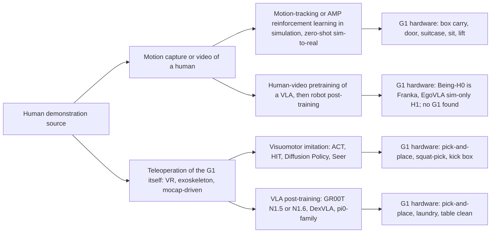
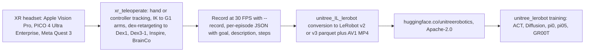

# Unitree G1 manipulation and loco-manipulation learned from human demonstrations (2024 to October 2026)

Scope: manuscripts in which a physical Unitree G1 (any hand: Dex1 gripper, Dex3-1, Inspire, BrainCo) autonomously executed manipulation or loco-manipulation using a policy learned from human demonstrations (motion capture, mocap-driven teleoperation, egocentric video, VR or exoskeleton teleoperation), plus released G1 demonstration datasets. Simulation-only results are labeled. Every arXiv identifier below was checked against the live abstract page on 2026-10-25 unless stated otherwise. Local PDFs in `manuscripts/` were used for OmniClone, HuMBLE, Beyond Retargeting and ZEST.

How the catalog separates the three policy families that appear on the G1:

## Key question 1: Which papers show autonomous G1 task execution learned from human demonstrations, with how many demonstrations and what success rate?

### Takeaway
Nine manuscripts report physical G1 autonomy from human-derived data. Teleoperation-based imitation on the G1 uses 28 to 200 demonstrations per task and reports 70 to 100 percent success on 10 to 60 trials of pick-and-place-class tasks (AMO, HOMIE, OmniClone, TrajBooster, HumanoidExo, Hierarchical VLP, TWIST2). Motion-capture or video-driven RL tracking (HDMI, PhysHSI, ResMimic) reaches box carrying and door traversal on the G1 with 2 to 16 reference clips per task but reports consecutive-run counts or 10-trial success rates rather than demonstration-count ablations. Only two papers vary the number of demonstrations on hardware (HumanoidExo, Humanoid Policy ~ Human Policy, the latter on H1 not G1).

### Cited Findings

#### Catalog entries (one per paper)

**1. AMO: Adaptive Motion Optimization for Hyper-Dexterous Humanoid Whole-Body Control**
- arXiv 2505.03738, submitted 2025-05-06, UC San Diego. [abs](https://arxiv.org/abs/2505.03738)
- Robot: 29-DoF Unitree G1 (abstract). [abs](https://arxiv.org/abs/2505.03738)
- Demonstration source: VR teleoperation through the paper's goal-conditioned whole-body teleop system; image and pose streaming via OpenTelevision (Appendix C); the headset model is not named for these experiments. [html](https://arxiv.org/html/2505.03738)
- Demonstrations: 50 episodes per task for Paper Bag Picking and Trash Bottle Throwing (Fig. 6 caption). Basket Picking count not stated. [html](https://arxiv.org/html/2505.03738)
- Policy class: ACT with DINOv2 visual encoder; chunk size 120 or 60; stereo vs mono input (Sec. IV-C). [html](https://arxiv.org/html/2505.03738)
- Hardware trials and success (Table IV, 10 trials per stage): Paper Bag Picking, stereo chunk 120: picking 8/10, moving 8/10, placing 9/10; mono chunk 120: 9/10, 7/10, 10/10; stereo chunk 60: 7/10, 7/10, 6/10. Trash Bottle Throwing, stereo chunk 120: picking 7/10, placing 10/10; mono chunk 120: 4/10, 10/10; stereo chunk 60: 5/10, 10/10. Success is scored per stage; no end-to-end success definition is given. [html](https://arxiv.org/html/2505.03738)
- Demo-count ablation: none. Basket Picking (long horizon) shown as a single rollout (Fig. 7). [html](https://arxiv.org/html/2505.03738)

**2. HOMIE: Humanoid Loco-Manipulation with Isomorphic Exoskeleton Cockpit**
- arXiv 2502.13013, v1 2025-02-18, v2 2025-04-28, Shanghai AI Laboratory and CUHK MMLab. [abs](https://arxiv.org/abs/2502.13013)
- Robot: Unitree G1 main platform, Fourier GR-1 for generality (Sec. IV-A2); real-world dexterous hand model not named. [html](https://arxiv.org/html/2502.13013)
- Demonstration source: isomorphic 7-DoF exoskeleton arms (DYNAMIXEL XL330-M288-T), Hall-sensor gloves up to 15 DoF, foot pedal for locomotion; hardware cost about 500 USD (Table III: exoskeleton 430 USD, gloves 30 USD each, pedal 20 USD). [html](https://arxiv.org/html/2502.13013)
- Demonstrations: 50 teleoperated episodes per task at 10 Hz (Sec. IV-D). [html](https://arxiv.org/html/2502.13013)
- Policy class: Seer (autoregressive transformer with MAE-pretrained ViT), not ACT (Sec. IV-D). [html](https://arxiv.org/html/2502.13013)
- Hardware trials and success (Table V, 15 trials per task): Squat Pick (tomato from low sofa) 73.3 percent; Pick and Place (tomato) 80.0 percent. Success definition not stated. [html](https://arxiv.org/html/2502.13013)
- Demo-count ablation: none found.

**3. OmniClone: Engineering a Robust, All-Rounder Whole-Body Humanoid Teleoperation System**
- arXiv 2603.14327, submitted 2026-03-15. Institutions (local PDF page 1): Beijing Institute of Technology, BIGAI, Peking University, University of Hong Kong, Tsinghua IIIS, State Key Lab of General AI, PKU-Wuhan Institute for AI. [abs](https://arxiv.org/abs/2603.14327)
- Robot: Unitree G1-Comp with 2-DoF actuated head and RealSense D455; 29 DoF body plus 12-DoF Inspire hands recorded as proprioceptive state (Appendix A and C-B, local PDF). [abs](https://arxiv.org/abs/2603.14327)
- Demonstration source: whole-body teleoperation driven by PICO VR headsets or optical MoCap systems, retargeted on an external PC (Appendix A "Deployment architecture"). The tracking policy itself is trained on about 30 hours of motion data derived in part from the TWIST2 corpus expanded from 23 to 29 DoF, about 60 percent standing manipulation (Appendix "Training dataset"). [abs](https://arxiv.org/abs/2603.14327)
- Demonstrations for autonomy: 50 full-body demonstrations (Sec. VI-B, Table II). [abs](https://arxiv.org/abs/2603.14327)
- Policy class: GR00T N1.6 VLA post-trained on four A100 GPUs, about 20k steps, batch 384, learning rate 1e-4, frozen VLM backbone; 16-step action chunks with 4 denoising steps, first 8 actions executed; OmniClone tracking policy as low-level controller (Appendix C-B). [abs](https://arxiv.org/abs/2603.14327)
- Hardware trials and success (Table II): Pick-and-Place (lift a tomato, place into basket) 21 trials, 85.71 percent; Squat to Pick-and-Place 5 trials, 80.00 percent. Success definition not stated beyond "generalizing to minor variations in object position". [abs](https://arxiv.org/abs/2603.14327)
- Demo-count ablation: none; the data-recipe ablation (Sec. V) concerns the tracking policy training set, not the VLA demonstrations. [abs](https://arxiv.org/abs/2603.14327)

**4. TrajBooster: Boosting Humanoid Whole-Body Manipulation via Trajectory-Centric Learning**
- arXiv 2509.11839, v1 2025-09-15, v2 2025-09-17; Westlake University, Shanghai Innovation Institute, Zhejiang University, Shanghai Jiao Tong University. [abs](https://arxiv.org/abs/2509.11839)
- Robot: Unitree G1 with Unitree Dex-3 7-DoF hands (Sec. IV-B). [html](https://arxiv.org/html/2509.11839v2)
- Demonstration source: Apple Vision Pro upper-body teleoperation following Open-TeleVision, joystick for locomotion; two wrist RGB cameras and one head RGB camera (Sec. III-D). Source data for post-pre-training: Agibot-World Beta, 176 tasks, 1,960 episodes, about 35 hours, retargeted to the G1 in simulation (Sec. IV-B). [html](https://arxiv.org/html/2509.11839v2)
- Demonstrations on the G1: 28 episodes across four table heights, about 10 minutes (Sec. IV-B, Fig. 6). [html](https://arxiv.org/html/2509.11839v2)
- Policy class: GR00T N1.5 VLA, post-pre-trained then post-trained (Sec. III-C, III-D). [html](https://arxiv.org/html/2509.11839v2)
- Hardware trials and success (Table II, 10 trials per task, 3K post-training steps with post-pre-training): Pick Mickey Mouse (39 cm) 100 percent; Store Toys (55 cm) 70 percent; Clean the Table (55 cm) 70 percent; Pick Orange and Place (76 cm) 10 percent plus 50 percent partial. Without post-pre-training at 3K steps all tasks 0 percent; at 10K steps 80, 30 (plus 30 partial), 70, 0 (plus 30 partial) percent. Partial success: toys on box edge; orange grasped but not placed. Unseen placement (Table III): 80 percent with post-pre-training vs 0 percent without. [html](https://arxiv.org/html/2509.11839v2)
- Demo-count ablation: none on target-robot data; the ablation is post-pre-training on/off and training steps. [html](https://arxiv.org/html/2509.11839v2)

**5. HumanoidExo: Scalable Whole-Body Humanoid Manipulation via Wearable Exoskeleton**
- arXiv 2510.03022, October 2025; National University of Defense Technology and Midea Group. [html](https://arxiv.org/html/2510.03022v1)
- Robot: Unitree G1, 1.3 m, 29 body DoF, two Inspire hands (12 DoF each, 6 active), RealSense D455 head camera, two wrist fisheye cameras (Sec. 3.5). [html](https://arxiv.org/html/2510.03022v1)
- Demonstration source: wearable exoskeleton (NuExo design) reading seven arm joints plus two glenohumeral DoF, elbow motor, forearm IMU, Dexmo force-feedback glove, Mid-360 LiDAR on the back with FAST-LIO odometry for torso pose (Sec. 3.2 to 3.3, Fig. 2). Plus a small number of robot teleoperation demonstrations. [html](https://arxiv.org/html/2510.03022v1)
- Tasks (Sec. 4.1, Fig. 5): PlaceToy (tabletop pick-and-place into a tray), Walk and PlaceToy, PlaceLaundry (squat, take clothes from basket, put into washing machine, stand). [html](https://arxiv.org/html/2510.03022v1)
- Policy class: HE-VLA built on DexVLA, with an RL actor-critic lower-body controller taking base velocity, yaw rate and torso height commands (Sec. 3.4); fine-tuned 50k iterations, batch 128, LR 2e-5 (Sec. 4.1). [html](https://arxiv.org/html/2510.03022v1)
- Hardware trials and success: PlaceToy, 60 trials per experiment (Fig. 6 caption): 5 teleop demos about 5 percent; 5 teleop plus 195 exoskeleton demos about 80 percent; 200 teleop demos comparable to the mixed setting (exact value only in Fig. 6). PlaceLaundry (Table 1): seen cloth 80 / 80 / 5 percent for 200 teleop / 5 teleop plus 195 exo / 5 teleop; unseen cloth 80 / 75 / 5 percent; trial count not stated. Walk and PlaceToy: walking 100 percent of trials, overall success "matched" the stationary experiment, no number. Success criteria not defined. [html](https://arxiv.org/html/2510.03022v1)
- Demo-count ablation: yes, the 5 / 5 plus 195 / 200 comparison above is the paper's central result. [html](https://arxiv.org/html/2510.03022v1)

**6. Hierarchical Vision-Language Planning for Multi-Step Humanoid Manipulation**
- arXiv 2506.22827, MIT and EPFL (Schakkal, Zandonati, Yang, Azizan). [html](https://arxiv.org/html/2506.22827v1)
- Robot: 29-DoF Unitree G1; hand model not specified. [html](https://arxiv.org/html/2506.22827v1)
- Demonstration source: RGB-based teleoperation, human pose from a single RGB camera with HybrIK retargeted to the G1 (Sec. III-B1). [html](https://arxiv.org/html/2506.22827v1)
- Demonstrations: 30 successful sequences split into pick and place datasets (Sec. III-B2). [html](https://arxiv.org/html/2506.22827v1)
- Policy class: Humanoid Imitation Transformer (HIT), ACT-based, 50-step chunks at 25 Hz (Sec. III-B2, Table V). [html](https://arxiv.org/html/2506.22827v1)
- Hardware trials and success: full sequence (pick bag from one table, place on second table) 72.5 percent over 40 trials (abstract, Sec. IV-C/D); per-skill pick 90 percent and place 83.3 percent over 30 trials each (Sec. III-B2). Success: bag picked up and placed on the designated surface (Sec. IV-C). [html](https://arxiv.org/html/2506.22827v1)
- Demo-count ablation: none.

**7. TWIST2: Scalable, Portable, and Holistic Humanoid Data Collection System**
- arXiv 2511.02832, submitted 2025-11-04; Amazon FAR, Stanford, USC, UC Berkeley, CMU. [abs](https://arxiv.org/abs/2511.02832v1)
- Robot: Unitree G1 29 DoF with two 7-DoF Dex31 hands, custom 2-DoF neck (about 250 USD) with ZED Mini stereo camera (about 400 USD) (Sec. III-B). [html](https://arxiv.org/html/2511.02832v1)
- Demonstration source: PICO 4U headset plus two PICO Motion Trackers on the calves, mocap-free whole-body teleoperation (Sec. III-C). [html](https://arxiv.org/html/2511.02832v1)
- Collection throughput (Table II): 98 bimanual pick-and-place episodes in 18.5 min (100 percent success, 11 s per episode); 46 mobile pick-and-place episodes in 19.5 min (100 percent, 25 s per episode). The abstract's "100 demonstrations in 15 minutes" and the introduction's "about 100 in 20 minutes" are inconsistent with Table II. [html](https://arxiv.org/html/2511.02832v1)
- Policy class: Diffusion Policy with 1D temporal convolution, ResNet-18 (R3M pretrained), 64-step action chunks (Sec. III-G). [html](https://arxiv.org/html/2511.02832v1)
- Demonstrations and hardware results (Sec. IV-C): WB-Dex whole-body dexterous pick-and-place, 170 demonstrations, successes and failures shown in Fig. 14 with no numeric rate; Kick-T (kick T-shaped box to target), 50 demonstrations, 6 of 7 hardware trials, success defined as box transported to the target. [html](https://arxiv.org/html/2511.02832v1)
- Demo-count ablation: none.

**8. HDMI: Learning Interactive Humanoid Whole-Body Control from Human Videos**
- arXiv 2509.16757, v1 2025-09-20, v3 2025-09-27; Robotics Institute, Carnegie Mellon University. [abs](https://arxiv.org/abs/2509.16757)
- Robot: Unitree G1; no dexterous hands; contacts are hand pushes and foot kicks (Sec. IV). [html](https://arxiv.org/html/2509.16757)
- Demonstration source: unconstrained monocular RGB human videos, pose via GVHMR, retargeting via LocoMuJoCo (Sec. III-A); the suitcase reference is retargeted from OMOMO mocap, not video (Sec. IV). Number of videos per task not reported. [html](https://arxiv.org/html/2509.16757)
- Policy class: RL policy tracking robot and object states jointly (unified object representation, residual action space, general interaction reward), deployed zero-shot. [abs](https://arxiv.org/abs/2509.16757)
- Hardware results (Sec. IV, Fig. 4 to 5): door open and traversal 67 consecutive runs (about 34 min) before failure with random 10 to 30 cm start offsets; suitcase (kneel, lift, walk) 7 consecutive successes; bread box carrying 2 full trials with occasional leg collisions on the 180 degree turn; foam mat relocation qualitative; "Truman's Bow" stair/bow/sit/wave/jump sequence completed 3 times continuously with occasional light back support. The abstract says 6 real-world tasks; Sec. IV lists five. No success-rate percentages or success definitions. [html](https://arxiv.org/html/2509.16757)
- Data-quantity ablation: none (ablations cover reward, termination, residual action space). [html](https://arxiv.org/html/2509.16757)

**9. PhysHSI: Towards a Real-World Generalizable and Natural Humanoid-Scene Interaction System**
- arXiv 2510.11072, submitted 2025-10-13; Shanghai AI Laboratory and HKUST. [abs](https://arxiv.org/abs/2510.11072)
- Robot: Unitree G1 (Sec. I, IV-C). [html](https://arxiv.org/html/2510.11072)
- Demonstration source: SMPL motions from AMASS and SAMP retargeted by optimization with manually annotated contact frames (Sec. III-A). Clip counts (Appendix VII-A): Carry Box 11 AMASS locomotion plus 3 AMASS carrying plus 2 GVHMR video sequences; Sit Down shared locomotion plus 4 SAMP; Lie Down plus 6 SAMP; Stand Up plus 2 SAMP. No self-captured mocap for training; mocap used only for localization ground truth (Sec. VI-B). Total minutes not reported. [html](https://arxiv.org/html/2510.11072)
- Policy class: AMP-based RL with PPO, asymmetric actor-critic (Sec. III-B); coarse-to-fine LiDAR plus camera object localization for deployment. [abs](https://arxiv.org/abs/2510.11072)
- Hardware trials and success (Table III, 10 trials per task): Carry Box 8/10 pick-up and 6/10 full sequence, placement error 0.19 m, 10.5 plus or minus 2.8 s; Sit Down 9/10; Lie Down 8/10; Stand Up 8/10. Real-world success criteria not stated; simulation criteria (Sec. VII-D2): box within 0.1 m of target; base within 0.1 m for sit/lie. [html](https://arxiv.org/html/2510.11072)
- Demo-count ablation: none; the tracking baseline uses about 2 to 5 trajectories per task (Sec. V-A). [html](https://arxiv.org/html/2510.11072)

**10. ResMimic: From General Motion Tracking to Humanoid Whole-body Loco-Manipulation via Residual Learning**
- arXiv 2510.05070; USC, Amazon FAR, Stanford, UC Berkeley, CMU. [abs](https://arxiv.org/abs/2510.05070)
- Robot: Unitree G1, 29 DoF, 1.3 m (Sec. IV). [html](https://arxiv.org/html/2510.05070v1)
- Demonstration source: task reference motions captured with an OptiTrack motion capture system (Sec. IV-A1); the base GMT policy is trained on AMASS plus OMOMO, over 15,000 clips, about 42 hours (Sec. III-B1). Per-task clip counts not given. [html](https://arxiv.org/html/2510.05070v1)
- Tasks (Sec. IV-A1): Kneel (one knee, lift box), Carry (box onto back), Squat (lift box with arms and torso), Chair (lift heavy irregular chair). Real objects: 4.5 kg box against a G1 wrist payload limit of about 2.5 kg; chairs of 4.5 kg and 5.5 kg (Sec. IV-C). [html](https://arxiv.org/html/2510.05070v1)
- Policy class: residual RL policy on top of a GMT tracking policy, point-cloud object tracking reward, contact reward, curriculum virtual object controller. [abs](https://arxiv.org/abs/2510.05070)
- Hardware results: qualitative (Fig. 6, Sec. IV-C); Fig. 4(a) shows 11 lifting trials from random initial poses with no success count; success defined only in simulation (object tracking error below threshold and balance maintained; Table I sim-to-sim). [html](https://arxiv.org/html/2510.05070v1)
- Demo-count ablation: none.

#### Candidates checked that do NOT show autonomous G1 manipulation learned from demonstrations
- **CLONE** (arXiv 2506.08931, v1 2025-06-10, v2 2025-08-30; BIT, BIGAI, PKU, BIGAI and UniTree joint lab): Unitree G1 teleoperation via Apple Vision Pro head and wrist tracking; MoE tracking policy trained on retargeted AMASS plus 14 Xsens-captured sequences (Sec. 3.4; Appendix D.3 says 345 motions, inconsistent). No autonomous policy learned from teleop data; real-world results are tracking errors (mean 5.1 cm over 3 to 8.9 m straight paths, 10 repeats each; 20 cm mean over a 10 m curved path, 6 trials). The "picking up objects from the ground" claim is supported only in simulation (App. D.3). [abs](https://arxiv.org/abs/2506.08931), [html](https://arxiv.org/html/2506.08931)
- **Humanoid Policy ~ Human Policy** (arXiv 2503.13441, v1 2025-03-17, v3 2025-10-05; UC San Diego, CMU, UW, Apple, MIT): hardware is Unitree H1 with 6-DoF Inspire hands and H1_2, not G1. Human data: PH2D egocentric dataset collected with Apple Vision Pro or Meta Quest 3 plus ZED Mini. Robot data: about 250 to 400 teleop demos per task checkpoint (Sec. 4); horizontal grasping used only 50 teleop samples (Appendix C). Policy: HAT (ACT architecture with unified human-centric state-action space). Table 2 (in-distribution / out-of-distribution): ACT 42/60 and 59/170; HAT with human data and normalization 49/60 and 101/170. Demo-count ablations: Fig. 5 (few-shot Humanoid B demos), Fig. 6 (60 vs 30 robot demos vs 120 human demos at 20 minutes collection), Table 5 (collection time: grasping 3.79 s human vs 19.72 s teleop). Relevant as the only hardware demo-count scaling study among the candidates, but not on G1. [abs](https://arxiv.org/abs/2503.13441), [html](https://arxiv.org/html/2503.13441)
- **Being-H0** (arXiv 2507.15597, 2025-07-21; Peking University, Renmin University, BeingBeyond): post-training robot is a 7-DoF Franka Research 3 with a 6-DoF Inspire hand, Gello exoskeleton teleop, 50 to 100 trajectories per task, 20 trials per task (Sec. 6.1.3). No Unitree G1. [abs](https://arxiv.org/abs/2507.15597), [html](https://arxiv.org/html/2507.15597)
- **EgoVLA** (arXiv 2507.12440, v1 2025-07-16, v3 2025-07-18; MIT, NVIDIA, UC San Diego, UIUC): simulation only (Isaac Lab, simulated Unitree H1 with Inspire hands, "not designed for direct sim-to-real transfer", Sec. 4). 100 teleop demos per task via OpenTelevision and Meta Quest 3; pretraining on HOI4D, HOT3D (833 min), HoloAssist (166 h, 1/10 sampled), TACO (2,317 sequences), about 500k image-action pairs at 3 FPS. Table 1 short-horizon seen: EgoVLA 77.78 percent, no-pretrain 64.55 percent, ACT 24.87 percent. Demo ablation: halving robot demos drops long-horizon seen success from 45.93 to 7.41 percent (Table 2). Zero-shot without robot post-training: 0 percent. [abs](https://arxiv.org/abs/2507.12440), [html](https://arxiv.org/html/2507.12440)
- **GR00T N1** (arXiv 2503.14734, v1 2025-03-18, v2 2025-03-27; NVIDIA): real-robot results are on the Fourier GR-1 only. [abs](https://arxiv.org/abs/2503.14734). The Isaac-GR00T repository later added `UNITREE_G1` and `UNITREE_G1_SONIC` embodiment tags and an end-to-end collect-finetune-deploy workflow for the GEAR-SONIC whole-body controller (GR00T N1.7), with no reported real-robot success rates. [github](https://github.com/NVIDIA/Isaac-GR00T)
- **iDP3** (arXiv 2410.10803, v1 2024-10-14, v3 2025-09-09, IROS 2025): 25-DoF humanoid on a height-adjustable cart with 3D LiDAR, more than 2,000 rollouts; the abstract does not name the robot and no G1 is mentioned. The project's known platform is the Fourier GR1 (not verified on the abstract page). [abs](https://arxiv.org/abs/2410.10803)
- **FALCON** (arXiv 2505.06776, v1 2025-05-10, v2 2025-11-16): RL in simulation with force curricula; payload transport 0 to 20 N, cart pulling 0 to 100 N, door opening 0 to 40 N; no human demonstrations, robot platform not named on the abstract page. [abs](https://arxiv.org/abs/2505.06776)
- **VisualMimic** (arXiv 2509.20322, Stanford): Unitree G1 with RealSense D435i; low-level tracker trained on AMASS and OMOMO retargeted with GMR; high-level task policies are RL in simulation distilled to depth (PPO teacher, DAgger student), explicitly "without requiring paired human-object motion data" (Sec. I). Tasks: Lift Box (0.5 kg to 1 m), Kick Ball, Kick Box, Push Box (3.8 kg, robot-height). No trial counts or success rates on hardware. Human data enters only through the tracker prior. [abs](https://arxiv.org/abs/2509.20322v2), [html](https://arxiv.org/html/2509.20322v1)
- **DreamControl** (arXiv 2509.14353, v2 2025-09-21; General Robotics, UC Berkeley, Brown): G1 (sim with Dex3-1 hands, real with Inspire hands); diffusion prior OmniControl trained on HumanML3D; RL in IsaacLab; real tasks Pick, Bimanual Pick, Press Button, Open Drawer, Precise Punch, Squat (Sec. IV-D); no hardware trial counts or success rates; success rates only in simulation (Table II, 1000 environments). [html](https://arxiv.org/html/2509.14353v2)
- **LeVERB** (arXiv 2506.13751, v3 September 2025; Berkeley, CMU, NTNU, SFU): synthetic data pipeline, 58.5 percent average success in simulation across LeVERB-Bench, qualitative generalization on a Unitree G1; no human demonstrations. [abs](https://arxiv.org/abs/2506.13751v3)
- **VideoMimic** (arXiv 2505.03729, v1 2025-05-06, v5 2025-08-29): real-to-sim-to-real from casual human videos; tasks are stairs and sitting/standing, not manipulation; robot not named on the abstract page. [abs](https://arxiv.org/abs/2505.03729)
- **HuBE** (arXiv 2508.19002, 2025-08-26): human-like upper-body behavior generation evaluated on unnamed "multiple commercial platforms"; no manipulation from demonstrations, no G1 named on the abstract page. [abs](https://arxiv.org/abs/2508.19002)
- **TeleOpBench** (arXiv 2505.12748, v1 2025-05-19, v2 2025-09-15; Shanghai AI Laboratory): simulator-centric benchmark with 30 tasks and four teleop modalities (MoCap, VR, exoskeleton, monocular vision); hardware validation on a physical dual-arm platform; no learned autonomous policy. [abs](https://arxiv.org/abs/2505.12748v2)
- **OpenWBT** (GALBOT and Tsinghua): Apple Vision Pro plus joystick whole-body teleoperation for Unitree G1 (H1 release pending), tied to R2S2 (arXiv 2505.10918); no datasets or autonomous results. [github](https://github.com/GalaxyGeneralRobotics/OpenWBT)
- **MimicKit** (arXiv 2510.13794): RL motion-imitation framework (DeepMimic, AMP and related) with Unitree G1 configs and a GMR conversion tool; a codebase, not a manipulation result. [html](https://arxiv.org/html/2510.13794v4)
- **WholeBodyVLA** (arXiv 2512.11047, ICLR 2026): runs on AgiBot X2, not G1. [abs](https://arxiv.org/abs/2512.11047v2)
- **Beyond Retargeting** (arXiv 2610.07891, 2026-10-06): retargeting-free teleoperation policy on a Unitree G1 driven by VR, optical mocap, text-to-motion and monocular video; results are latency and tracking success rate of the teleoperation policy, no autonomous task policy (local PDF, abstract and Sec. V-C). [abs](https://arxiv.org/abs/2610.07891)
- **HuMBLE** (arXiv 2610.10489, 2026-10-07; RAI Institute, Boston Dynamics, CMU) and **ZEST** (arXiv 2602.00401, 2026-01-30; RAI Institute, Boston Dynamics): Vicon-captured human motion drives locomotion and athletic skills on Atlas and Unitree G1; HuMBLE uses about three hours of Vicon locomotion data (local PDF, "Methods" and dataset paragraph); no manipulation. [HuMBLE abs](https://arxiv.org/abs/2610.10489), [ZEST abs](https://arxiv.org/abs/2602.00401)

### Inferences
- Teleoperation-based imitation on the G1 clusters at 50 demonstrations per task (AMO, HOMIE, OmniClone, TWIST2 Kick-T) with success rates of 70 to 86 percent on 7 to 21 trials; the only paper that pushes to 200 demonstrations (HumanoidExo) reports about 80 percent on 60 trials, and its 5-demonstration condition collapses to about 5 percent. Inference: on the G1, the regime between 5 and 50 demonstrations is where success rises steeply and is almost unmeasured on hardware.
- Motion-capture-driven RL (PhysHSI, ResMimic, HDMI) needs an order of magnitude fewer reference clips (2 to 16 per task) than visuomotor imitation needs demonstrations, but every such paper reports consecutive runs or 10-trial counts without a success definition, so the numbers are not comparable with the imitation-learning tables.
- The HumanoidExo result (5 teleop plus 195 wearable-exoskeleton demos matching 200 teleop demos) is the closest existing evidence that human-side capture can replace robot teleoperation on a G1 at equal success; its exoskeleton is a kinematic arm capture, functionally similar to mocap of the arms.

### Gaps
- No paper reports a hardware success-rate curve versus number of demonstrations on a G1 beyond HumanoidExo's three-point comparison (5, 5 plus 195, 200).
- PlaceLaundry and Walk and PlaceToy trial counts in HumanoidExo are not stated.
- OmniClone's Squat to Pick-and-Place rests on 5 trials; TWIST2 Kick-T on 7.
- The headset model for AMO's imitation-learning data collection is not stated.
- Hand model is not stated for HOMIE and Hierarchical VLP hardware runs.
- GR00T N1.5 or N1.6 real-G1 success rates are not published by NVIDIA; the only G1 VLA numbers come from third parties (OmniClone, TrajBooster, Humanoid Everyday).

## Key question 2: Which tasks closest to sweeping with a broom, lifting and carrying a box, and washing dishes have been demonstrated on a G1, and with what data quantities?

### Takeaway
Box lifting and carrying on a G1 is well covered by mocap- or video-driven RL (PhysHSI 6/10 full carry from 16 reference clips; HDMI bread box 2 trials from video; ResMimic 4.5 kg box from OptiTrack clips; TWIST2 teleop lifting a box from the ground) but not by visuomotor imitation with reported demo counts. Table wiping and eraser wiping (the closest sweeping analogue) appear only as released datasets (Unitree G1_Dex1_Wipe_Table, 930 episodes, 3.2 h) and one Humanoid Everyday evaluation task (0 to 70 percent across policies, about 40 demos). Dishwasher loading exists only as Unitree whole-body teleoperation datasets (200 to 374 episodes per task) with no published autonomous success rate; no broom sweeping on a G1 was found.

### Cited Findings

Box lifting and carrying:
- PhysHSI Carry Box on G1: 8/10 pick-up, 6/10 full sequence, 0.19 m placement error, from 11 AMASS locomotion plus 3 AMASS carrying plus 2 video-derived clips; AMP RL. [html](https://arxiv.org/html/2510.11072)
- HDMI bread box carrying on G1: 2 full trials from monocular human video; suitcase kneel-lift-walk 7 consecutive successes from an OMOMO reference. [html](https://arxiv.org/html/2509.16757)
- ResMimic: G1 lifts and carries a 4.5 kg box (kneel, back carry, squat variants) and 4.5 to 5.5 kg chairs from OptiTrack-captured references; 11 random-pose lifting trials shown without a success count. [html](https://arxiv.org/html/2510.05070v1)
- VisualMimic: G1 Lift Box 0.5 kg to 1 m and Push Box 3.8 kg; RL in simulation on top of an AMASS plus OMOMO tracker; no trial counts. [html](https://arxiv.org/html/2509.20322v1)
- TWIST2 data collection covers mobile pick-and-place (46 episodes in 19.5 min) and transporting through a door and picking a brick from the ground; the project page lists these as dataset tasks, not autonomous results. [html](https://arxiv.org/html/2511.02832v1), [project](https://yanjieze.com/projects/TWIST2/)
- HOLD (Vicon human data, RAI Institute and Boston Dynamics): lifting, carrying and pushing boxes, climbing boxes, sitting on a chair; 552 trajectories (276 plus mirrors), 576.6 min, 120 Hz, with G1-retargeted motions in `data/g1`. [github](https://github.com/rai-opensource/hold)
- HuMBLE: about three hours of Vicon locomotion data; locomotion only. [abs](https://arxiv.org/abs/2610.10489)

Wiping and sweeping analogues:
- Humanoid Everyday "Use eraser to wipe the desk" (Tool Use category), about 40 demonstrations per task (Sec. III-C), 10 trials per policy (Table II): DP 0 percent, DP3 70 percent, ACT 0 percent, OpenVLA 30 percent, pi0-FAST 40 percent, pi0.5 40 percent, GR00T N1.5 0 percent. Robot for this task not disambiguated between G1 (Dex3-1) and H1 (Inspire). [html](https://arxiv.org/html/2510.08807)
- Unitree datasets: G1_Dex1_Wipe_Table 930 episodes, 343,060 frames, 3.18 h; G1_Dex1_Wipe_Board 1,180 episodes, 6.37 h; G1_Dex1_Erase_Board 200 episodes, 1.18 h; G1_Dex1_DualRobot_Clean_Table 200 episodes; G1_WBT_Inspire_Clean_The_Living_Room 300 episodes, 2.60 h; G1_WBT_Brainco_Clean_Tea_Table_Garbage 74 episodes (LeRobot `meta/info.json` of each repository under https://huggingface.co/unitreerobotics, read 2026-10-25; hours computed as frames divided by 30 fps). [Wipe_Table card](https://huggingface.co/datasets/unitreerobotics/G1_Dex1_Wipe_Table)
- TrajBooster "Clean the Table" on G1 with Dex-3: 70 percent over 10 trials from 28 total teleop episodes (about 10 min) across four tasks plus Agibot post-pre-training. [html](https://arxiv.org/html/2509.11839v2)
- No source found for a G1 sweeping with a broom from a learned policy; the only G1 chore claims found were vendor demos (UnifoLM tidying and dishwasher loading "under test conditions") with no paper. [search summary of Unitree UnifoLM coverage](https://www.yicaiglobal.com/news/chinas-unitree-open-sources-world-model-to-advance-robotics-ecosystem)

Dish handling and washing:
- Unitree whole-body teleoperation datasets: G1_WBT_Inspire_Take_Plates_Into_Dishwasher 300 episodes, 380,913 frames, 3.53 h, 4 cameras 640x480, Apache-2.0; G1_WBT_Brainco_Collect_Plates_Into_Dishwasher 300 episodes, 3.95 h; G1_WBT_Inspire_Walk_To_Table_Put_Cups_And_Rack_Plates_In_Dishwasher 374 episodes, 5.12 h; G1_WBT_Brainco_Walk_To_Table_Put_Cups_And_Rack_Plates_In_Dishwasher 200 episodes, 3.37 h; G1_WBT_Inspire_Put_Plate_Into_Dishwasher and G1_WBT_Brainco_Put_Plate_Into_Dishwasher 200 episodes each; G1_Dex1_ArrangePlates 1,069 episodes, 6.33 h; G1_Dex1_StackBowls 979 episodes, 2.74 h; G1_Dex1_Squeeze_Dish_Soap 300 episodes, 0.73 h; G1_Dex1_Tableware_Storage 500 episodes, 2.24 h. [Take_Plates card](https://huggingface.co/datasets/unitreerobotics/G1_WBT_Inspire_Take_Plates_Into_Dishwasher)
- Pouring on G1: Unitree G1_Dex3_Pouring_Dataset 311 episodes, 1.13 h; G1_Dex1_Pour_Drink 850 episodes, 9.29 h; G1_Dex1_Pour_From_Bottle 300 episodes. [Pouring parquet tree](https://huggingface.co/datasets/unitreerobotics/G1_Dex3_Pouring_Dataset/tree/refs%2Fconvert%2Fparquet/default/train)
- OmniClone shows "Serving Tea" without spillage and "Transporting Coffee Beans" as teleoperated (not autonomous) behaviors (Sec. VI-A, Fig. 7). [abs](https://arxiv.org/abs/2603.14327)
- Door and cart class: HDMI door traversal 67 consecutive runs on G1 from video; Humanoid Everyday "Walk to grab door handle" 0 to 30 percent across policies; Unitree G1_WBT_Inspire_Push_Wheelchair 200 episodes, 1.49 h. [HDMI html](https://arxiv.org/html/2509.16757), [HE html](https://arxiv.org/html/2510.08807)

### Inferences
- The box-carrying results on G1 come from mocap or video references plus RL, not from teleop imitation. Inference: for a Vicon pipeline, box carrying is the task with the most direct precedent (PhysHSI and ResMimic both start from retargeted human-object mocap), and the published reference-data requirement is in the range of a few clips to tens of clips per task.
- Wiping tasks are the best-documented proxy for sweeping: the same lateral tool-contact motion, with between 200 and 1,180 teleoperated episodes released per task by Unitree but no public success rates. Inference: a sweeping policy would have to establish its own baseline.
- Dishwasher loading has 200 to 374 released whole-body teleop episodes per variant but zero published autonomous evaluations, so the data exists while the result does not.

### Gaps
- No manuscript found with autonomous broom sweeping on any humanoid using learned policies; Boston Dynamics Atlas sweeping demos are not G1 and not papers.
- No autonomous dishwasher-loading success rate on a G1 was found.
- Humanoid Everyday does not state which robot (G1 or H1) performed each Table II task.
- Unitree dataset cards do not state the teleoperation device for the WBT (whole-body) series; the Dex3 cards link avp_teleoperate (Apple Vision Pro), and xr_teleoperate lists Apple Vision Pro, PICO 4 Ultra Enterprise and Meta Quest 3 as supported devices, but the mapping from device to dataset is not published.

## Key question 3: Which released G1 datasets exist, what is their size, and how were they collected?

### Takeaway
Unitree's Hugging Face organization holds 191 G1 dataset repositories (185 real-robot with readable LeRobot metadata, 3 simulation), totaling 82,845 episodes and about 545 hours at 30 fps, split into Dex1 gripper tabletop tasks (108 datasets, 65,154 episodes, 370 h), whole-body teleoperation household tasks (56 datasets, 12,941 episodes, 136 h), Dex3 (13 datasets, 3,152 episodes, 24 h) and BrainCo (8 datasets, 1,598 episodes, 15 h). Humanoid Everyday adds 4,064 G1 episodes (16.5 h) collected with Apple Vision Pro, NVIDIA adds 1,000 G1 fruit pick-and-place episodes, and HOLD is the only Vicon-captured human dataset with G1 retargets (552 trajectories, 9.6 h, boxes and chair).

### Cited Findings

Collection pipeline shared by the Unitree releases (as documented by Unitree's tools):

- xr_teleoperate supports Apple Vision Pro, PICO 4 Ultra Enterprise and Meta Quest 3; robots G1 (29 and 23 DoF), H1, H1_2, H2, R1; end effectors Dex1-1, Dex3-1, Inspire (dfx and ftp), BrainCo; recording at a default 30 FPS with per-task JSON (goal, description, steps); locomotion by R3 controller or joysticks; output consumed by unitree_IL_lerobot. [github](https://github.com/unitreerobotics/xr_teleoperate)
- unitree_lerobot supports ACT, Diffusion, Pi0, Pi05 and GR00T training and real-robot evaluation for G1 with Dex1 and Dex3; its README points to avp_teleoperate for data recording and lists no success rates. [github](https://github.com/unitreerobotics/unitree_lerobot)
- Unitree Hugging Face organization: 205 dataset repositories on 2026-10-25, 191 with "G1" in the name; non-G1 entries are Z1 arm and R1 datasets, RoboCupFootball, model and USD assets (Hugging Face API `/api/datasets?author=unitreerobotics`). [org](https://huggingface.co/unitreerobotics)
- Per-group totals from each repository's `meta/info.json` (total_episodes, total_frames, fps; hours = frames / fps / 3600), read 2026-10-25: Dex1 108 datasets, 65,154 episodes, 370.4 h; WBT 56 datasets, 12,941 episodes, 135.6 h; Dex3 13 datasets, 3,152 episodes, 24.0 h; Brainco 8 datasets, 1,598 episodes, 15.3 h; simulation (Dex1 Isaac Lab) 3 datasets, 624 episodes, 7.5 h; three `_MainCamOnly` WBT repositories return 404 for `meta/info.json`. [org](https://huggingface.co/unitreerobotics)
- Representative Unitree G1 datasets (episodes, hours): G1_Dex3_ToastedBread_Dataset 418 ep, 3.26 h, bread into toaster then hand toast to a human, 20 to 40 s per episode, 28-dim state (14 arm plus 14 hand joints), 4 cameras 640x480 AV1, Apache-2.0, links avp_teleoperate; G1_Dex3_BlockStacking 301 ep; G1_Dex3_Pouring 311 ep, 1.13 h; G1_Dex3_ObjectPlacement 210 ep; G1_Dex3_CameraPackaging 201 ep; eight G1_Dex3_Pick* datasets about 200 ep each; G1_Dex1_Assembling_Motor 1,770 ep, 26.8 h (largest); G1_Dex1_Hang_Pants 1,400 ep, 13.3 h; G1_Dex1_ToolboxStorage 1,064 ep, 11.1 h; G1_Dex1_StorePaddle 1,047 ep, 9.9 h; G1_Dex1_Pour_Drink 850 ep, 9.3 h; G1_Dex1_Wipe_Table 930 ep, 3.2 h, 8 camera streams (head stereo raw and rectified, wrist color, wrist IR), gripper range 5.5 open to 0.0 closed, LeRobot v3.0, part of the UnifoLM_G1_Dex1_Dataset collection. [ToastedBread card](https://huggingface.co/datasets/unitreerobotics/G1_Dex3_ToastedBread_Dataset), [Wipe_Table card](https://huggingface.co/datasets/unitreerobotics/G1_Dex1_Wipe_Table)
- Unitree WBT (whole-body teleoperation) series, each 200 to 400 episodes, state and action covering root pose, 29 joints and both end-effectors, 4 cameras 640x480, Apache-2.0, LeRobot format: Take_Plates_Into_Dishwasher (Inspire, 300 ep, 3.53 h), Collect_Plates_Into_Dishwasher (BrainCo, 300 ep, 3.95 h), Put_Clothes_into_Washing_Machine (Inspire 300 ep, 4.50 h; Dex1 154 ep; BrainCo 200 ep), Laundry_Basket_Washer (BrainCo, 300 ep, 6.29 h), Plastic_Box_Parts (BrainCo 400 ep, 8.04 h; Inspire 200 ep, 6.97 h), Push_Wheelchair (Inspire, 200 ep, 1.49 h), Make_The_Bed, Pickup_Pillow, Put_Drinks_Into_Fridge, Sort_Fruit, Supermarket_Shelf_Organizing, Clean_The_Living_Room, Tidy_Living_Room_Slippers, Hang_Up_Clothes, Adjust_Sickbed (BrainCo). Collection device not stated on the cards. [Take_Plates card](https://huggingface.co/datasets/unitreerobotics/G1_WBT_Inspire_Take_Plates_Into_Dishwasher)
- NVIDIA PhysicalAI-Robotics-GR00T-Teleop-G1: 1,000 upper-body teleoperation trajectories on a Unitree G1 with Unitree tri-finger hands and the default RealSense camera; task is to pick the fruit named in the prompt (apple, pear, starfruit, grapes) and place it on a plate or basket (the card is inconsistent); 20 fps 640x480 RGB, 43-dim joint state and action, MP4 plus HDF5, about 400 MB, CC BY 4.0, created 2025-06-01; teleop device not named; links a GR00T N1.5 finetuning guide, no success rates. [card](https://huggingface.co/datasets/nvidia/PhysicalAI-Robotics-GR00T-Teleop-G1/blob/main/README.md)
- Humanoid Everyday (arXiv 2510.08807, v1 2025-10-09, v2 2026-06-17, v3 2026-07-04; USC and Toyota Research Institute): 10.3k trajectories, over 3 million frames, 260 tasks, 7 categories, about 40 episodes per task, 30 Hz; robots Unitree G1 (29 DoF) with 7-DoF Dex3-1 tactile hands and Unitree H1 (27 DoF) with 6-DoF Inspire hands; RealSense RGB-D and Livox LiDAR; teleoperation with Apple Vision Pro (wrist and finger keypoints, dex-retargeting, Pinocchio IK) (Sec. III-A, III-C). [abs](https://arxiv.org/abs/2510.08807), [html](https://arxiv.org/html/2510.08807)
- Humanoid Everyday Hugging Face releases (read 2026-10-25): USC-PSI-Lab/Humanoid-Everyday-G1, 4,064 episodes, 1,779,287 frames, 30 fps, robot_type g1 (16.5 h computed), last modified 2025-11-27, no license field; USC-PSI-Lab/Humanoid-Everyday-H1, 4,885 episodes, 1,659,786 frames (15.4 h); USC-PSI-Lab/humanoid-everyday (mixed), 8,949 episodes, 3,436,171 frames (31.8 h), Apache-2.0, last modified 2026-06-02. [G1 repo](https://huggingface.co/datasets/USC-PSI-Lab/Humanoid-Everyday-G1), [H1 repo](https://huggingface.co/datasets/USC-PSI-Lab/Humanoid-Everyday-H1), [mixed repo](https://huggingface.co/datasets/USC-PSI-Lab/humanoid-everyday)
- Humanoid Everyday policy benchmark (Table II, 10 trials per task, about 40 demos per task), average success: DP 29 percent, DP3 34 percent, ACT 34 percent, OpenVLA 39 percent, pi0-FAST 37 percent, pi0.5 36 percent, GR00T N1.5 51 percent. Per task for GR00T N1.5: rotate chair 100, eraser wipe 0, dumpling toy into plate 80, fold towel 50, hand over dumpling toy 100, walk to door handle 30, insert rose 0 percent. [html](https://arxiv.org/html/2510.08807)
- TWIST2 "TWIST Data" whole-body loco-manipulation dataset: bimanual and mobile dexterous pick-and-place, towel folding, cloth finding and folding, soccer kick, basketball, door transport, brick pick-up from the ground, circling; hosted via twist-data.github.io; episode count and hours not stated on the paper or project page. Table II collection sessions: 98 bimanual and 46 mobile pick-and-place episodes. [project](https://yanjieze.com/projects/TWIST2/), [html](https://arxiv.org/html/2511.02832v1)
- OmniClone states that "the complete pipeline for autonomous data collection and task execution will be publicly released" (Appendix C-B); no dataset link in the PDF. [abs](https://arxiv.org/abs/2603.14327)
- HOLD (Humanoid Omniskill Loco-manipulation Dataset, RAI Institute with Boston Dynamics): one human performer, Vicon optical motion capture, 552 trajectories (276 originals plus mirrors), 4,053,854 frames at 120 Hz, 576.6 minutes; locomotion (shuffle, walk, sidestep, turn, jog, sprint) and human-object interaction (lift, carry, push boxes, climb boxes, sit on chair); BVH, 80 percent scaled data, and G1-retargeted motions in `data/g1`; CC-BY-4.0; associated paper HuMBLE (arXiv 2610.10489). [github](https://github.com/rai-opensource/hold)
- Other Vicon or mocap humanoid data: HuMBLE uses an in-house Vicon locomotion dataset of about three hours (local PDF, dataset paragraph and Methods). [abs](https://arxiv.org/abs/2610.10489). ResMimic captured task references with OptiTrack (Sec. IV-A1). [html](https://arxiv.org/html/2510.05070v1). CLONE added 14 Xsens-captured sequences to AMASS (Sec. 3.4). [html](https://arxiv.org/html/2506.08931). No Vicon-captured household-task dataset for the G1 was found; community G1 retargets on Hugging Face (LAFAN1 retargets, exptech/g1-moves 60 clips via markerless MOVIN TRACIN, datamentors G1 movement dataset 63 episodes) are motion-only. [LAFAN1 retarget](https://huggingface.co/datasets/justin0428/LAFAN1_Retargeting_Dataset)
- Related Unitree tooling without datasets: OpenWBT (GALBOT and Tsinghua, Apple Vision Pro plus joysticks, G1) has no recording pipeline. [github](https://github.com/GalaxyGeneralRobotics/OpenWBT). UnifoLM-WMA-0 (Unitree world-model-action framework) code released September 2025 under CC BY-NC-SA 4.0; the Unitree Dex1 datasets on Hugging Face are grouped in a "UnifoLM_G1_Dex1_Dataset" collection. [news](https://www.yicaiglobal.com/news/chinas-unitree-open-sources-world-model-to-advance-robotics-ecosystem), [Wipe_Table card](https://huggingface.co/datasets/unitreerobotics/G1_Dex1_Wipe_Table)

### Inferences
- Unitree's 545 hours across 185 real G1 datasets is roughly 17 times the Humanoid Everyday G1 split (16.5 h) and about 55 times the OmniClone tracking-policy corpus (30 h of motion), but it is organized as 200 to 1,770 episodes per single task, so per-task scale (1 to 27 h) is the relevant comparison for a new task.
- Every released G1 manipulation dataset was collected by XR teleoperation (Apple Vision Pro or PICO class devices) rather than by optical mocap; HOLD is the only Vicon dataset with G1 retargets and it contains human motion only, no robot observations. Inference: a Vicon-captured household-task dataset with G1 retargets and camera observations has no public precedent.
- The Dex3 series is the smallest group (24 h) and the WBT series is the only one that includes locomotion in the episode; dishwasher, laundry and wheelchair tasks exist only in WBT form.

### Gaps
- Unitree dataset cards do not state the teleoperation device, operator count or success filtering; hours above are computed from frame counts, not stated by Unitree.
- Three Unitree `_MainCamOnly` repositories had no readable `meta/info.json` on 2026-10-25.
- TWIST2's released dataset size (episodes, hours) is not published on the paper or project page; the Hugging Face repository name was not found by search (only third-party `*twist2*` uploads exist).
- Humanoid Everyday hours are not stated by the authors; the 16.5 h and 15.4 h figures are computed from the Hugging Face frame counts at 30 fps.
- The NVIDIA G1 dataset does not state total duration or teleoperation hardware.
- No license is declared on the USC-PSI-Lab/Humanoid-Everyday-G1 and -H1 repositories; the mixed repository is Apache-2.0.
