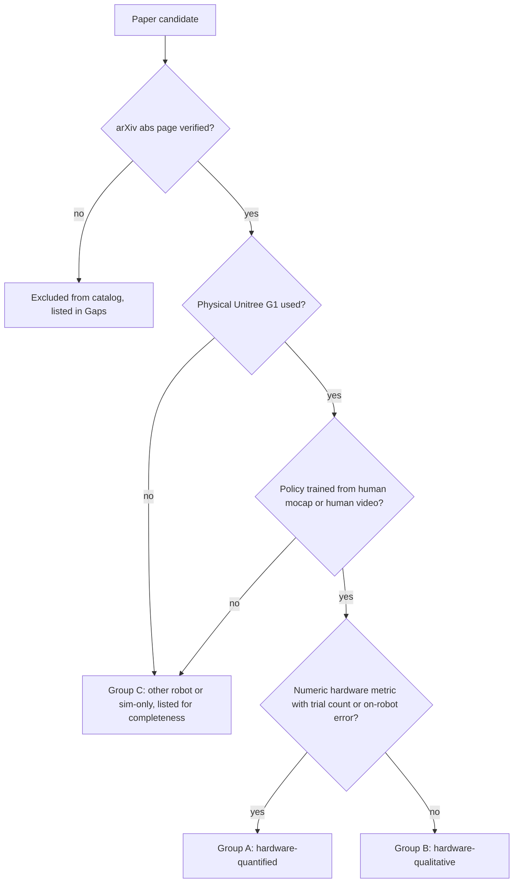

# Catalog of learned whole-body motion-tracking policies deployed on the Unitree G1 (2024 to October 2026)

Scope: manuscripts in which a learned whole-body motion-tracking or motion-imitation policy trained from human motion capture (or human video) was deployed on a physical Unitree G1. Every arXiv identifier below was verified against the live abstract page on 2026-10-25 (title and submission date read from the page). Numbers were read from the arXiv PDF text (pdftotext) and are cited to the table, figure, or section where they appear. "Hardware-quantified" means the paper reports a numeric per-trial success rate or a tracking error measured on the physical G1. "Hardware-qualitative" means hardware demos are shown (figures or video) without trial counts or on-robot metrics. "Sim-only" means no physical G1 result.

Classification procedure applied to every paper:

## Key question 1: Which papers deployed mocap- or video-trained tracking policies on a real G1, and what did each report?

### Takeaway
Forty-plus manuscripts were checked. Twenty-two report a physical G1 deployment with at least one numeric hardware metric (Group A), eighteen more show G1 hardware demos only qualitatively (Group B), and the remaining candidates are H1-only, sim-only, or not motion-tracking (Group C). Hardware trial counts are small almost everywhere (5 to 30 trials per task); only SONIC (124 motions, one trial each) and HDMI (67 consecutive door runs) exceed this. Training-data quantities range from a single reference clip (AdaMimic, KungfuBot per-motion policies) to 611 h (SONIC) and 2,000+ h (HoloMotion-1).

### Cited Findings

#### Group A: hardware-quantified G1 results

##### ASAP (arXiv 2502.01143)
- Title: "ASAP: Aligning Simulation and Real-World Physics for Learning Agile Humanoid Whole-Body Skills"; submitted 3 Feb 2025; CMU and NVIDIA (first-page affiliations). [Source](https://arxiv.org/abs/2502.01143)
- Data: human videos, pose estimated with TRAM, retargeted to G1 (Sec. III, Fig. 3c); per-task tracking policies. [Source](https://arxiv.org/abs/2502.01143)
- Simulator and RL: IsaacGym pretraining, PPO; sim-to-sim tests in IsaacSim and Genesis (Sec. IV). Parallel-environment count and GPU-hours: not stated in the extracted text. [Source](https://arxiv.org/abs/2502.01143)
- Real-world data for the delta-action model: five tasks (kick, jump forward, step forward and back, single-foot balance, single-foot jump); "we execute the tracking policy 30 times for each task"; 100 real motion clips plus 10 min of locomotion data were sufficient for a 4-DoF delta action model (Sec. IV-C). [Source](https://arxiv.org/abs/2502.01143)
- Hardware metric (Table V, closed-loop on G1): Real-World-Kick, Vanilla Eg-mpjpe 61.2 mm / Empjpe 43.5 mm vs ASAP 50.2 / 40.1 mm; Real-World-LeBron (out of distribution) Vanilla 159 / 55.3 mm vs ASAP 112 / 47.5 mm. No hardware success rate is reported. [Source](https://arxiv.org/abs/2502.01143)
- Data ablation: Fig. 10(a) varies the size of the real/sim rollout dataset used to train the delta-action model (MPJPE decreases with more data); this is an ablation of correction data, not of human motion data. [Source](https://arxiv.org/abs/2502.01143)

##### ExBody2 (arXiv 2412.13196)
- Title: "ExBody2: Advanced Expressive Humanoid Whole-Body Control"; submitted 17 Dec 2024; UC San Diego, UC Berkeley, MIT. [Source](https://arxiv.org/abs/2412.13196)
- Data: CMU subset of AMASS (DCMU), automatically filtered by a base-policy tracking-error threshold (Sec. IV-C, Fig. 4; thresholds 0.075 to 0.175, best 0.15). Clip count and hours are not stated in the extracted text. [Source](https://arxiv.org/abs/2412.13196)
- Simulator and RL: IsaacGym, PPO teacher, DAgger-style student; batch size 4096 (appendix hyperparameter table); onboard Jetson Orin NX. [Source](https://arxiv.org/abs/2412.13196)
- Hardware metric (Table III, "Comparisons with baselines on selected motions for Unitree G1 in real world", joint-position error from onboard motor readings, rad): Exbody2 Empjpe 0.1074 (upper 0.1092, lower 0.1054) vs OmniH2O* 0.1396 and Exbody2-w/o-Filter 0.1361. Motions: standing postures, walking, squatting, dancing from the CMU subset. No success rate or trial count on hardware. [Source](https://arxiv.org/abs/2412.13196)
- Data ablation (sim, Fig. 4): tracking error vs dataset filtering threshold; moderate threshold 0.15 gives the lowest error, lenient thresholds degrade it. [Source](https://arxiv.org/abs/2412.13196)

##### KungfuBot / PBHC (arXiv 2506.12851)
- Title: "KungfuBot: Physics-Based Humanoid Whole-Body Control for Learning Highly-Dynamic Skills"; submitted 15 Jun 2025; TeleAI (China Telecom), SJTU, ECUST, HIT, ShanghaiTech. [Source](https://arxiv.org/abs/2506.12851)
- Data: 13 motions (Table 4), from monocular video processed by their pipeline plus selected AMASS and LAFAN clips (for example Hooks punch 210 frames LAFAN, Tai Chi 610 frames LAFAN, Jump kick 330 frames AMASS); one policy per motion. [Source](https://arxiv.org/abs/2506.12851)
- Simulator and RL: IsaacGym, PPO, batch size 4096 (Table 8); each model trained 27 h on a single RTX 4090 (Appendix D.1). [Source](https://arxiv.org/abs/2506.12851)
- Hardware metric (Table 2): 10 trials of the Tai Chi motion on G1, metrics from onboard sensors with root fixed at origin: Empbpe real 36.64 +- 2.592 vs MuJoCo 33.18 +- 2.720; Empjpe real 1130.05 +- 9.478 vs 1061.24 +- 83.27; Empbve 3.01 vs 2.96; Empbae 3.12 vs 2.90; Empjve 65.68 vs 67.71 (units as printed in Table 2). Other skills (boxing, kicks, dance) are shown qualitatively (Fig. 8, Fig. 12). No hardware success rate. [Source](https://arxiv.org/abs/2506.12851)

##### HuB (arXiv 2505.07294)
- Title: "HuB: Learning Extreme Humanoid Balance"; submitted 12 May 2025; Tsinghua, Shanghai Qi Zhi Institute, UC Berkeley, UC San Diego. [Source](https://arxiv.org/abs/2505.07294)
- Data: a small set of extreme-balance reference motions (Swallow Balance, Bruce Lee's Kick, Ne Zha Pose, Single-leg Stand, Deep Squat); clip count and source hours not stated in the extracted text. [Source](https://arxiv.org/abs/2505.07294)
- Simulator and RL: IsaacGym, PPO teacher, DAgger student with 25-step history (Appendix); onboard Jetson Orin NX at 50 Hz. [Source](https://arxiv.org/abs/2505.07294)
- Success definition (Sec. 4.1): an episode succeeds if the humanoid keeps balance without (i) falling, (ii) foot-contact mismatch, or (iii) average tracking error above a threshold. [Source](https://arxiv.org/abs/2505.07294)
- Hardware metric (Table 2, 5 trials per task): HuB 4/5 Swallow Balance, 5/5 Bruce Lee's Kick, 5/5 Ne Zha Pose, 5/5 Single-leg Stand, 5/5 Deep Squat; OmniH2O baseline 0/5 on the first four and 4/5 on Deep Squat; HuB local position error Epos-l 38.31, 27.87, 30.91, 29.58, 29.90 mm respectively. Also 10 consecutive Bruce Lee's Kick executions without reset or failure (Sec. 4.3). [Source](https://arxiv.org/abs/2505.07294)

##### AMO (arXiv 2505.03738)
- Title: "AMO: Adaptive Motion Optimization for Hyper-Dexterous Humanoid Whole-Body Control"; submitted 6 May 2025; UC San Diego. [Source](https://arxiv.org/abs/2505.03738)
- Data and training: lower-body policy tracks torso and height commands; upper-body targets sampled from AMASS (4000 "Target Arm" entries in the appendix table); IsaacGym, PPO teacher distilled to student; tracking errors averaged over 4096 environments and 500 steps (Table II). Jetson Orin NX at 50 Hz (Appendix C). [Source](https://arxiv.org/abs/2505.03738)
- Hardware metric (Table IV, imitation-learning tasks, not motion tracking): Paper Bag Picking stages 8/10, 8/10, 9/10 (stereo, chunk 120); Trash Bottle Throwing 7/10 picking, 10/10 placing. Whole-body teleoperation is shown qualitatively. Note: AMO is a command-tracking controller with mocap-sampled arm targets, not a mocap-trajectory tracker. [Source](https://arxiv.org/abs/2505.03738)

##### CLONE (arXiv 2506.08931)
- Title: "CLONE: Closed-Loop Whole-Body Humanoid Teleoperation for Long-Horizon Tasks"; submitted 10 Jun 2025; Beijing Institute of Technology, BIGAI, Peking University. [Source](https://arxiv.org/abs/2506.08931)
- Data (Sec. 3.4): CLONED = 149 curated AMASS sequences with motion-editing augmentation + 14 custom sequences captured with an IMU-based Xsens system + procedural hand-orientation augmentation. [Source](https://arxiv.org/abs/2506.08931)
- Simulator and RL (Appendix): IsaacGym on a single A800; teacher PPO with 8192 parallel environments, about 24 h; student with 4096 environments, about 48 h (MoE student, DAgger). [Source](https://arxiv.org/abs/2506.08931)
- Hardware metric (Sec. 4, Fig. 4): straight-path teleoperation to 3 m, 6 m, 8.9 m, 10 repetitions each: mean final-position error 5.1 cm, maximum 12.0 cm at 8.9 m; curved 10 m path with two 90 deg turns, 6 trials. Whole-body tracking of waving, squatting, jumping shown qualitatively (Fig. 5). Sim metrics: success rate, MPKPE, hand-orientation error (Table 1). [Source](https://arxiv.org/abs/2506.08931)

##### BeyondMimic (arXiv 2508.08241)
- Title: "BeyondMimic: From Motion Tracking to Versatile Humanoid Control via Guided Diffusion"; submitted 11 Aug 2025; UC Berkeley and Stanford. [Source](https://arxiv.org/abs/2508.08241)
- Data: "approximately 2.5 hours of diverse human motions" trained (Sec. "Diverse Skills"); sources include prior datasets, Unitree-retargeted LAFAN1, and animation packs (Sec. S2); 30 representative clips totaling 15 min were deployed on hardware. [Source](https://arxiv.org/abs/2508.08241)
- Simulator and RL: PPO, MLP policies at 50 Hz (Sec. "Implementation"); Isaac Lab based stack (cites unitree_rl_lab and MJLab); diffusion policy runs on an RTX 4060 Mobile mini PC with TensorRT. Parallel-environment count and GPU-hours not stated in extracted text. [Source](https://arxiv.org/abs/2508.08241)
- Hardware metric (Fig. 8A, MDP-design ablation): one martial-arts motion, each configuration repeated 3 times on hardware with motion-capture ground truth; axis-angle representation fails once; 5 ms injected delay causes one failure and 10 ms causes failures in 2 of 3 trials. Velocity-tracking error 12.14 percent walking and 13.65 percent running (Sec. "Human-like naturalness"). Cartwheel sim-to-sim success 95 percent with latent diffusion vs 5 percent baseline (MuJoCo). No aggregate hardware success rate over the 30 clips. [Source](https://arxiv.org/abs/2508.08241)

##### HDMI (arXiv 2509.16757)
- Title: "HDMI: Learning Interactive Humanoid Whole-Body Control from Human Videos"; submitted 20 Sep 2025; Robotics Institute, CMU. [Source](https://arxiv.org/abs/2509.16757)
- Data: all reference motions from monocular RGB videos except suitcase manipulation, retargeted from OMOMO (Sec. IV); robot-object co-tracking rewards. [Source](https://arxiv.org/abs/2509.16757)
- Simulator and RL: IsaacSim, PPO, same hyperparameters for all tasks; sim metrics over 4096 parallel environments (Sec. V); mocap markers on robot pelvis and objects supply global poses at deployment. [Source](https://arxiv.org/abs/2509.16757)
- Hardware metric (Sec. IV): door open-and-traverse 67 continuous runs (34 min) before failure, with 10 to 30 cm random start offsets, and 7 further runs after a floorboard was removed; suitcase manipulation 7 consecutive successful runs; bread-box carrying 2 full trials; foam-mat relocation success; Truman's Bow long-horizon sequence 3 consecutive executions (with occasional light back support on stairs). Sim final success rates for 8 tasks in Fig. 6. [Source](https://arxiv.org/abs/2509.16757)

##### SONIC (arXiv 2511.07820)
- Title: "SONIC: Supersizing Motion Tracking for Natural Humanoid Whole-Body Control"; submitted 11 Nov 2025; NVIDIA. [Source](https://arxiv.org/abs/2511.07820)
- Data (Sec. "Humanoid Motion Dataset"): about 700 h of human mocap, retargeted with General Motion Retargeting; after removing infeasible clips, 611 h of training data, 100 million frames; held-out test-content 7,016 clips (15 h) and test-repetition 9,395 clips (12 h); a released subset of 288 h from 522 actors (SOMA and G1 formats). [Source](https://arxiv.org/abs/2511.07820)
- Simulator and RL: Isaac Lab, PPO, 4096 parallel environments per GPU (Table S2), 128 GPUs for 7 days, 21k GPU hours (Abstract, Sec. 2.1). [Source](https://arxiv.org/abs/2511.07820)
- Success definition (Sec. 2.1): local motion tracking; failure modes such as falling terminate the episode (not a global-root 0.5 m threshold). [Source](https://arxiv.org/abs/2511.07820)
- Hardware metric (Fig. 2K and 2L, Sec. "Real-World Evaluation"): 124 diverse motion sequences, one trial each; 123/124 tracked (99.2 percent) vs 124/124 in simulation; MPJPE-L 25.7 mm real vs 22.3 mm sim; upper body 22.2 vs 21.8 mm; feet 53.7 vs 29.0 mm. Inference onboard Jetson Orin (1 to 2 ms per forward pass). VLA tasks (Table 1): strict binary success over 10 to 20 trials per task, 75 percent average; drill-and-box relocation 70 percent over 10 trials. [Source](https://arxiv.org/abs/2511.07820)
- Data ablation (sim, Fig. 2A): training on 4M, 10M, 22M, 100M frames (20k, 50k, 110k, 317k clips), subsets sampled uniformly across sub-categories; success and MPJPE-L improve consistently with data; model scaling 1.2M to 42M parameters gives 98.0 percent / 27.7 mm to 99.6 percent / 23.8 mm on test-content. Exact per-data-size values are in Fig. 2A (not in the text). [Source](https://arxiv.org/abs/2511.07820)

##### Any2Track (arXiv 2509.13833)
- Title: "Track Any Motions under Any Disturbances"; submitted 17 Sep 2025; affiliations not present in the extracted first-page text (secondary sources list Tsinghua and Peking University, unverified). [Source](https://arxiv.org/abs/2509.13833)
- Data: LAFAN1 + AMASS, retaining highly dynamic clips that GMT removed (Sec. III); hours not stated in extracted text. [Source](https://arxiv.org/abs/2509.13833)
- Simulator and RL: MuJoCo-based training in parallel on 8 GPUs (Sec. III); PPO teacher, DAgger student, AnyAdapter world-model fine-tuning. [Source](https://arxiv.org/abs/2509.13833)
- Hardware metric (Table VI, Sec. IV-C): MPJPE / MPJVE from onboard motor sensors via forward kinematics, averaged over 5 motion trajectories: no disturbance 17.38 mm / 11.56 (PPO baseline 29.38 / 14.26); complex terrain 18.34 / 11.87; external constraint (rope to hoist) 19.17 / 13.04; 5 kg payload 23.24 / 12.69. No hardware success rate. Sim success rate 89.23 percent (abstract). [Source](https://arxiv.org/abs/2509.13833)

##### PhysHSI (arXiv 2510.11072)
- Title: "PhysHSI: Towards a Real-World Generalizable and Natural Humanoid-Scene Interaction System"; submitted 13 Oct 2025; Shanghai AI Laboratory and HKUST. [Source](https://arxiv.org/abs/2510.11072)
- Data: AMASS and SAMP motions retargeted to G1 with object annotations (Sec. III, Fig. 2); for example the carry-box task uses 11 locomotion sequences from AMASS plus 3 AMASS and 2 video-based interaction sequences (appendix). [Source](https://arxiv.org/abs/2510.11072)
- Simulator and RL: IsaacGym, AMP-style adversarial motion prior with PPO (Sec. III-B); all perception and control onboard Jetson Orin NX; LiDAR plus AprilTag object localization. [Source](https://arxiv.org/abs/2510.11072)
- Hardware metric (Table III, 10 trials per task): Carry Box 8/10 pick-up and 6/10 full sequence, placement precision 0.19 +- 0.10 m, 10.5 s execution, 5.69 m range; Sit Down 9/10; Lie Down 8/10; Stand Up 8/10; object-localization study 15/17 trials. Sim carry-box success 81.34 percent (Table I). [Source](https://arxiv.org/abs/2510.11072)

##### AdaMimic (arXiv 2510.14454)
- Title: "Towards Adaptable Humanoid Control via Adaptive Motion Tracking"; submitted 16 Oct 2025; Shanghai AI Laboratory and SJTU. [Source](https://arxiv.org/abs/2510.14454)
- Data: a single reference motion per task, reconstructed from video with GVHMR and retargeted; five tasks (far jump, high jump, triple jump, tennis hit, badminton hit); sparse keyframe editing generates adaptation targets (Fig. 2, Fig. 4). [Source](https://arxiv.org/abs/2510.14454)
- Simulator and RL: Isaac Gym, 4096 parallel environments, PPO (Sec. V, Table VI). [Source](https://arxiv.org/abs/2510.14454)
- Hardware metric (Table IV, 6 trials per task, success plus local joint error and smoothness): AdaMimic easy adaptation 5/6, 6/6, 6/6, 6/6, 6/6; hard adaptation 5/6, 5/6, 6/6, 6/6, 6/6; AMP-style baseline 0/6 on badminton hit and 0/6 on high jump (hard); DeepMimic-Adapt 1/6 high jump (easy) and 0/6 (hard). [Source](https://arxiv.org/abs/2510.14454)

##### ZEST (arXiv 2602.00401)
- Title: "ZEST: Zero-shot Embodied Skill Transfer for Athletic Robot Control"; submitted 30 Jan 2026; RAI Institute and Boston Dynamics (RAI Institute authors did the G1 work, footnote 1). [Source](https://arxiv.org/abs/2602.00401)
- Data: MoCap captured with Xsens and Vicon systems, video-reconstructed motions (ViCap), and keyframe animation (Sec. "Methods", refs 58 and 59); per-motion or multi-motion policies. G1 motions in Table 1: Cartwheel, Table-tennis, Ballet sequence, Jump onto box, Climb up box, Climb down box. [Source](https://arxiv.org/abs/2602.00401)
- Simulator and RL: Isaac Lab, PPO; approximately 10 h (about 7k iterations) on a single NVIDIA L4 GPU; mini-batch 4096, 245,760 samples per iteration (4096 x 24) (Table S7). [Source](https://arxiv.org/abs/2602.00401)
- Hardware metric: Table 1 reports MAE(q), MAD(R), ML2(omega) and maxima over successful trials per motion (G1 rows present; numeric values for G1 rows did not extract cleanly from the PDF). Box skills (Sec. "ViCap-Derived Human-Like Skills on Hardware"): box climb up and climb down 5/5 consecutive successes at the nominal 0.75 m box; all trials within the training distribution (+-10 cm x, +-0.3 rad yaw) succeed (Fig. S5); 2 kg torso payload succeeds; climb up succeeds at 0.55 m and climb down at 0.55 m and 0.95 m. [Source](https://arxiv.org/abs/2602.00401)

##### OmniTrack (arXiv 2602.23832)
- Title: "OmniTrack: General Motion Tracking via Physics-Consistent Reference"; submitted 27 Feb 2026; Huazhong University of Science and Technology, BIGAI, SJTU. [Source](https://arxiv.org/abs/2602.23832)
- Data (Sec. IV): Unitree-retargeted LAFAN1 (40 clips, about 2.5 h) and an AMASS subset of about 10,000 clips; full LAFAN1 plus about 8 h of CMU motions for the final policy; about 16 h of KIT motions as a test set. [Source](https://arxiv.org/abs/2602.23832)
- Simulator and RL: IsaacLab, PPO, two-stage (physical motion generation then general tracking); GMR retargeter for teleoperation. [Source](https://arxiv.org/abs/2602.23832)
- Hardware metric (Table IV): sim-vs-real DoF error, root rotation error, and angular-velocity error from onboard sensors for six motions (walking, running, dancing, martial arts, getting up, cartwheel); example row 0.0601 rad / 0.0675 rad / 0.6567 rad/s sim vs 0.0710 / 0.0996 / 0.6716 real. Robustness demo: 17 consecutive side flips without failure; hour-long continuous tracking (Sec. V). No hardware success rate. Sim success 96.88 percent on the full test set and 84.81 percent on the dynamic LAFAN1 subset vs BeyondMimic 70.04 percent (Table II, III). [Source](https://arxiv.org/abs/2602.23832)
- Data ablation (sim, Fig. 4): training on 1/8, 1/2, and full LAFAN1; with raw retargeted references success drops from 95.1 percent to 88.2 percent and MPJPE rises 10.1 mm as data grows; with physically plausible references success stays near 92.6 percent. [Source](https://arxiv.org/abs/2602.23832)

##### ULTRA (arXiv 2603.03279)
- Title: "ULTRA: Unified Multimodal Control for Autonomous Humanoid Whole-Body Loco-Manipulation"; submitted 3 Mar 2026 (v3 17 Oct 2026); University of Illinois Urbana-Champaign. [Source](https://arxiv.org/abs/2603.03279)
- Data: OMOMO human-object mocap converted by an RL neural-retargeting policy into physically feasible G1 rollouts with augmentation (Fig. 2); objects: large box, suitcase, household objects. [Source](https://arxiv.org/abs/2603.03279)
- Simulator and RL: IsaacGym, PPO, 4096 parallel environments (Table E); DAgger-style distillation to a multimodal student; MuJoCo sim-to-sim. [Source](https://arxiv.org/abs/2603.03279)
- Hardware metric (Table IV): dense reference tracking on OMOMO subset (bimanual box lift/carry, suitcase transport) 73 percent (19/26); sparse goal following with OptiTrack object pose 80 percent (8/10) vertical and 90 percent (9/10) lateral; egocentric depth 50 percent (5/10) and 60 percent (6/10). MoCap used for success evaluation. [Source](https://arxiv.org/abs/2603.03279)

##### OmniClone (arXiv 2603.14327)
- Title: "OmniClone: Engineering a Robust, All-Rounder Whole-Body Humanoid Teleoperation System"; submitted 15 Mar 2026; Beijing Institute of Technology, BIGAI, Peking University, HKU, Tsinghua. [Source](https://arxiv.org/abs/2603.14327)
- Data (Appendix A): TWIST2 corpus expanded from 23 to 29 DoF, plus AMASS and LAFAN, plus motions captured through their own teleoperation interface; about 60 percent standing manipulation; 30 h total. [Source](https://arxiv.org/abs/2603.14327)
- Simulator and RL (Sec. V): Isaac Lab on a single RTX 4090; teacher PPO converges in about 60 h (about 33K PPO steps, 4,096 parallel environments); DAgger student about 22 h; about 80 GPU hours total. Sim evaluation in MuJoCo on OmniBench (SR and MPJPE by category, Table I, Fig. 2). [Source](https://arxiv.org/abs/2603.14327)
- Hardware metric: tracker itself evaluated qualitatively via teleoperation by 6 participants (1.47 m to 1.94 m), all novices completing the pick-and-place task within 5 to 7 practice trials (Sec. VI-A, Fig. 5); downstream GR00T N1.6 policy trained on 50 demonstrations: 85.71 percent (21 trials) Pick-and-Place and 80.00 percent (5 trials) Squat to Pick-and-Place (Table II). G1-Comp platform with 2-DoF head. [Source](https://arxiv.org/abs/2603.14327)
- Data-recipe ablation (sim, Fig. 4): data composition steers per-category SR and MPJPE. [Source](https://arxiv.org/abs/2603.14327)

##### LIMMT (arXiv 2606.06953)
- Title: "LIMMT: Less is More for Motion Tracking"; submitted 5 Jun 2026; Tsinghua, GalBot, SJTU, Peking University, Shanghai Qi Zhi Institute. [Source](https://arxiv.org/abs/2606.06953)
- Data: AMASS (24,197 clips in Table 9) and PHUMA; GQS curation selects subsets from 1 percent to 100 percent (Fig. 2); 3 percent of AMASS corresponds to under one hour of data (Sec. 1). [Source](https://arxiv.org/abs/2606.06953)
- Simulator and RL (Sec. 4): trackers Any2Track (MJX) and TWIST2 (Isaac Lab); PPO for 2 x 10^9 environment steps on 8 RTX 4090 GPUs; 32,768 parallel environments (Table 5); 10 seeds per setting. [Source](https://arxiv.org/abs/2606.06953)
- Hardware metric (Table 6, 10 trials per category, SR = trials tracked to completion, MPJPE in rad): Walking 10/10 (Full) vs 10/10 (GQS 10 percent); Jumping 8/10 vs 9/10; Dance 1 7/10 vs 8/10; Dance 2 6/10 vs 7/10; average SR 0.775 vs 0.850; MPJPE 0.1528 vs 0.1287. [Source](https://arxiv.org/abs/2606.06953)
- Data ablation (sim and hardware): Fig. 2 success vs data ratio; GQS 3 percent reaches 95.6 percent SR (Any2Track) and 86.1 percent (TWIST2), above full-data baselines, while random 3 percent collapses to 83.8 percent and 64.9 percent (Sec. 4.2). Hardware comparison above is the only on-robot data-quantity comparison found in this survey. [Source](https://arxiv.org/abs/2606.06953)

##### Humanoid-GPT (arXiv 2606.03985)
- Title: "Humanoid-GPT: Scaling Data and Structure for Zero-Shot Motion Tracking"; submitted 2 Jun 2026; Tsinghua, Galbot, SJTU, Peking University, Shanghai Qi Zhi Institute. [Source](https://arxiv.org/abs/2606.03985)
- Data: about 2B G1-retargeted frames from AMASS, LAFAN1, MotionMillion, PHUMA, Motion-X++ and in-house recordings (Sec. 1, Sec. 3). [Source](https://arxiv.org/abs/2606.03985)
- Simulator and RL: PPO experts trained in MuJoCo on motion clusters (about 384 experts), distilled by DAgger with about 32K environments into a causal Transformer (Sec. 3, Appendix B.3); roughly 15,000 GPU hours total, experts on RTX 4090 and distillation on H100 (Sec. C.3, Table 8). [Source](https://arxiv.org/abs/2606.03985)
- Hardware metric (Table 3): four unseen dance motions on the real G1, MPJPE (rad) and MPJVE over each sequence; Humanoid-GPT-B 0.0974 / 0.1075 / 0.0858 / 0.0856 vs GMT 0.1087 / 0.1098 / 0.0921 / 0.0994, TWIST 0.1253 / 0.1162 / 0.1079 / 0.1047, Any2Track 0.1039 / 0.1136 / 0.0956 / 0.0928. No hardware success rate; live mocap teleoperation and box-carrying shown qualitatively (Sec. 4). [Source](https://arxiv.org/abs/2606.03985)
- Data ablation (sim, Table 2): MLP 2M tokens 76.89 percent SR; Humanoid-GPT-S 2M 83.26 percent, 20M 86.02 percent; GPT-B 200M 88.27 percent, 2B 90.43 percent; GPT-L 2B 92.58 percent SR with MPJPE 0.0735 rad. [Source](https://arxiv.org/abs/2606.03985)

##### ReactiveBFM (arXiv 2606.30362)
- Title: "ReactiveBFM: Reactive Closed-Loop Motion Planning Towards Universal Humanoid Whole-Body Control"; submitted 29 Jun 2026; CUHK and Shanghai AI Laboratory. [Source](https://arxiv.org/abs/2606.30362)
- Data: behavior foundation model pretrained with PPO on more than 100 million retargeted human motion frames (102 million, 64 GPUs, about 10 days, IsaacLab, 8192 training environments, Table 7); planner trained on 37.14 h from 100STYLE, AMASS-HumanML3D and PhysHSI rollouts, 48 h on one RTX 4090 (Sec. 3, Appendix). [Source](https://arxiv.org/abs/2606.30362)
- Hardware metric (Sec. 4.2): moving-target reaching, 10 real-world trials, 90 percent success; sim-to-sim 93.1 percent success (Table 1). Off-board RTX 4090 workstation; HTC VIVE trackers for localization. [Source](https://arxiv.org/abs/2606.30362)

##### Extreme-RGMT (arXiv 2607.20110)
- Title: "Extreme-RGMT: Continual Learning of Highly Dynamic Skills for Robust Generalist Humanoid Control"; submitted 22 Jul 2026; Beijing Institute of Technology (School of Automation). [Source](https://arxiv.org/abs/2607.20110)
- Data: LAFAN1 and AMASS plus in-house Xsens inertial mocap (Sec. III-C, Table V); hours not stated in extracted text. [Source](https://arxiv.org/abs/2607.20110)
- Simulator and RL: PPO in parallel simulation; MuJoCo evaluation; policy at 50 Hz, PD at 500 Hz on the 29-DoF G1 (Sec. IV-C). [Source](https://arxiv.org/abs/2607.20110)
- Hardware metric (Table VIII, four motions per setting, five trials per motion): fixed AMASS replay of flips, butterfly kick, back-handspring, aerial cartwheel 90.0 percent; online Xsens teleoperation of highly dynamic motions 85.0 percent; generalist Xsens teleoperation 100.0 percent; ablations (unified encoder, w/o FSQ, w/o STAR) 85.0 / 80.0 / 80.0 on replay and 75.0 / 65.0 / 45.0 on dynamic teleoperation. [Source](https://arxiv.org/abs/2607.20110)

##### ContactMimic (arXiv 2607.08742)
- Title: "ContactMimic: Humanoid Object Interaction via Contact Control"; submitted 9 Jul 2026; University of Illinois Urbana-Champaign. [Source](https://arxiv.org/abs/2607.08742)
- Data: human-object interaction clips from HUMOTO retargeted with OmniRetarget; 10 motions in simulation, 5 on hardware (Sec. 4). [Source](https://arxiv.org/abs/2607.08742)
- Simulator and RL: one policy per motion, PPO in Isaac Lab with 4096 parallel environments (Appendix B, Table 5); onboard at 50 Hz, PD at 1000 Hz, no external mocap at deployment (Appendix E). [Source](https://arxiv.org/abs/2607.08742)
- Hardware metric (Table 2, success = physical contact behavior matches the commanded contact label): wipe whiteboard 5/5 and 5/5; sit in front of table 4/5 and 5/5; lean on backrest I 9/10 and 10/10; lean on backrest II 10/10 and 9/10; sit and squat 5/5 and 5/5 (contact-on and contact-off commands respectively). [Source](https://arxiv.org/abs/2607.08742)

##### HuMBLE (arXiv 2610.10489)
- Title: "HuMBLE: Human Motion-Driven Behavior Learning for Embodied Locomotion"; submitted 7 Oct 2026; RAI Institute, Boston Dynamics, CMU. [Source](https://arxiv.org/abs/2610.10489)
- Data: curated human locomotion dataset captured with a Vicon system, 528,214 frames, approximately 3 h, released (Sec. "Results", Sec. S2). [Source](https://arxiv.org/abs/2610.10489)
- Simulator and RL: Isaac Lab, PPO teacher with reference tracking, DAgger distillation, PPO fine-tuning with mixed reference-guided and goal-conditioned environments; batch size 4096, 98,304 samples per iteration (4096 x 24) (supplementary tables). [Source](https://arxiv.org/abs/2610.10489)
- Hardware metric (Table S2, G1 sim vs real steady-state and mean-absolute command-tracking error in m/s and rad/s): forward walk steady-state (0.07, 0.06) sim vs (0.03, 0.05) real; MAE (0.09, 0.20) sim vs (0.10, 0.23) real. The deployed policy tracks SE(2) velocity commands, not reference trajectories; box-parkour integration with separately trained box climb-up/down policies is shown qualitatively (Sec. S7). Inference 1.1 ms on Jetson AGX Orin CPU. [Source](https://arxiv.org/abs/2610.10489)

#### Group B: hardware-qualitative G1 results (no trial counts or on-robot tracking metrics)

- TWIST (arXiv 2505.02833, "TWIST: Teleoperated Whole-Body Imitation System", 5 May 2025, Stanford and Simon Fraser University). Data: AMASS + OMOMO, over 15,000 clips (about 42 h) with infeasible motions filtered, plus 150 in-house mocap clips (about 0.5 h) (Sec. 3.1). IsaacGym PPO teacher, RL+BC student; OptiTrack streaming at 50 Hz; RTX 4090 inference. Hardware: box lifting, carrying, kicking a door, soccer kick, dance, shown in Fig. 2 and video; Fig. 7 plots real-world rollout curves while holding a box; motors overheat after 5 to 10 min. No trial counts. [Source](https://arxiv.org/abs/2505.02833)
- GMT (arXiv 2506.14770, "GMT: General Motion Tracking for Humanoid Whole-Body Control", 17 Jun 2025, UC San Diego and SFU). Data: curated AMASS + LAFAN1, 8925 clips, 33.12 h (Sec. 4.1). IsaacGym, 4096 parallel environments, PPO teacher about 3 days on one RTX 4090 plus DAgger student about 1 day (Sec. 6.5). Hardware: Sec. 4.4 qualitative (stylized walking, kicks, dance, spins). [Source](https://arxiv.org/abs/2506.14770)
- VideoMimic (arXiv 2505.03729, "Visual Imitation Enables Contextual Humanoid Control", 6 May 2025, UC Berkeley). Data: LAFAN mocap pretraining (MPT) then 123 self-collected monocular video clips (Table 6). IsaacGym, PPO, 2 x RTX 4090 with 4096 environments each (8192 total), DAgger distillation (Appendix). Jetson Orin NX at 50 Hz. Hardware: stairs, sitting, standing, terrain, qualitative (Fig. 5, Fig. 9). MPT ablation on success rate is sim-only (Fig. 6). [Source](https://arxiv.org/abs/2505.03729)
- KungfuBot2 / VMS (arXiv 2509.16638, "KungfuBot2: Learning Versatile Motion Skills for Humanoid Whole-Body Control", 20 Sep 2025, TeleAI, SJTU, ECUST). Data: AMASS retargeted, 9,770 motions, 30.41 h (Sec. III). IsaacGym 4,096 parallel environments, PPO teacher, DAgger student, 1,000 rollouts per motion for sim evaluation. Hardware: Sec. IV-D qualitative (locomotion styles, racket swings, Charleston, kicks, martial arts). Sim Table III: GMT 92.68 percent success on test set, VMS higher (value truncated in extraction). [Source](https://arxiv.org/abs/2509.16638)
- UniTracker (arXiv 2507.07356, "UniTracker: Learning Universal Whole-Body Motion Tracker for Humanoid Robots", 10 Jul 2025, SJTU, Shanghai AI Laboratory and others). Data: AMASS filtered by PHC, 8179 motions (Sec. II). IsaacGym 8192 parallel environments, PPO teacher, CVAE-based DAgger student; 23 of 29 DoF controlled (wrists locked). Hardware: Fig. 1 and video, qualitative, including text-to-motion and video-estimated motions. [Source](https://arxiv.org/abs/2507.07356)
- Behavior Foundation Model (arXiv 2509.13780, "Behavior Foundation Model for Humanoid Robots", 17 Sep 2025, Peking University, CUHK Shenzhen, SJTU, Fudan, Shanghai AI Laboratory). Data: AMASS retargeted (Sec. III). IsaacGym 8192 parallel environments, PPO proxy agent, DAgger CVAE pretraining; 23 DoF (wrists frozen). Hardware: sim-to-real results on G1 described qualitatively (Sec. IV-A). [Source](https://arxiv.org/abs/2509.13780)
- Robust and Generalized Humanoid Motion Tracking / RGMT (arXiv 2601.23080, 30 Jan 2026, affiliations not in extracted text). Data: about 3.5 h curated from LAFAN1 and an AMASS subset (Sec. IV). Isaac Gym, single RTX 4090, 5,680 parallel environments, PPO. Hardware: real-world dance tracking with fall recovery and joystick locomotion, qualitative (Fig. 4, Fig. 5). [Source](https://arxiv.org/abs/2601.23080)
- Beyond Retargeting (arXiv 2610.07891, "Beyond Retargeting: Low-Latency and Robust Humanoid Whole-Body Teleoperation with Learned Atomic Motion Primitives", 6 Oct 2026, HKUST, Zhejiang University, Tencent Robotics X). Data: retargeted AMASS/LAFAN1/OMOMO library, 14,147 training and 4,073 testing clips; cross-simulator evaluation on 6,495 SONIC bones-seed trajectories (Sec. V). IsaacSim, PPO MoE teacher, distilled codebook student; RTX 4060 inference. Sim Table I (0.1 m keypoint noise): codebook SR 0.9590 vs TWIST 0.8451, GMT 0.7540, CLONE 0.8335, TWIST2 0.6199, Any2Track 0.0556; success = finishing the clip without pelvis-height error above 0.25 m. Hardware (Sec. V-C): one checkpoint driven by VR headset, optical mocap, monocular video, and text-to-motion, qualitative. [Source](https://arxiv.org/abs/2610.07891)
- HoloMotion-1 (arXiv 2605.15336, "HoloMotion-1 Technical Report", 14 May 2026, Horizon Robotics). Data (Table 4): MotionMillion video-derived 2,000+ h, AMASS 40+ h, LAFAN1 4.6 h, PICO 4 Ultra teleoperation 10+ h, Noitom PN Link inertial mocap 10+ h. IsaacLab, 8,192 environments, sequence-level PPO, 64 RTX 5090 GPUs about 6 days (about 9,200 GPU hours). Sim (MuJoCo, Table 6): HoloMotion 97.55 percent SR vs SONIC 95.58, GMT 92.54, Any2Track 25.10 on their evaluation suite. Hardware: zero-shot transfer shown qualitatively (Fig. 2). [Source](https://arxiv.org/abs/2605.15336)
- HiPHI (arXiv 2608.16222, "HiPHI: A Large-Scale Benchmark for High-Precision Human Motion and Object-Interaction", 17 Aug 2026, Noitom Robotics, NUS, Tsinghua SIGS, HKUST). Data: 617.5 h optical mocap after mirroring (308.7 h raw), 371.8 h body-only plus 245.7 h human-object interaction with 40 objects, retargeted to G1 (Sec. 3, Table 1). Tracking policies trained with BeyondMimic-style setup; Fig. 7 shows cross-dataset MPJPE falling as unmirrored HiPHI training data grows from 3 to 300 h (sim). Hardware: Sec. 5.4 and Fig. 8 qualitative (locomotion, sitting, crawling, carrying, flipping). [Source](https://arxiv.org/abs/2608.16222)
- Heracles (arXiv 2603.27756, "Heracles: Bridging Precise Tracking and Generative Synthesis for General Humanoid Control", 29 Mar 2026, affiliations not in extracted text). Data: clips from LAFAN1, 100STYLE, SnapMoGen (Sec. 5); Isaac Sim with 16,384 parallel environments on a single A100 80 GB, PPO; MuJoCo evaluation on 101 unseen motions. Hardware: fall recovery from supine, lateral, prone across three trials (Fig. 7) and tracking demos (Fig. 4), qualitative. [Source](https://arxiv.org/abs/2603.27756)
- PGMT (arXiv 2609.08511, "PGMT: Perceptive General Motion Tracking for Humanoid Robots", 8 Sep 2026, Zhejiang University and NUS). Data: LAFAN1 retargeted (Sec. III). Four RTX 5090 GPUs for training; Jetson Orin NX and Livox Mid-360 LiDAR onboard. Hardware: terrain-adaptive tracking over boxes up to 37 cm, qualitative (Sec. IV-D). [Source](https://arxiv.org/abs/2609.08511)
- Learning Whole-Body Humanoid Locomotion via Motion Generation and Motion Tracking (arXiv 2604.17335, 19 Apr 2026, RA-L; acknowledgments name the ETH AI Center). Data: about one hour of motion data after augmentation covering box climbing, vaulting, jump-down, stairs (Sec. III). IsaacLab, PPO, single RTX 4090. Hardware: 75 cm box climb and jump-down, stairs, hurdles, mixed terrain, qualitative (Fig. 3); success rates with and without fine-tuning are sim-only (Fig. 4). [Source](https://arxiv.org/abs/2604.17335)
- Teleopit (arXiv 2608.01834, "Teleopit: A Full-Embodiment Humanoid Teleoperation System", 3 Aug 2026, Westlake University and Shanghai Innovation Institute). Data (Table 4): training set 63,237 clips, 127 h 56 min, including a BONES-SEED subset (31,071 clips, 88 h), LAFAN1 (57 clips, 31 min), TWIST2 and PICO recordings. mjlab (GPU MuJoCo), PPO, 8 NVIDIA A800 GPUs for about 50 h, 8192 environments per GPU (65,536 total). Tracker sim success 91.7 percent (mocap subset) and 100.0 percent (PICO subset) (Table 6). Hardware: whole-body tracking qualitative (Fig. 8); downstream ACT and GR00T N1.7 policies 90.0 and 95.0 percent over 20 trials (Table 13). [Source](https://arxiv.org/abs/2608.01834)
- TWIST2 (arXiv 2511.02832, "TWIST2: Scalable, Portable, and Holistic Humanoid Data Collection System", 4 Nov 2025, Amazon FAR, Stanford, USC, UC Berkeley, CMU). Data: about 20k clips (7k via GMR plus 13k from TWIST) from AMASS, OMOMO and in-house mocap (Sec. III). PPO tracker; MuJoCo model of the neck. Hardware: tracker shown qualitatively; data-collection yield 98 episodes in 18.5 min at 100 percent success (Table II). [Source](https://arxiv.org/abs/2511.02832)
- Humanoid-DART (arXiv 2606.26855, "Humanoid-DART: Humanoid Loco-Manipulation using Diffusion-guided Augmentation through Relabeling and Tracking", 25 Jun 2026, TUM MIRMI). Data: hundreds of DynaRetarget object-robot trajectories; MuJoCo via mjlab on a single RTX 5090, PPO. Hardware: push, kick, pick-and-place on a physical G1, qualitative (Fig. 1, Sec. IV). [Source](https://arxiv.org/abs/2606.26855)
- DreamControl (arXiv 2509.14353, 17 Sep 2025; affiliations not in extracted text) deploys selected tasks on G1 after retraining; references come from human-motion diffusion priors rather than mocap tracking, so it sits outside the strict scope. [Source](https://arxiv.org/abs/2509.14353)
- RoboGhost (arXiv 2510.14952, "From Language to Locomotion: Retargeting-free Humanoid Control via Motion Latent Guidance", 16 Oct 2025, University of Sydney, BAAI, HIT, HKUST, SJTU, PKU): IsaacGym training, MuJoCo transfer, real G1 execution described qualitatively. [Source](https://arxiv.org/abs/2510.14952)

#### Group C: not a physical G1 deployment, or not mocap-based motion tracking

- HOVER (arXiv 2410.21229, 28 Oct 2024, NVIDIA, CMU, UC Berkeley, UT Austin, UC San Diego): real robot is the 19-DoF Unitree H1; 20 standing motion sequences tested in the real world (Sec. III-C). Not a G1 result. [Source](https://arxiv.org/abs/2410.21229)
- OmniH2O (arXiv 2406.08858, 13 Jun 2024, CMU and SJTU): Unitree H1; retargeted AMASS with 14k sequences in sim; 20 standing sequences on hardware (Table 2); 40 min of teleoperated demonstrations for LfD. Not a G1 result. [Source](https://arxiv.org/abs/2406.08858)
- HugWBC (arXiv 2502.03206, 5 Feb 2025, SJTU and Shanghai AI Lab): Unitree H1; command-space controller; 16 h on one RTX 4090; real-world tracking error over five tests per command (Table VI). Not a G1 result and not a mocap tracker. [Source](https://arxiv.org/abs/2502.03206)
- EGM (arXiv 2512.19043, 22 Dec 2025, Shanghai Innovation Institute, Fudan, CUHK, ByteDance): 23-DoF G1 in IsaacGym only; Dsmall 4.08 h vs Dlarge 10,393 motions 27.47 h (Table 2 compares training sets in sim); evaluated on 13,596 motions, 49.25 h. Sim-only. [Source](https://arxiv.org/abs/2512.19043)
- Retargeting Matters / GMR (arXiv 2510.02252, 2 Oct 2025, Stanford): BeyondMimic policies on 21 LAFAN1 motions; success rates in IsaacSim (100 trials per policy), with domain randomization (4096 trials), and MuJoCo sim2sim (100 trials) (Table I, III). No hardware trials reported. [Source](https://arxiv.org/abs/2510.02252)
- GenTrack (arXiv 2608.01410, 2 Aug 2026, Zhejiang University, Peking University, Tencent, Zhejiang Lab): G1 evaluated in simulation per search summary; hardware not confirmed. [Source](https://arxiv.org/abs/2608.01410)
- HumanTracker (arXiv 2608.13555, 13 Aug 2026, Nankai, Tsinghua, Galbot, SJTU, PKU, Qi Zhi): benchmark of about 153 h optical mocap across 25K clips, MuJoCo evaluation of trackers (Table 3); no hardware. [Source](https://arxiv.org/abs/2608.13555)
- R2S2 (arXiv 2505.10918, 16 May 2025, Tsinghua and Peking University): G1 and H1 real-world results averaged over 10 trials, but the skills are RL primitives, not mocap imitation. [Source](https://arxiv.org/abs/2505.10918)
- ULC (arXiv 2507.06905, 9 Jul 2025): G1 loco-manipulation command controller, Isaac Lab 8192 environments; not mocap tracking. [Source](https://arxiv.org/abs/2507.06905)
- HiWET (arXiv 2602.06341, 6 Feb 2026, SJTU, Shanghai Innovation Institute, Tongji, Tsinghua): G1 real-world end-effector tracking errors 12 mm (circle) and 15 mm (square) (Table II); Isaac Lab; world-frame end-effector tracking, not mocap imitation. [Source](https://arxiv.org/abs/2602.06341)
- XHugWBC (arXiv 2602.05791, 5 Feb 2026, SJTU and Shanghai AI Lab): cross-humanoid locomotion generalist across seven real robots; mocap use not verified; outside scope. [Source](https://arxiv.org/abs/2602.05791)
- GenHOI (arXiv 2606.12995, 11 Jun 2026, HKUST Guangzhou, USTC, HKU, NUS): G1 real-world box grasping, chair carrying, table lifting via generated video and trajectory optimization with a tracker; the reference is a generated video rather than mocap. Success rates in sim over 10 trials per setting (Fig. 4, Fig. 5). [Source](https://arxiv.org/abs/2606.12995)
- GENMO (arXiv 2505.01425, NVIDIA): human motion estimation/generation model; no robot deployment found. [Source](https://arxiv.org/abs/2505.01425)

### Inferences
- Across Group A, the median hardware evaluation is 5 to 10 trials per motion on a handful of motions; SONIC's 124 single-trial motions is the only evaluation whose scale approaches the sim test sets. Inference: hardware success rates in this literature carry wide binomial uncertainty (a 9/10 result has a 95 percent interval roughly 0.55 to 1.0).
- Papers that train one policy per motion (KungfuBot, HuB, AdaMimic, ContactMimic, ZEST box skills) report the highest per-motion hardware success (80 to 100 percent), while generalist trackers either report tracking error only (ExBody2, Any2Track, Humanoid-GPT, OmniTrack) or success on curated hold-out sets (SONIC, LIMMT, Extreme-RGMT). Inference: hardware success and data scale are confounded by motion difficulty and by whether the policy is a specialist.
- The two RAI Institute papers (ZEST, HuMBLE) are the only ones in the set that name Vicon capture explicitly; CLONE and Extreme-RGMT name Xsens; TWIST and ULTRA name OptiTrack for online streaming or object tracking.

### Gaps
- HiTMan: no arXiv paper found under this name (two searches); likely a misremembered name.
- MimicKit and HumanoidVerse: training frameworks, not manuscripts; no arXiv paper verified, so not cataloged.
- Unitree's own releases: unitree_rl_mjlab (MuJoCo-based) includes a G1 motion-imitation training section, but no Unitree manuscript with hardware metrics was found. [Source](https://github.com/unitreerobotics/unitree_rl_mjlab)
- ASAP, BeyondMimic, HuB, Any2Track, Extreme-RGMT: parallel-environment count or GPU-hours not stated in the extracted text.
- ZEST Table 1 numeric values for G1 rows did not extract from the PDF layout; the RAI PDF in manuscripts/2602.00401v1.pdf should be read directly for MAE(q) and MAD(R) on the G1 motions.
- KungfuBot2 Table III VMS success value and HumanTracker per-method hardware results were not available (the latter has none).

## Key question 2: For each paper, how many minutes or clips of human motion were used, and what was the hardware success rate and its definition?

### Takeaway
Training data spans six orders of magnitude (one clip to 100 million frames) while hardware success is reported for only about half the papers, with definitions that differ (fall-free completion, contact-matching, task completion, or local tracking without termination). The table below is a compact index; definitions and sources are in Key question 1.

### Cited Findings
| Paper (arXiv) | Human motion training data | Hardware success metric on G1 (definition) | Hardware tracking error |
|---|---|---|---|
| ASAP 2502.01143 | per-task video clips; 100 real rollout clips for delta model | none (30 executions per task used as data) | Table V: Eg-mpjpe 50.2 mm kick, 112 mm LeBron OOD |
| ExBody2 2412.13196 | CMU subset of AMASS, filtered at threshold 0.15 | none | Table III: MPJPE 0.1074 rad |
| KungfuBot 2506.12851 | 13 motions, 158 to 610 frames each | none | Table 2: 10 Tai Chi trials, Empbpe 36.64 mm |
| HuB 2505.07294 | 5 balance motions | Table 2: 4/5, 5/5, 5/5, 5/5, 5/5 (no fall, no contact mismatch, error below threshold); 10 consecutive kicks | Epos-l 27.9 to 38.3 mm |
| CLONE 2506.08931 | 149 AMASS + 14 Xsens sequences | none | 5.1 cm mean global drift over 3 to 8.9 m, 10 reps each |
| TWIST 2505.02833 | about 42 h (15,000 clips) + 0.5 h (150 clips) in-house | none (qualitative) | none |
| GMT 2506.14770 | 33.12 h, 8925 clips | none (qualitative) | none |
| VideoMimic 2505.03729 | LAFAN pretraining + 123 video clips | none (qualitative) | none |
| BeyondMimic 2508.08241 | about 2.5 h; 30 clips (15 min) deployed | 3 hardware repeats per MDP variant on one motion (Fig. 8A) | velocity error 12.14 / 13.65 percent walk / run |
| HDMI 2509.16757 | per-task videos; OMOMO suitcase | 67 consecutive door runs; 7 suitcase; 2 bread box; 3 Truman's Bow (task completion) | none |
| KungfuBot2 2509.16638 | 30.41 h, 9,770 motions | none (qualitative) | none |
| UniTracker 2507.07356 | 8179 AMASS motions | none (qualitative) | none |
| Any2Track 2509.13833 | LAFAN1 + AMASS | none | Table VI: MPJPE 17.4 to 23.2 mm over 5 motions |
| BFM 2509.13780 | AMASS | none (qualitative) | none |
| PhysHSI 2510.11072 | AMASS + SAMP subsets per task | Table III: carry box 8/10 lift, 6/10 full; sit 9/10; lie 8/10; stand 8/10 (task completion) | placement 0.19 m |
| AdaMimic 2510.14454 | 1 clip per task (5 tasks) | Table IV: 5/6 to 6/6 (completion without fall) | local joint error 28.7 to 35.3 (units per Table IV) |
| SONIC 2511.07820 | 611 h, 100M frames | 123/124 motions, one trial each (fall-free local tracking) | MPJPE-L 25.7 mm |
| ZEST 2602.00401 | per-motion mocap (Xsens, Vicon), video, animation | box climb up/down 5/5 at nominal; all in-distribution starts succeed (Fig. S5) | Table 1 MAE(q), MAD(R) per motion |
| RGMT 2601.23080 | about 3.5 h | none (qualitative) | none |
| OmniTrack 2602.23832 | LAFAN1 2.5 h + about 8 h CMU | none; 17 consecutive side flips | Table IV: DoF error 0.0710 rad real vs 0.0601 sim (row 1) |
| ULTRA 2603.03279 | OMOMO subsets, neural retargeting | Table IV: 19/26 dense tracking; 8/10, 9/10 sparse goal (mocap-judged completion) | none |
| OmniClone 2603.14327 | 30 h | tracker qualitative; downstream VLA 85.71 percent (21 trials), 80 percent (5 trials) | none |
| HoloMotion-1 2605.15336 | 2,000+ h mixed | none (qualitative) | none |
| Humanoid-GPT 2606.03985 | 2B frames | none | Table 3: MPJPE 0.0856 to 0.1075 rad on 4 dances |
| LIMMT 2606.06953 | AMASS 10 percent GQS subset vs full | Table 6: 10/10, 9/10, 8/10, 7/10 (tracked to completion) vs 10/10, 8/10, 7/10, 6/10 full | MPJPE 0.1287 vs 0.1528 rad |
| ReactiveBFM 2606.30362 | 100M+ frames (BFM); 37.14 h planner | 9/10 moving-target reaching | none |
| Extreme-RGMT 2607.20110 | LAFAN1 + AMASS + Xsens | Table VIII: 90.0 / 85.0 / 100.0 percent over 4 motions x 5 trials | none |
| ContactMimic 2607.08742 | HUMOTO clips, 1 policy per motion | Table 2: 4/5 to 10/10 per motion (contact matches command) | none |
| Teleopit 2608.01834 | 127 h 56 min, 63,237 clips | tracker qualitative; sim SR 91.7 / 100 percent | none |
| HiPHI 2608.16222 | up to 300 h HiPHI | none (qualitative) | none |
| HuMBLE 2610.10489 | about 3 h Vicon | none (command tracking) | Table S2 velocity errors |
| Beyond Retargeting 2610.07891 | 14,147 clips (AMASS/LAFAN1/OMOMO) | none (qualitative) | none |

All entries sourced to the abstract pages listed in Key question 1 (same URLs).

### Inferences
- No paper reports both a controlled sweep of human-motion hours and a hardware success rate except LIMMT (two data points, 10 trials each). Everything else conflates data quantity with method, policy type, and motion set. Inference: a hardware data-scaling curve for the G1 does not yet exist in the literature.
- Several groups converge on about 3 h of curated mocap as sufficient for a deployable generalist or locomotion prior (RGMT 3.5 h, HuMBLE 3 h, EGM 4.08 h in sim, BeyondMimic 2.5 h, OmniTrack 2.5 h LAFAN1). Inference: hours in the low single digits are a practical floor for generalist G1 trackers when data is curated.

### Gaps
- Hours for HuB, Any2Track, ExBody2, PhysHSI, Extreme-RGMT, Heracles, PGMT, Humanoid-DART training sets are not stated in the extracted text.
- SONIC Fig. 2A per-data-size success values are only in the figure, not the text.

## Key question 3: Which papers include human-object interaction (box, broom, dishes, carrying, pushing) on G1 hardware?

### Takeaway
Thirteen papers show object interaction on the physical G1; only HDMI, PhysHSI, ULTRA, ContactMimic, SONIC (VLA tasks), OmniClone (VLA), AMO (LfD), and ZEST (box climbing) attach trial counts. Box carrying is the dominant object task; no paper shows broom or dish tasks with a learned mocap tracker on hardware.

### Cited Findings
- HDMI: door push/kick traversal (67 runs), suitcase (7), bread box carrying (2), foam mat relocation, box pushing, with mocap markers on objects (Sec. IV, Fig. 1). [Source](https://arxiv.org/abs/2509.16757)
- PhysHSI: carry box 8/10 lift and 6/10 full over distances up to 5.7 m, boxes of varied dimensions and weights; sitting, lying (Table III, Fig. 4). [Source](https://arxiv.org/abs/2510.11072)
- ULTRA: bimanual box lift/carry and suitcase transport from OMOMO, 19/26 dense tracking; kicking boxes (Sec. V-E, Table IV). [Source](https://arxiv.org/abs/2603.03279)
- ContactMimic: whiteboard wiping, sitting at table, leaning on chair backrest, sit-and-squat with explicit contact commands (Table 2). [Source](https://arxiv.org/abs/2607.08742)
- SONIC: VLA tasks including drill and box relocation to a shelf (70 percent over 10 trials) and soda can to trash can with pedal (Table 1); 11 kg object drop robustness test (Sec. S2). [Source](https://arxiv.org/abs/2511.07820)
- TWIST: crouch to lift a box from the ground, carry a toy, kick a door while carrying objects, transport a box with feet (Sec. 4.1); real-world rollout curves while holding a box (Fig. 7). Qualitative. [Source](https://arxiv.org/abs/2505.02833)
- ZEST: jump onto box, climb up/down a 0.75 m box, 5/5 consecutive, with 2 kg payload (Sec. "ViCap-Derived Skills on Hardware"). [Source](https://arxiv.org/abs/2602.00401)
- HuMBLE: box parkour via a high-level policy sequencing locomotion and box climb-up/down experts (Sec. S7), qualitative. [Source](https://arxiv.org/abs/2610.10489)
- OmniClone: teleoperated pick-and-place, tissue retrieval from a low cabinet, serving tea (Fig. 7); autonomous policy 85.71 percent (21 trials) and 80 percent (5 trials) (Table II). [Source](https://arxiv.org/abs/2603.14327)
- AMO: paper-bag picking and bottle throwing via imitation learning, 7/10 to 10/10 per stage (Table IV). [Source](https://arxiv.org/abs/2505.03738)
- Any2Track: 5 kg back payload (not manipulation) with MPJPE 23.24 mm (Table VI). [Source](https://arxiv.org/abs/2509.13833)
- Humanoid-GPT: collaborative box carrying with a human in live mocap teleoperation, qualitative (Sec. 4). [Source](https://arxiv.org/abs/2606.03985)
- LIMMT: "Hold box" among qualitative real-world motions (Fig. 8). [Source](https://arxiv.org/abs/2606.06953)
- HiPHI: carrying shown qualitatively (Fig. 8); 245.7 h of HOI capture with 40 objects available for training. [Source](https://arxiv.org/abs/2608.16222)
- Humanoid-DART: push, kick, pick-and-place of a box on physical G1, qualitative (Fig. 1). [Source](https://arxiv.org/abs/2606.26855)
- GenHOI: box grasping, chair carrying, table lifting on G1 via generated video plus trajectory optimization (Sec. V-E); outside the mocap-tracking scope. [Source](https://arxiv.org/abs/2606.12995)
- Teleopit and TWIST2: bottle-into-box and basket-to-shelf tasks via teleoperation and downstream policies (Table 13; Table II), qualitative for the tracker. [Source](https://arxiv.org/abs/2608.01834) [Source](https://arxiv.org/abs/2511.02832)

### Inferences
- Object-state observation on hardware is the dividing line: HDMI, ULTRA, and ReactiveBFM use external mocap or VIVE trackers for object or robot pose; PhysHSI and ULTRA (egocentric mode) use onboard LiDAR, AprilTags, or depth; ContactMimic uses no object sensing and relies on a fixed start mat. Inference: hardware HOI success rates are not comparable across papers because the perception assumptions differ.

### Gaps
- No paper found with broom sweeping or dish handling by a learned whole-body mocap tracker on G1 hardware.

## Key question 4: Which papers report tracking data quantity against success (data ablations)?

### Takeaway
Nine papers vary motion-data quantity or composition; all but LIMMT measure the effect in simulation only. Results disagree on direction: SONIC, Humanoid-GPT, and HiPHI report monotone gains with more data, while LIMMT, OmniTrack (raw references), and EGM report that curated small subsets match or beat full datasets.

### Cited Findings
- LIMMT: Fig. 2 success vs data ratio 1 to 100 percent; GQS 3 percent exceeds full data (95.6 vs lower for Any2Track; 86.1 percent for TWIST2); random 3 percent collapses (83.8, 64.9 percent); hardware Table 6: GQS 10 percent 0.850 vs full 0.775 average success over 40 trials each. [Source](https://arxiv.org/abs/2606.06953)
- SONIC: Fig. 2A, 4M to 100M frames (20k to 317k clips), consistent improvement in success and MPJPE-L; sim-only. [Source](https://arxiv.org/abs/2511.07820)
- Humanoid-GPT: Table 2, 2M to 2B tokens, SR 83.26 to 90.43 percent at fixed GPT-S/B capacity, 92.58 percent for GPT-L; MLP baselines saturate; sim (MuJoCo). [Source](https://arxiv.org/abs/2606.03985)
- OmniTrack: Fig. 4, 1/8, 1/2, full LAFAN1; raw references 95.1 to 88.2 percent; plausible references stable near 92.6 percent; sim. [Source](https://arxiv.org/abs/2602.23832)
- HiPHI: Fig. 7, 3 to 300 h of unmirrored HiPHI data, cross-dataset MPJPE decreases monotonically on AMASS, BONES-SEED, Motion-X++, LAFAN1; sim. [Source](https://arxiv.org/abs/2608.16222)
- EGM: Table 2, Dsmall 4.08 h vs Dlarge 27.47 h training sets evaluated on Dasap; the paper's headline is that 4.08 h generalizes to 49.25 h of test motions; sim-only. [Source](https://arxiv.org/abs/2512.19043)
- ExBody2: Fig. 4, filtering threshold 0.075 to 0.175 (data quantity and difficulty coupled), lowest error at 0.15; sim. [Source](https://arxiv.org/abs/2412.13196)
- OmniClone: Fig. 4 data-recipe ablation (composition, not quantity); sim. [Source](https://arxiv.org/abs/2603.14327)
- VideoMimic: Fig. 6, MoCap pretraining vs none, success rate; sim. [Source](https://arxiv.org/abs/2505.03729)
- ASAP: Fig. 10(a), delta-action-model dataset size vs MPJPE (correction data, not human motion); sim. [Source](https://arxiv.org/abs/2502.01143)
- HuMBLE: Fig. 5B, fraction of reference-guided vs goal-conditioned environments, fidelity vs command coverage; sim. [Source](https://arxiv.org/abs/2610.10489)
- HoloMotion-1: Table 6 compares methods trained on 10 h (Any2Track), 30 h (GMT), 700 h (SONIC), 2,000+ h (HoloMotion) under one MuJoCo protocol, but method and data vary together. [Source](https://arxiv.org/abs/2605.15336)

### Inferences
- The disagreement between "more data helps" (SONIC, Humanoid-GPT, HiPHI, all with high-capacity or well-curated corpora) and "less curated data is enough" (LIMMT, EGM, OmniTrack raw references) is consistent with data quality, not quantity, being the binding variable for MLP trackers at the 1 to 30 h scale, and capacity-limited saturation above that. This is an inference; no paper tests both axes on hardware.

### Gaps
- No G1 hardware study sweeps more than two data-quantity levels (LIMMT: 10 percent vs 100 percent).
- No paper reports hardware success as a function of mocap hours for human-object interaction tasks.
