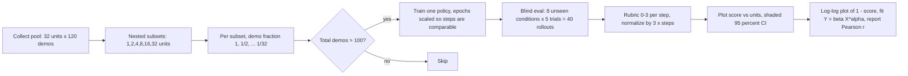
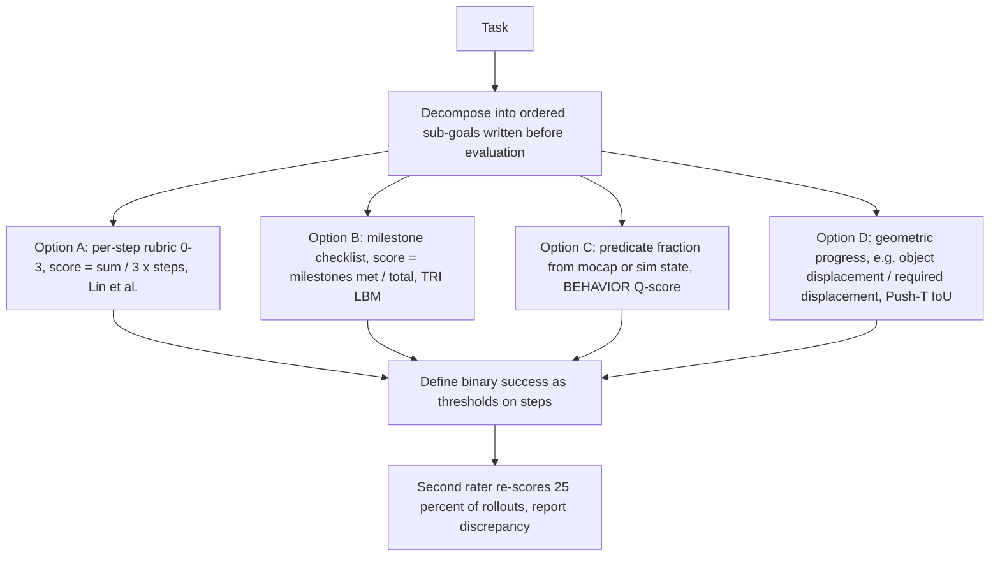
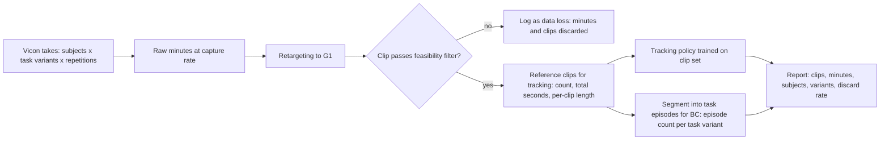

# Methodology for data learning curves: minutes of motion capture versus normalized task completion on a Unitree G1

Scope: how published robot-learning work constructs data-scaling curves, how small-trial success rates should be reported, how graded completion scores are defined, how motion-capture data is quantified, and what a minimal experiment looks like for a lab with one G1, one Vicon volume, one GPU (roughly 100 to 200 GPU-hours) and a few hundred hardware trials. Every number carries its source and the figure, table, or section where it appears. Arithmetic computed for these notes is labelled as such.

## Key question 1: Exact protocol of Lin et al. (arXiv 2410.18647) and similar data-scaling studies, and the functional form they found

### Takeaway
Lin et al. vary the number of training environments or objects in powers of two (1 to 32), train one Diffusion-Policy-style policy per data level, evaluate each policy with 40 blind real-robot rollouts (8 unseen conditions x 5 trials) scored by a 0 to 3 per-step rubric normalized to [0, 1], plot the optimality gap (1 minus normalized score) on log-log axes, and fit Y = beta * X^alpha by linear regression in log-log space. Generalization scales as a power law in the number of environments or objects, while adding demonstrations per environment saturates at roughly 50 demonstrations per environment-object pair. The number of training seeds per data level is not reported.

### Cited Findings
- Title and authors verified: "Data Scaling Laws in Imitation Learning for Robotic Manipulation", Fanqi Lin, Yingdong Hu, Pingyue Sheng, Chuan Wen, Jiacheng You, Yang Gao; v1 24 Oct 2024, v4 26 Jun 2026; over 40,000 demonstrations and over 15,000 real-robot rollouts (abstract) | [arXiv abs 2410.18647](https://arxiv.org/abs/2410.18647)
- Data pools (Sec. 4.1, Sec. 4.3): object scaling uses 32 objects in one environment with 120 demonstrations per object (3,840 collected, 3,765 and 3,820 valid after SLAM filtering for Pour Water and Mouse Arrangement); environment scaling uses 32 environments with one object and 120 demonstrations each (3,424 and 3,351 valid); environment-object pairs use 32 pairs (3,648 and 3,564 valid); the multi-object check (Sec. 4.3, Fig. 6) uses 16 environments x 4 objects (6,896 and 6,505 valid) | [arXiv HTML 2410.18647](https://arxiv.org/html/2410.18647)
- Subset sampling (Sec. 4.1, Appendix C): training sets use 2^m units for m = 0 to 5 (1, 2, 4, 8, 16, 32), randomly drawn from the pool of 32; within each selected unit the demonstration fraction is 2^(-n) for n = 0 to 5 (100 percent down to 3.125 percent); a policy is trained only when the total demonstration count exceeds 100, giving 21 policies in the object experiment; larger datasets always contain the smaller ones (nested subsets) | [arXiv HTML 2410.18647](https://arxiv.org/html/2410.18647)
- Training budget scaled with data (Appendix C): the smallest dataset trains for 800 epochs (about 5.3 x 10^4 steps) and the largest for 75 epochs (about 5 x 10^5 steps); the largest policy takes 75 hours on 8 A800 GPUs; the model exceeds 396 million parameters, action horizon 16, observation horizon 2 or 3, 16 denoising iterations (Table 3) | [arXiv HTML 2410.18647](https://arxiv.org/html/2410.18647)
- Evaluation per data point (Sec. 4.1, Appendix E.2): 8 unseen objects (or environments) x 5 trials = 40 trials per policy; the reported value is the average normalized score over these 40 trials; testing is blind with policy order shuffled at each initial object position | [arXiv HTML 2410.18647](https://arxiv.org/html/2410.18647)
- Seeds: the paper does not state the number of training seeds or repeated runs per data level; one policy per data level is implied | [arXiv HTML 2410.18647](https://arxiv.org/html/2410.18647); independently confirmed absent by [alphaXiv overview](https://www.alphaxiv.org/overview/2410.18647)
- Metric (Sec. 3): each task step is scored 0 to 3 by the tester; normalized score = total score / (3 x number of steps), capped at 1; Pour Water has 3 steps (divide by 9) and Mouse Arrangement 2 steps (divide by 6, Appendix G.3); success rate is called "an overly sparse signal"; action MSE "often does not correlate with real-world performance" (Sec. 3, Appendix E.1, G.1) | [arXiv HTML 2410.18647](https://arxiv.org/html/2410.18647)
- Plotting (Sec. 4.1, Sec. 4.2): Figs. 2 to 4 show the normalized score versus number of objects, environments, or pairs with shaded 95 percent confidence intervals; Fig. 5 uses log-scale on all axes with dashed power-law fits and fitted equations in the legend | [arXiv HTML 2410.18647](https://arxiv.org/html/2410.18647)
- Functional form (Sec. 4.2): Y = beta * X^alpha, where Y is the optimality gap (1 minus normalized score) and X is the count of objects, environments, or pairs; fitted as a linear regression in log-log space on the 100 percent demonstration-fraction points; fit quality reported as Pearson r; a three-parameter fit with an irreducible-error term "was not statistically justified" with only 6 data points (footnote 1) | [arXiv HTML 2410.18647](https://arxiv.org/html/2410.18647)
- Demonstration count is a weak predictor (Sec. 4.3, Fig. 7 left): correlation between total demonstrations and performance is r = -0.62 (Pour Water) and -0.79 (Mouse Arrangement), described as "weak power-law relationship" | [arXiv HTML 2410.18647](https://arxiv.org/html/2410.18647)
- Saturation (Sec. 4.1, Sec. 4.3, Fig. 7): the 50 percent and 100 percent demonstration-fraction curves overlap in Fig. 3; performance plateaus at about 400, 800, and 1,600 total demonstrations for 8, 16, and 32 pairs; recommendation: 50 demonstrations per environment-object pair, collected in as many environments as possible with one object per environment | [arXiv HTML 2410.18647](https://arxiv.org/html/2410.18647)
- Headline results: with 8 objects the normalized score exceeds 0.8, with 32 it exceeds 0.9 (Sec. 4.1); extrapolation predicts 1,191 pairs for a 0.99 score on Mouse Arrangement (Sec. 4.2, unverified); the verification tasks Fold Towels and Unplug Charger, trained on 32 pairs x 50 demonstrations, reach normalized scores 0.95 and 0.887 and success rates 87.5 and 90.0 percent (Sec. 5, Table 1) | [arXiv HTML 2410.18647](https://arxiv.org/html/2410.18647)
- RoboCasa scaling curve (Sec. V-A, Fig. 6, Fig. 12): multitask BC-Transformer on 24 atomic tasks; Human-50 (50 demos per task) 28.8 percent, Generated-100 26.3 percent, Generated-300 35.0 percent, Generated-3000 47.6 percent average success; 50 trials per task across five fixed evaluation scenes with unseen object instances; binary success; real-robot co-training result averaged over 3 seeds (13.6 vs 24.4 percent on seen objects, Sec. V-C, Fig. 9) | [arXiv HTML 2406.02523](https://arxiv.org/html/2406.02523); title and authors verified at [arXiv abs 2406.02523](https://arxiv.org/abs/2406.02523)
- GR00T N1 data levels: simulation uses 30, 100, and 300 demonstrations per task (Table 4) with 100 trials per point, taking the maximum score of the last 5 checkpoints (Sec. 4.3); real robot uses 10 percent and full data only (Table 5) with 10 trials per task (5 for Pack Machinery); Fig. 10 (Appendix B) plots average success versus number of demonstrations; no log scale or fitted curve is mentioned | [arXiv HTML 2503.14734](https://arxiv.org/html/2503.14734); title verified at [arXiv abs 2503.14734](https://arxiv.org/abs/2503.14734)
- TRI Large Behavior Models pretraining-scale curve (Sec. 3.3, Fig. 7): five unseen simulation tasks, 200 rollouts per task (1,000 per data point), four pretraining mixtures (full Ramen, TRI-Ramen only, 50 percent of TRI-Ramen tasks, 25 percent of TRI-Ramen tasks), x-axis is the percentage of task-specific finetuning data; at 15 percent finetuning data all five models are statistically separable | [arXiv HTML 2507.05331](https://arxiv.org/html/2507.05331)
- Diffusion Policy simulation protocol (Sec. 5.2, Tables 1 and 2): 3 training seeds x 50 environment initializations = 150 runs per method; main metric averages the last 10 checkpoints (saved every 50 epochs), best-checkpoint numbers also shown; real-robot tasks use 20 trials | [arXiv HTML 2303.04137](https://arxiv.org/html/2303.04137)
- Meta-analysis of scaling in robotics: Sartor and Thompson, "Neural Scaling Laws in Robotics" (327 papers), report that "the performance of robotic models improves with increased resources, following a power-law relationship" | [arXiv abs 2405.14005](https://arxiv.org/abs/2405.14005)

### Protocol diagram (Lin et al. design, generalized)

### Inferences
- The independent variable Lin et al. find predictive is the number of distinct conditions (environments, objects), not the number of demonstrations. For a mocap lab the analogue is the number of distinct subjects, object placements, or task variants captured, not minutes of the same motion repeated. Plotting "minutes" alone risks measuring saturation of repetition rather than coverage.
- One policy per data level with 40 rollouts is the published minimum. Because training randomness is not captured, the 95 percent bands in Figs. 2 to 4 reflect only rollout variance (inferred; the paper does not state how the bands were computed).
- Six data levels spaced by factors of two were enough for a two-parameter power law but not for a three-parameter form. A lab with 4 to 6 levels should fit only two parameters.

### Gaps
- The exact alpha, beta, and Pearson r values of Fig. 5 are embedded in the figure legend image and were not recoverable from the HTML text or the alphaXiv summary. The PDF exceeded the fetch size limit.
- How the shaded 95 percent confidence intervals of Figs. 2 to 4 were computed (bootstrap over trials, normal approximation, or other) is not stated in the retrieved text.
- RoboCasa does not state the per-rollout success criterion in the retrieved text; GR00T N1 Fig. 10 axis labels and scale were not retrievable.

## Key question 2: Hardware trials needed for a 95 percent interval to exclude 0.6 when the true rate is 0.8

### Takeaway
With 80 percent observed success, the Wilson score interval first excludes 0.6 at n = 25 trials (20 successes, 95 percent interval 0.609 to 0.911); Clopper-Pearson needs n = 30 (24 successes, 0.614 to 0.923). Distinguishing two policies at 0.6 versus 0.8 is far more expensive: about 81 trials per policy for 80 percent power at two-sided alpha 0.05 by normal approximation, about 90 per policy with Fisher's exact test. Brown, Cai, and DasGupta recommend Wilson or Jeffreys intervals for small n; the Wald interval should not be used.

### Cited Findings
- Interval choice: Brown, Cai, and DasGupta, "Interval Estimation for a Binomial Proportion", Statistical Science 16(2):101-133, 2001, show the Wald interval's coverage is erratic and "far more persistent than is appreciated" and recommend "the Wilson interval or the equal-tailed Jeffreys prior interval for small n and the interval suggested in Agresti and Coull for larger n" | [Project Euclid, DOI 10.1214/ss/1009213286](https://projecteuclid.org/euclid.ss/1009213286)
- Agresti and Coull, "Approximate is Better than 'Exact' for Interval Estimation of Binomial Proportions", The American Statistician 52(2):119-126, 1998: the Clopper-Pearson "exact" interval is conservative (coverage too high), the Wald interval undercovers, the Wilson score interval has coverage close to nominal even for very small n, and the 95 percent score interval behaves like the adjusted Wald interval after adding two successes and two failures | [UF author copy](https://users.stat.ufl.edu/~aa/articles/agresti_coull_1998.pdf)
- Rule of thumb from the robotics evaluation literature: a 95 percent interval for a proportion is roughly p_hat plus or minus 1/sqrt(N) for p_hat in [0.25, 0.75] and N at least 36 (footnote 8) | [Snyder et al., arXiv HTML 2503.10966v4](https://arxiv.org/html/2503.10966v4)
- Typical trial counts in robot policy papers are "only a small number of trials (e.g., 10-60)" per evaluation setting (Sec. I); Table I of the same paper uses N = 50 and 100 on hardware and 500 to 1,500 in simulation | [arXiv HTML 2503.10966v4](https://arxiv.org/html/2503.10966v4)
- Sequential comparison cost (Table I, Sec. V-C2): a 36-point gap (56 vs 92 percent) was resolved in 17 to 23 trials; a 59 vs 68 percent gap "would require Nmax = 500 trials to confidently determine p1 > p0" | [arXiv HTML 2503.10966v4](https://arxiv.org/html/2503.10966v4); paper identity (RSS 2025, Snyder et al., TRI and Princeton) at [arXiv abs 2503.10966](https://arxiv.org/abs/2503.10966v2)
- Kress-Gazit et al. (Appendix 6.3, Fig. 7) show that the same 15/3 vs 11/6 ratio supports different conclusions at small (5/1 vs 6/3) and large (150/30 vs 110/60) sample sizes; the paper recommends reporting the number of evaluations per condition "and not just percentages" (Sec. 4.1), and illustrates a Bayesian Bernoulli model with a uniform prior: 15/18 vs 11/17 gives about 0.11 probability that the weaker policy is better (Example 6); 13/20 vs 14/20 cannot be separated (Appendix 6.4.2) | [arXiv HTML 2409.09491](https://arxiv.org/html/2409.09491); paper identity at [arXiv abs 2409.09491](https://arxiv.org/abs/2409.09491v1)
- TRI LBM paper: success-rate uncertainty shown as Bayesian posteriors under a uniform Beta prior (violin plots), chosen over confidence intervals because overlapping CIs mislead pairwise comparison (Sec. 4.1.4); pairwise binary comparisons use a sequential paired test with Type-I error 5 percent, continuous task-completion comparisons use Welch's t-test, Bonferroni correction across k(k-1)/2 comparisons, results shown as Compact Letter Display (Sec. 4.1.5) | [arXiv HTML 2507.05331](https://arxiv.org/html/2507.05331)

### Arithmetic (computed for these notes with scipy; z = 1.959964)
Wilson score interval: center = (p_hat + z^2/(2n)) / (1 + z^2/n); half-width = z * sqrt(p_hat(1 - p_hat)/n + z^2/(4n^2)) / (1 + z^2/n).

Worked example, n = 25, k = 20, p_hat = 0.80: z^2 = 3.8415; z^2/n = 0.15366; center = (0.80 + 0.07683)/1.15366 = 0.7601; half-width = 1.96 * sqrt(0.0064 + 0.0015366)/1.15366 = 1.96 * 0.08909/1.15366 = 0.1514; interval [0.609, 0.911]. Lower bound exceeds 0.6.

| n | k (80 percent) | Wilson 95 percent | Clopper-Pearson 95 percent | Agresti-Coull 95 percent |
|---|---|---|---|---|
| 10 | 8 | 0.490 to 0.943 | 0.444 to 0.975 | 0.479 to 0.954 |
| 15 | 12 | 0.548 to 0.930 | 0.519 to 0.957 | 0.540 to 0.937 |
| 20 | 16 | 0.584 to 0.919 | 0.563 to 0.943 | 0.578 to 0.925 |
| 25 | 20 | 0.609 to 0.911 | 0.593 to 0.932 | 0.604 to 0.916 |
| 30 | 24 | 0.627 to 0.905 | 0.614 to 0.923 | 0.623 to 0.909 |
| 40 | 32 | 0.652 to 0.895 | 0.644 to 0.909 | 0.650 to 0.898 |
| 50 | 40 | 0.670 to 0.888 | 0.663 to 0.900 | 0.668 to 0.889 |
| 100 | 80 | 0.711 to 0.867 | 0.708 to 0.873 | 0.710 to 0.867 |

- First n (multiple of 5) at which the lower bound exceeds 0.6 with p_hat = 0.8: Wilson n = 25; Clopper-Pearson n = 30.
- One-sample exact binomial test, H0: p = 0.6 versus H1: p = 0.8, one-sided alpha 0.05, power 0.8: n = 36, reject when k is at least 27 (power 0.832).
- Two-sample comparison of two policies at 0.6 versus 0.8, two-sided alpha 0.05, power 0.8: about 81 trials per policy (normal approximation); Fisher's exact test reaches power 0.80 at 90 per policy (0.515 at 50, 0.745 at 80, 0.844 at 100).
- Wilson interval width at p_hat = 0.8: 0.335 at n = 20, 0.278 at n = 30, 0.218 at n = 50. At p_hat = 0.5: n = 10 gives [0.237, 0.763], n = 20 gives [0.299, 0.701], n = 50 gives [0.366, 0.634], n = 100 gives [0.404, 0.596].

### Inferences
- A single policy evaluated with 10 trials (the Humanoid Everyday and GR00T N1 real-robot norm) has an interval wider than 0.45 at p_hat = 0.8; adjacent points on a learning curve separated by less than 0.3 cannot be distinguished at that trial count.
- For a learning curve the relevant comparison is between adjacent data levels, i.e. two-sample. With a budget of a few hundred trials and 5 data levels, 40 to 60 trials per level is feasible and resolves gaps of roughly 0.3 but not 0.2. Using a continuous completion score instead of binary success raises power per trial (the LBM paper's reason for Welch's t-test on task completion).
- Report k/n, not percentages, and plot Wilson intervals, following Brown et al. and Kress-Gazit et al. Sequential tests (Snyder et al.) let the lab add trials without p-hacking when two adjacent levels are ambiguous.

### Gaps
- No robotics paper found gives a trial-count table as a function of success-rate gap; Snyder et al. give only specific cases (36-point gap in 17 to 23 trials; 9-point gap needing up to 500).

## Key question 3: Papers defining a graded completion score for manipulation tasks, including humanoids

### Takeaway
Graded scores in the literature take four forms: tester-assigned per-step rubrics normalized to [0, 1] (Lin et al.), milestone checklists with equal weight (TRI LBM), fraction of satisfied goal predicates evaluated automatically (BEHAVIOR Q-score, LBM simulation), and geometric coverage measures thresholded into success (Diffusion Policy Push-T IoU and sauce coverage). On humanoids specifically, GR00T N1 uses object-count and half-credit partial scores on the Fourier GR-1, and Humanoid Everyday (Unitree G1 and H1) uses only binary success over 10 trials; OmniBench (OmniClone) and Beyond Retargeting score tracking policies by success rate plus tracking error, not by task progress.

### Cited Findings
- Lin et al. (Sec. 3, Appendix D): per-step 0 to 3 rubric; Pour Water step 1 (grasp) 0 = no approach, 1 = touch without grasp or slip during lift, 2 = long push before grasp, 3 = clean grasp; step 2 (pour) 0 = never approaches mug, 1 = mouth outside mug, 2 = mouth on rim allowing partial pour, 3 = mouth fully inside; step 3 (place) 0 = never approaches coaster, 1 = outside coaster or topples mug, 2 = partial placement, 3 = fully and stably on coaster; success requires at least 2, exactly 3, and at least 2; Mouse Arrangement success requires 3 on pick-up and at least 2 on placement; Fold Towels step 1 graded by number of towel layers grasped, step 2 by fraction of maximum overlap (Appendix D.3) | [arXiv HTML 2410.18647](https://arxiv.org/html/2410.18647)
- TRI LBM (Sec. 4.1.2, Sec. 8.3): real-world task completion = sum of rubric milestones each scored +1 if completed, divided by the number of milestones; simulation task completion uses automated predicates over simulation state that also capture partial success; about 27 percent of nearly 2,700 real rollouts were re-checked, with 2.31 percent success-rate discrepancy and 6.25 percent rubric-question discrepancy (Sec. 4.1.3) | [arXiv HTML 2507.05331](https://arxiv.org/html/2507.05331)
- Kress-Gazit et al. (Sec. 3.1.1, Table 1): sub-goal rubric items per task plus task-agnostic items such as unexpected collisions; Pancake Policy C had 4/19 overall success but picked up the spatulas and flipped the pancake in 100 percent of runs, which binary success hides; Sec. 3.1.2 proposes Signal Temporal Logic robustness values as an automatic graded metric; Sec. 3.2.2 adds smoothness (SPARC) | [arXiv HTML 2409.09491](https://arxiv.org/html/2409.09491)
- BEHAVIOR (2021): primary metric is a success score Q defined as the highest fraction of satisfied goal literals across ground solutions to the goal condition, evaluated at each step | [arXiv PDF 2108.03332](https://arxiv.org/pdf/2108.03332); BEHAVIOR-1K 2025 challenge: a run counts as success when all BDDL goal predicates hold, otherwise Q-score is the fraction of completed sub-goals using the best-matched goal clause | [BEHAVIOR challenge leaderboard](https://behavior.stanford.edu/challenge/leaderboard.html); BEHAVIOR-1K paper identity (1,000 activities, 50 scenes, OmniGibson) at [arXiv abs 2403.09227](https://arxiv.org/abs/2403.09227)
- GR00T N1 (Sec. 4.3, Sec. 4.4): "a partial scoring system to capture model behavior across different execution phases"; Pack Machinery counts how many of 5 objects end in the bin within 30 s; in pretraining tasks grasping correctly but failing placement scores 0.5; 10 trials per real task (5 for Pack Machinery); robot is the Fourier GR-1 humanoid | [arXiv HTML 2503.14734](https://arxiv.org/html/2503.14734), [arXiv abs 2503.14734](https://arxiv.org/abs/2503.14734)
- Humanoid Everyday (Sec. V-A, Fig. 7, Table II): binary success rate, 10 trials per task on 7 tasks (rotate chair, use eraser, put dumpling toy in plate, fold towel, hand over toy, walk to grab door handle, insert rose in vase), 7 policies (DP, DP3, ACT, OpenVLA, pi0-FAST, pi0.5, GR00T N1.5); GR00T N1.5 averages 51 percent, DP 29 percent; robots are Unitree G1 (29 DoF, Dex3-1 hands) and H1 (Sec. III-A); dataset 10.3k trajectories, 260 tasks, about 40 episodes per task, 30 Hz, over 3 million frames | [arXiv HTML 2510.08807v1](https://arxiv.org/html/2510.08807v1); identity at [arXiv abs 2510.08807](https://arxiv.org/abs/2510.08807v1)
- Diffusion Policy real tasks: Push-T success = end-state IoU above the minimum IoU in the demonstrations (Sec. 6.1); sauce pouring scored by IoU against a nominal circle and spreading by coverage, thresholded at minimum human performance (Sec. 6.3); mug flipping and bimanual tasks are binary over 20 trials | [arXiv HTML 2303.04137](https://arxiv.org/html/2303.04137)
- OmniBench (OmniClone, Sec. III and Appendix B-A, local manuscript): six functional categories (loco-manipulation, manipulation, squatting, walking, running, jumping), 60 episodes per category averaging 90 frames at 30 Hz, stratified by complexity (High, Medium, Low) and dynamic intensity (Fast, Medium, Slow) into 18 categories; metrics are success rate and MPJPE in mm per category (Table I, Fig. 1, Fig. 2); the paper argues aggregate SR "conflates distinct movement patterns" and "masks specific failure modes" (Sec. III-A) | [arXiv abs 2603.14327](https://arxiv.org/abs/2603.14327)
- Beyond Retargeting (Sec. on simulators, Table I, local manuscript): a tracking rollout "succeeds if it finishes the reference clip without a pelvis-height error exceeding 0.25 m"; SR is reported with seven tracking metrics (MPJPE in rad, MPJVE, MPKPE, root position, root linear velocity, root yaw, root yaw velocity); TWIST scores SR 0.8451 on the 6,495-trajectory SONIC bones-seed set | [arXiv abs 2610.07891](https://arxiv.org/abs/2610.07891)
- Benchmarks verified but without graded metrics in the retrieved abstracts: RLBench, 100 hand-designed tasks with motion-planner demonstrations | [arXiv abs 1909.12271](https://arxiv.org/abs/1909.12271); LIBERO, 130 tasks in four suites | [arXiv abs 2306.03310](https://arxiv.org/abs/2306.03310); ManiSkill3 | [arXiv abs 2410.00425](https://arxiv.org/abs/2410.00425); RoboCasa, binary success over 50 trials per task | [arXiv HTML 2406.02523](https://arxiv.org/html/2406.02523)

### Score construction diagram

### Inferences
- A Vicon lab can implement Option C automatically: mark the object and the robot, and compute predicates (object on target, object lifted above height, robot within reach) from Vicon rigid bodies at each frame, which mirrors BEHAVIOR's per-step predicate evaluation and the LBM simulation metric. This makes the "normalized task completion score" reproducible and removes rater bias.
- For tracking policies, the published convention is SR under a fall or pelvis-height criterion plus tracking error, not task completion. A lab that wants a task-completion axis for a tracking policy must add a task-defined predicate layer on top of the tracking success criterion.
- Humanoid Everyday is the closest published G1 manipulation benchmark and uses only binary success with 10 trials, so a graded score on a G1 would exceed the current reporting standard.

### Gaps
- No paper was found that reports a graded task-completion score for an RL motion-tracking policy on a humanoid; existing tracking work reports SR plus kinematic error.
- The OmniBench success criterion (fall, tracking-error threshold) was not located in the extracted manuscript text.

## Key question 4: How motion-capture data is quantified, and what unit matters for RL tracking versus behavior cloning

### Takeaway
Mocap datasets are quantified in hours, frames, sequences or clips, and subjects (AMASS: over 40 hours, over 11,000 motions, over 300 subjects; LAFAN1: 4.6 hours, 77 sequences, 5 subjects, 496,672 frames at 30 fps). Tracking-policy papers report training data as hours and clip counts (OmniClone 30 hours; Beyond Retargeting 14,147 training clips; SONIC 700 hours, over 100 million frames; HuMBLE about 3 hours, 528,214 frames) and evaluate on held-out clips. Behavior-cloning papers count demonstrations (episodes) per task and condition. For a tracking policy the unit the policy sees is the reference clip; minutes are a proxy for clip count times clip length.

### Cited Findings
- AMASS: "more than 40 hours of motion data, spanning over 300 subjects, more than 11,000 motions", unifying 15 optical marker-based datasets | [arXiv abs 1904.03278](https://arxiv.org/abs/1904.03278)
- LAFAN1 (Harvey et al., SIGGRAPH 2020): 5 subjects, 77 sequences, 496,672 frames at 30 fps (about 4.6 hours), BVH format | [arXiv abs 2102.04942](https://arxiv.org/abs/2102.04942); dataset statistics mirrored at [Papers with Code LAFAN1 entry](https://astro.paperswithcode.com/dataset/lafan1)
- OmniClone training data (Appendix B-A, local manuscript): derived from the TWIST2 corpus with retargeting expanded from 23 to 29 DoF, filtered by heuristics on root state and whole-body joint energy, augmented with teleoperation captures; final set is about 60 percent standing manipulation and totals 30 hours; the whole system "requires only 30 hours of motion data and a single consumer GPU"; teacher converges in about 60 hours (about 33K PPO steps, 4,096 parallel environments) on one RTX 4090, student DAgger distillation about 22 hours, about 80 GPU-hours total (Sec. V) | [arXiv abs 2603.14327](https://arxiv.org/abs/2603.14327)
- Beyond Retargeting (local manuscript): retargeted AMASS/LAFAN1/OMOMO library with 14,147 training and 4,073 testing clips; cross-simulator evaluation on 6,495 SONIC bones-seed trajectories described as "more OOD than the training library"; robot Unitree G1 in IsaacSim, evaluation in MjLab | [arXiv abs 2610.07891](https://arxiv.org/abs/2610.07891)
- HuMBLE (local manuscript): about three hours of Vicon motion capture (N = 528,214 frames) collected from an actor following vocalized commands at randomized intervals, with left and right turns separated into distinct takes to fit the capture volume, mirrored to enforce bilateral symmetry; the authors "leave a rigorous scalability analysis ... to future work" | [arXiv abs 2610.10489](https://arxiv.org/abs/2610.10489)
- ZEST (local manuscript, Table 1): data is listed per motion with duration in seconds (for example Walk 8.47 s, Jog 7.11 s, Forward roll 14.74 s, Crawl on all fours 29.98 s); one policy per behavior trained about 10 hours (about 7k iterations) on a single NVIDIA L4 GPU; Fig. 2(e-f) reports simulated success rates after 10 h and 20 h of training | [arXiv abs 2602.00401](https://arxiv.org/abs/2602.00401)
- SONIC: motion tracking scaled to 100M+ frames from 700 hours of mocap, models from 1.2M to 42M parameters, 21k GPU-hours; "performance improves steadily with compute and data diversity"; Science Robotics 11(117), 2026 | [arXiv abs 2511.07820](https://arxiv.org/abs/2511.07820)
- Humanoid-GPT: pretrained on a 2B-frame retargeted corpus combining major mocap datasets with in-house recordings; abstract claims "scaling analyses" but gives no functional form | [arXiv abs 2606.03985](https://arxiv.org/abs/2606.03985); a search snippet states the data-scaling study samples 10k, 50k, 100k, and 300k clip clusters tested on the AMASS test split (snippet only, not verified against the paper body)
- OmniTrack: a search snippet reports that scaling from one-eighth of the dataset to the full set reduced success from 95.1 to 88.2 percent when references were not physically consistent, while physically plausible references held 92.6 percent (snippet only; the abstract page gives no numbers) | [arXiv abs 2602.23832](https://arxiv.org/abs/2602.23832)
- Behavior-cloning units: Lin et al. count demonstrations per object or environment (120 collected, 50 recommended); Humanoid Everyday counts trajectories and episodes per task (about 40); TRI LBM reports hours, tasks, and demonstrations together (TRI-Ramen about 545 hours, 532 tasks, 64,262 demonstrations; real 468 hours, 362 tasks, 46,063 demonstrations; total about 1,695 hours including about 1,150 hours of curated external data, Sec. 4.4) | [arXiv HTML 2507.05331](https://arxiv.org/html/2507.05331); GR00T N1 reports 88 hours of in-house teleoperation and about 827 hours of neural trajectories | [arXiv HTML 2503.14734](https://arxiv.org/html/2503.14734)

### Data accounting diagram

### Inferences
- For RL tracking, the quantity that enters training is the set of reference clips after retargeting and filtering. Minutes before retargeting overstate the usable data; OmniClone's root-state and joint-energy filtering and Lin et al.'s SLAM-filtering (3,840 collected to 3,765 valid) show that published counts separate collected from valid data. A lab should report both and treat the gap as retargeting loss.
- For behavior cloning on the G1, the unit should be episodes per task variant, matching Lin et al. and Humanoid Everyday; minutes are secondary.
- HuMBLE's single-actor, roughly three-hour dataset and its explicit deferral of scalability analysis indicate that no published study yet plots tracking performance against capture minutes for a single-lab dataset; the lab's curve would be new.

### Gaps
- The number of subjects in the HuMBLE capture is not stated explicitly in the extracted text ("the actor" suggests one; inferred).
- OmniTrack and Humanoid-GPT scaling numbers come from search snippets and were not verified against figure or table numbers in the paper bodies.

## Key question 5: Pitfalls specific to this experiment

### Takeaway
The published evidence identifies five confounds: the policy's effective data unit is the clip, not the minute; diversity drives generalization more than quantity; clip selection and uncontrolled initial conditions bias results; retargeting discards data unevenly; and mocap minutes and BC episodes are different quantities that scale differently.

### Cited Findings
- Diversity versus quantity: Lin et al. find total demonstration count is only weakly correlated with performance (r = -0.62 and -0.79) while environment and object count follow a power law; performance plateaus near 50 demonstrations per environment-object pair (Sec. 4.3, Fig. 7) | [arXiv HTML 2410.18647](https://arxiv.org/html/2410.18647)
- Diversity in tracking data: SONIC attributes gains to "compute and data diversity" | [arXiv abs 2511.07820](https://arxiv.org/abs/2511.07820); OmniClone argues that aggregate SR over a self-curated training distribution "fails to capture true generalization, as evaluation and training distributions are identical" and evaluates on unseen HY-Motion-1.0 generated motions (Sec. III-A, Appendix B-A) | [arXiv abs 2603.14327](https://arxiv.org/abs/2603.14327)
- Reference quality as a confound: OmniTrack's snippet-reported result that adding more raw, non-physically-consistent references reduced success from 95.1 to 88.2 percent implies that a minutes axis can show a negative slope if added clips are of lower quality (snippet, unverified) | [arXiv abs 2602.23832](https://arxiv.org/abs/2602.23832)
- Data loss by filtering: Lin et al. discard 75 of 3,840 Pour Water demonstrations after SLAM filtering (Sec. 4.1); OmniClone filters training motions by root state and joint energy (Appendix B-A) | [arXiv HTML 2410.18647](https://arxiv.org/html/2410.18647), [arXiv abs 2603.14327](https://arxiv.org/abs/2603.14327)
- Initial conditions and distribution shift: Kress-Gazit et al. Example 2, re-running a policy after a lab reorganization gave 0/8 successes versus 13/20 before; they recommend image overlays or markings to match initial conditions, evaluating all policies in one session, interleaving policies so the evaluator is blind, and separating demonstrator from evaluator (Sec. 2.2, 2.3) | [arXiv HTML 2409.09491](https://arxiv.org/html/2409.09491)
- Checkpoint selection: Diffusion Policy reports both best checkpoint and average of last 10 checkpoints because the two differ (Sec. 5.2, Tables 1 and 2) | [arXiv HTML 2303.04137](https://arxiv.org/html/2303.04137); GR00T N1 takes the maximum of the last 5 checkpoints over 100 trials (Sec. 4.3) | [arXiv HTML 2503.14734](https://arxiv.org/html/2503.14734)
- Training randomness unmeasured: the LBM paper states its violin plots "do not capture the randomness from the training process" (Sec. 3) | [arXiv HTML 2507.05331](https://arxiv.org/html/2507.05331); Lin et al. report no seeds | [arXiv HTML 2410.18647](https://arxiv.org/html/2410.18647)
- Metric mismatch: Lin et al. show action MSE does not track real performance in the object-generalization case (Pearson r only -0.73, Fig. 17 left, Appendix E.1) | [arXiv HTML 2410.18647](https://arxiv.org/html/2410.18647)
- Adding trials after the fact: Snyder et al. warn that appending trials to a fixed batch test "risks p-hacking" and that "insignificance of the test does not mean that the null hypothesis should be accepted" (Sec. I, V-C2) | [arXiv HTML 2503.10966v4](https://arxiv.org/html/2503.10966v4)

### Inferences
- Clip count versus minutes: a 10-minute take of walking and ten 1-minute takes of ten tasks are equal in minutes but differ by a factor of ten in clips and task variants. Following Lin et al., the lab should fix clip length and vary the number of distinct clips, or vary minutes while holding the variant distribution fixed, and state which was done.
- Cherry-picking: if the subset at each data level is hand-selected (easiest clips first), the curve measures the selection rule. Random nested subsets, as in Lin et al. Appendix C, remove this.
- Retargeting failures: the curve should use post-retargeting minutes on the x-axis, and the discard rate should be reported per data level. If the discard rate varies with motion type, data levels with more agile content lose more and the x-axis is biased.
- Mocap minutes versus demonstration episodes: for an RL tracking policy, one clip is one training unit and the policy is evaluated on tracking of held-out clips; for a BC policy, one teleoperated episode is one unit and evaluation is task success from randomized initial states. A single graph that mixes the two needs a per-panel axis definition.

### Gaps
- No published study was found that isolates clip count from clip length for humanoid tracking at fixed total minutes.

## Key question 6: Minimal experiment design for roughly 100 to 200 GPU-hours and a few hundred hardware trials

### Takeaway
Published compute figures (OmniClone about 80 GPU-hours for teacher plus student on one RTX 4090; ZEST about 10 hours per policy on one L4) and published evaluation norms (Lin et al. 40 blind rollouts per policy; Diffusion Policy 3 seeds; TRI LBM 50 real rollouts per policy per condition) bound the design: 4 to 5 data levels spaced by factors of two, 1 to 2 policies per level, 40 to 50 hardware rollouts per policy with a graded score, Wilson intervals on binary success, and bootstrap bands on the mean completion score. This is inferred from the cited budgets; no paper prescribes a budget-constrained design directly.

### Cited Findings
- Compute per policy: OmniClone teacher about 60 hours and student about 22 hours on one RTX 4090, about 80 GPU-hours total (Sec. V, local manuscript) | [arXiv abs 2603.14327](https://arxiv.org/abs/2603.14327); ZEST about 10 hours (about 7k iterations) on one NVIDIA L4 per behavior, with success-rate ablations at 10 h and 20 h (Fig. 2(e-f)) | [arXiv abs 2602.00401](https://arxiv.org/abs/2602.00401); Lin et al. 75 hours on 8 A800 GPUs for the largest 396M-parameter diffusion policy (Appendix C) | [arXiv HTML 2410.18647](https://arxiv.org/html/2410.18647)
- Rollouts per policy in published curves: 40 (Lin et al., Sec. 4.1), 50 per task (RoboCasa, Sec. V-A), 50 real per task per policy per condition (LBM, Sec. 3), 10 real per task (GR00T N1, Humanoid Everyday) ,  sources above
- Seeds: Diffusion Policy 3 seeds x 50 initializations (Sec. 5.2); RoboCasa real result averaged over 3 seeds (Sec. V-C) | [arXiv HTML 2303.04137](https://arxiv.org/html/2303.04137), [arXiv HTML 2406.02523](https://arxiv.org/html/2406.02523)
- Data levels: Lin et al. 6 levels (1 to 32 units), two-parameter power law only (footnote 1); GR00T N1 3 levels (30, 100, 300 demos); RoboCasa 4 levels (50, 100, 300, 3000); LBM 4 pretraining mixtures ,  sources above
- Nested subsets and scaled training steps: Lin et al. Appendix C | [arXiv HTML 2410.18647](https://arxiv.org/html/2410.18647)
- Reporting checklist: success definition, number of evaluations per condition, evaluation timing (A/B, session, days), initial conditions, failure-mode narrative with frequencies, release of rollout data (Kress-Gazit et al., Sec. 4.1, 4.3, 5) | [arXiv HTML 2409.09491](https://arxiv.org/html/2409.09491)
- Statistics for comparison across levels: Bayesian Beta-posterior violins for SR and Welch's t-test with Bonferroni for completion scores (LBM, Sec. 4.1.4-4.1.5) | [arXiv HTML 2507.05331](https://arxiv.org/html/2507.05331); Wilson or Jeffreys intervals for small n | [Brown, Cai, DasGupta 2001](https://projecteuclid.org/euclid.ss/1009213286)

### Proposed minimal protocol (inferred from the cited budgets)

```mermaid
gantt
    title Minimal data learning-curve experiment, one G1, one GPU
    dateFormat  X
    axisFormat  %s
    section Capture
    Capture full pool, log takes, subjects, variants        :a1, 0, 5
    Retarget, filter, record discard per clip                :a2, 5, 8
    section Training
    Build nested random subsets at 5 levels (1/16 to 1)      :b1, 8, 9
    Train 5 to 8 policies, 15 to 25 GPU-h each               :b2, 9, 30
    section Evaluation
    Blind interleaved hardware rollouts, 40 to 50 per policy :c1, 30, 40
    Second rater re-scores 25 percent                        :c2, 40, 42
    section Analysis
    Wilson CI on SR, bootstrap CI on mean score, log-log fit :d1, 42, 44
```

Design parameters (inferred):
- Data levels: 5, nested random subsets at 1/16, 1/8, 1/4, 1/2, and 1 of the post-retargeting pool, equally spaced in log2 as in Lin et al. The x-axis is post-retargeting minutes; the clip count and the number of distinct variants at each level are reported alongside.
- Policies per level: with 100 to 200 GPU-hours and 15 to 25 GPU-hours per tracking policy (OmniClone teacher-only scale on a 4090, or ZEST-scale), 5 levels x 1 seed costs 75 to 125 GPU-hours and 5 levels x 2 seeds costs 150 to 250. Two seeds at the smallest and largest levels, one at intermediate levels, fits 7 policies in 105 to 175 GPU-hours and gives a direct estimate of training variance at the ends of the curve.
- Trials per policy: 40 to 50, as in Lin et al. and LBM. Seven policies x 45 trials = 315 hardware rollouts. At 45 trials, the Wilson 95 percent interval at p_hat = 0.8 is 0.662 to 0.891 (computed above), which separates adjacent levels only if their true rates differ by about 0.3 on binary success; the graded score has higher power.
- Initial conditions: a fixed list of 9 to 10 start configurations (object pose, robot stance) marked in the Vicon frame, 5 trials each, identical across policies, interleaved and blind (Lin et al. Appendix E.2; Kress-Gazit et al. Sec. 2.2-2.3).
- Score: milestone checklist evaluated from Vicon rigid bodies (object lifted, object within tolerance of goal, robot upright at end), normalized by the number of milestones (LBM Sec. 4.1.2 form), with binary success defined as all milestones met. Both are plotted.
- Bands: Wilson intervals for SR; percentile bootstrap over the 40 to 50 rollouts for the mean normalized score; where two seeds exist, plot both points. Fit a two-parameter power law to 1 minus mean score in log-log space and report Pearson r, as Lin et al. do, with the caveat that 5 points do not support a third parameter.
- Reporting: k/n per point, discard rate per level, number of distinct variants per level, session dates, and failure-mode counts (Kress-Gazit et al. Sec. 4.1, 4.3).

### Inferences
- Because the binary success interval at 45 trials cannot resolve differences below about 0.3, the primary y-axis should be the normalized completion score; binary success should be a secondary panel.
- Spending GPU-hours on a second seed at the two extreme levels gives more information about whether the slope is real than spreading seeds evenly, given that the curve's shape is decided by its endpoints.

### Gaps
- Per-policy GPU-hours for a G1 tracking policy on the lab's hardware are not in the sources; the 15 to 25 GPU-hour figure interpolates between ZEST (10 h on an L4 per behavior) and OmniClone (60 h teacher on a 4090 for a 30-hour multi-skill corpus). The lab should time one full training run first.
- No source found gives a power analysis for continuous completion scores in robotics; the bootstrap-band recommendation is a transfer from general statistics, not from a cited robotics paper.
